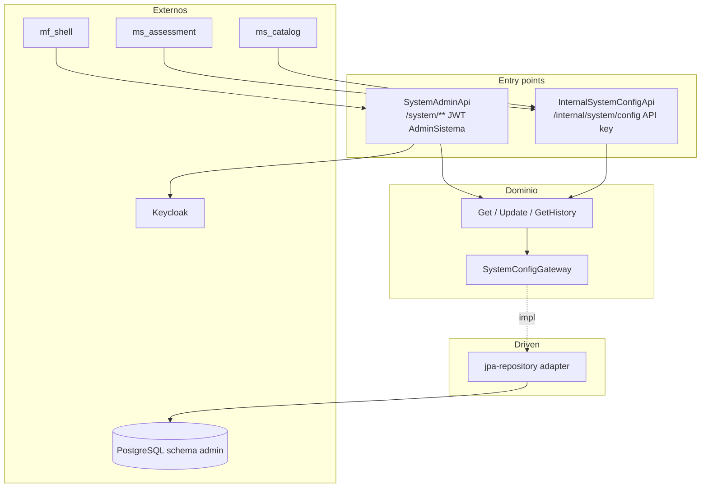

# ms_admin — Diseño

| Campo | Valor |
|---|---|
| Repositorio | `MSPI_NVA_CO_MR_BACK/ms_admin` |
| Estado | Activo |
| Alcance | Arquitectura, modelo de datos y diseño de API de `ms_admin` |

---

## 1. Arquitectura general

Clean Architecture multi-módulo (`MsAdmin`):



## 2. Modelo de datos

Fuente: `docker-config/docker/postgres/init/patch-admin-schema.sql`.

### 2.1 `admin.system_config`

| Columna | Tipo | Notas |
|---|---|---|
| `key` | `varchar(120)` PK | Valor canónico `mspi.system.config` |
| `value_json` | `jsonb` NOT NULL | Campos de días y futuros parámetros |
| `version` | `int` NOT NULL DEFAULT 1 | |
| `updated_by` | `uuid` | Sin FK a `iam.user` |
| `updated_at` | `timestamptz` NOT NULL DEFAULT `now()` | |

### 2.2 `admin.system_config_history`

| Columna | Tipo | Notas |
|---|---|---|
| `id` | `bigserial` PK | |
| `key` | `varchar(120)` NOT NULL | |
| `version` | `int` NOT NULL | |
| `value_json` | `jsonb` NOT NULL | Snapshot del valor |
| `changed_by` | `uuid` | Sin FK |
| `changed_at` | `timestamptz` NOT NULL DEFAULT `now()` | |
| `summary` | `varchar(500)` | |

Índice: `(key, changed_at DESC)`.

Migración: copia desde `iam.system_config` / `iam.system_config_history` si existen; luego `DROP` de tablas `iam`.

## 3. Diseño de API

### 3.1 Panel — `SystemAdminApi` (`.../api/system/SystemAdminApi.java`)

| Método | Ruta | Auth | Notas |
|---|---|---|---|
| GET | `/system/config` | JWT `AdminSistema` | Config + defaults merge |
| PUT | `/system/config` | JWT `AdminSistema` | Body `UpdateSystemConfigRequest` (`config`, `changedBy` opcional) |
| GET | `/system/config/history` | JWT `AdminSistema` | Query `limit` default 10 |

### 3.2 Interna — `InternalSystemConfigApi` (`.../api/internal/InternalSystemConfigApi.java`)

| Método | Ruta | Auth |
|---|---|---|
| GET | `/internal/system/config` | `X-Internal-Api-Key` |

Misma proyección de lectura (`SystemConfigResponse`: key, value, updatedAt, updatedBy, version).

### 3.3 Seguridad

- `SecurityConfig`: `/system/**` → `hasRole("AdminSistema")`.
- `InternalApiKeyFilter` protege `/internal/**` con `INTERNAL_API_KEY`.

## 4. Contrato de valor JSON

Campos gestionados en dominio:

```json
{
  "assessmentDueDays": 30,
  "assessmentExtensionDays": 15,
  "assessmentDeletionGraceDays": 5,
  "catalogDeletionGraceDays": 5
}
```

Validación en escritura: cada campo de días, si se envía, debe ser entero **1–365**.

## 5. Decisiones de diseño

| Decisión | Justificación |
|---|---|
| Microservicio dedicado `:8089` | Separar config global de IAM; gap UI shell ya existía (comentario en `SystemAdminApi`) |
| Historial en tabla aparte | Auditoría de cambios de parámetros sin sobrescribir evidencia |
| Defaults en caso de uso (no solo seed SQL) | Lectura siempre útil aunque la fila esté vacía o parcial |
| UUID `updated_by`/`changed_by` sin FK | Desacople de `iam.user`; label humano en summary/JWT |
| Sin módulo de “salud del sistema” | Retirado por decisión de producto (comentario en código) |
