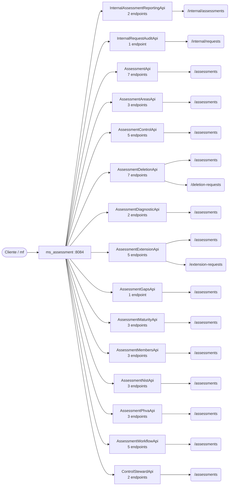

# 08 · Referencia de API — `ms_assessment`

**Evaluaciones y motor de cálculo** · puerto local `:8084` · 52 endpoints (49 de negocio, 3 internos).

> Generada a partir del código fuente (controladores `@RestController` y `SecurityConfig`). Si un endpoint cambia en el código, esta referencia debe regenerarse.

## Convenciones

| Aspecto | Regla |
|---|---|
| URL base (local) | `http://localhost:8084` |
| Autenticación de usuario | `Authorization: Bearer <JWT>` emitido por Keycloak; roles en `realm_access.roles` → `ROLE_*` |
| Autenticación servicio-a-servicio | Rutas `/internal/**` con cabecera `X-Internal-Api-Key` (comparación en tiempo constante) |
| Respuesta exitosa | `{ "meta": { "traceId", "timestamp" }, "data": … }` |
| Respuesta de error | `{ "meta": …, "error": [ { "code", "message" } ] }` (manejador global de excepciones) |
| Formato | JSON (`application/json`) salvo cargas de archivos (`multipart/form-data`) y descargas binarias |

## Reglas de acceso (SecurityConfig)

Se evalúan en orden; la primera regla que coincide decide. La autorización fina de negocio (miembro de la evaluación, estado, rol en la evaluación) se valida además dentro de cada caso de uso.

| # | Método | Patrón | Regla |
|---|---|---|---|
| 1 | * | `/actuator/health`, `/actuator/info` | Público |
| 2 | * | `/error` | Público |
| 3 | * | `/internal/**` | Público (filtro de API-key interna) |
| 4 | * | `/assessments/**` | Autenticado |
| 5 | * | `/**` | Autenticado |

## Mapa de recursos

**Contexto.** Cada caja intermedia es un controlador (adaptador de entrada de la arquitectura hexagonal); las hojas son las raíces de recurso que expone. Los controladores no contienen lógica de negocio: delegan en casos de uso del módulo `domain/usecase`.

## Resumen

| Controlador | Endpoints | Raíz común |
|---|---|---|
| `InternalAssessmentReportingApi` | 2 | `/internal/assessments/{assessmentId}` |
| `InternalRequestAuditApi` | 1 | `/internal/requests/{requestNumber}` |
| `AssessmentApi` | 7 | `/assessments` |
| `AssessmentAreasApi` | 3 | `/assessments/{assessmentId}/areas` |
| `AssessmentControlApi` | 5 | `/assessments/{assessmentId}` |
| `AssessmentDeletionApi` | 7 | `/assessments, /deletion-requests` |
| `AssessmentDiagnosticApi` | 2 | `/assessments/{assessmentId}/diagnostic` |
| `AssessmentExtensionApi` | 5 | `/assessments, /extension-requests` |
| `AssessmentGapsApi` | 1 | `/assessments/{assessmentId}/gaps` |
| `AssessmentMaturityApi` | 3 | `/assessments/{assessmentId}/maturity` |
| `AssessmentMembersApi` | 3 | `/assessments/{assessmentId}/members` |
| `AssessmentNistApi` | 3 | `/assessments/{assessmentId}/nist` |
| `AssessmentPhvaApi` | 3 | `/assessments/{assessmentId}/phva` |
| `AssessmentWorkflowApi` | 5 | `/assessments` |
| `ControlStewardApi` | 2 | `/assessments/{assessmentId}/controls` |

## Endpoints de negocio

### `AssessmentApi`

| Método | Ruta | Acceso | Parámetros | Cuerpo | HTTP | Caso de uso / guarda |
|---|---|---|---|---|---|---|
| `POST` | `/assessments` | JWT (cualquier rol) | — | `CreateAssessmentRequest` | 201 | `CreateAssessmentUseCase` |
| `GET` | `/assessments` | JWT (cualquier rol) | `?page=0`, `?size=20`, `?q?`, `?status?`, `?excludePendingDeletion=false` | — | 200 | `ListAssessmentsUseCase` |
| `GET` | `/assessments/{assessmentId}` | JWT (cualquier rol) | `assessmentId` | — | 200 | `GetAssessmentUseCase` |
| `PATCH` | `/assessments/{assessmentId}` | JWT (cualquier rol) | `assessmentId` | `UpdateAssessmentRequest` | 200 | `UpdateAssessmentUseCase` · guarda: `requireEdit` |
| `PUT` | `/assessments/{assessmentId}/entity-order-type` | JWT (cualquier rol) | `assessmentId` | `EntityOrderTypeRequest` | 200 | `AssignEntityOrderTypeUseCase` · guarda: `requireEdit` |
| `POST` | `/assessments/{assessmentId}/publish` | JWT (cualquier rol) | `assessmentId` | `RowVersionRequest` | 200 | `PublishAssessmentUseCase` |
| `POST` | `/assessments/{assessmentId}/clone` | JWT (cualquier rol) | `assessmentId` | — | 201 | `CloneAssessmentUseCase` |

### `AssessmentAreasApi`

| Método | Ruta | Acceso | Parámetros | Cuerpo | HTTP | Caso de uso / guarda |
|---|---|---|---|---|---|---|
| `GET` | `/assessments/{assessmentId}/areas` | JWT (cualquier rol) | `assessmentId` | — | 200 | `GetAssessmentAreasUseCase` |
| `PUT` | `/assessments/{assessmentId}/areas` | JWT (cualquier rol) | `assessmentId` | `List` | 200 | `ReplaceAssessmentAreasUseCase` · guarda: `requireEdit` |
| `PUT` | `/assessments/{assessmentId}/areas/{areaId}/topics` | JWT (cualquier rol) | `assessmentId`, `areaId` | `List` | 200 | `ReplaceAssessmentAreaTopicsUseCase` · guarda: `requireEdit` |

### `AssessmentControlApi`

| Método | Ruta | Acceso | Parámetros | Cuerpo | HTTP | Caso de uso / guarda |
|---|---|---|---|---|---|---|
| `GET` | `/assessments/{assessmentId}/controls` | JWT (cualquier rol) | `assessmentId`, `?controlType?` | — | 200 | `ListAssessmentControlsUseCase` |
| `GET` | `/assessments/{assessmentId}/controls/{assessmentControlNodeId}` | JWT (cualquier rol) | `assessmentId`, `assessmentControlNodeId` | — | 200 | `GetControlDetailUseCase` |
| `PATCH` | `/assessments/{assessmentId}/controls/{assessmentControlNodeId}` | JWT (cualquier rol) | `assessmentId`, `assessmentControlNodeId` | `PatchControlScoreRequest` | 200 | `PatchControlScoreUseCase` · guarda: `requireEdit` |
| `PATCH` | `/assessments/{assessmentId}/controls/{assessmentControlNodeId}/review` | JWT (cualquier rol) | `assessmentId`, `assessmentControlNodeId` | `ReviewControlRequest` | 200 | `ReviewControlUseCase` · guarda: `requireReview` |
| `GET` | `/assessments/{assessmentId}/scores/rollup` | JWT (cualquier rol) | `assessmentId`, `?controlType?` | — | 200 | `ComputeAssessmentRollupUseCase` |

### `AssessmentDeletionApi`

| Método | Ruta | Acceso | Parámetros | Cuerpo | HTTP | Caso de uso / guarda |
|---|---|---|---|---|---|---|
| `POST` | `/assessments/{assessmentId}/deletion-requests` | JWT (cualquier rol) | `assessmentId` | `CreateDeletionRequest` | 201 | `RequestAssessmentDeletionUseCase` · guarda: `requireDeletionRequest` |
| `POST` | `/assessments/{assessmentId}/deletion-requests/{requestId}/approve` | JWT (cualquier rol) | `assessmentId`, `requestId` | `DeletionDecisionRequest` | 200 | `ApproveAssessmentDeletionUseCase` · guarda: `requireDeletionDecision` |
| `POST` | `/assessments/{assessmentId}/deletion-requests/{requestId}/reject` | JWT (cualquier rol) | `assessmentId`, `requestId` | `DeletionDecisionRequest` | 200 | `RejectAssessmentDeletionUseCase` · guarda: `requireDeletionDecision` |
| `POST` | `/assessments/{assessmentId}/deletion-requests/{requestId}/cancel` | JWT (cualquier rol) | `assessmentId`, `requestId` | `DeletionDecisionRequest` | 200 | `CancelAssessmentDeletionUseCase` · guarda: `canDecideDeletion` |
| `GET` | `/assessments/{assessmentId}/deletion-requests` | JWT (cualquier rol) | `assessmentId` | — | 200 | `ListAssessmentDeletionRequestsUseCase` |
| `GET` | `/deletion-requests` | JWT (cualquier rol) | `?status=PENDING` | — | 200 | `ListPendingDeletionRequestsUseCase` · guarda: `canDecideDeletion` |
| `GET` | `/assessments/deleted` | JWT (cualquier rol) | `?q?` | — | 200 | `ListDeletedAssessmentsUseCase` |

### `AssessmentDiagnosticApi`

| Método | Ruta | Acceso | Parámetros | Cuerpo | HTTP | Caso de uso / guarda |
|---|---|---|---|---|---|---|
| `GET` | `/assessments/{assessmentId}/diagnostic/domain-effectiveness` | JWT (cualquier rol) | `assessmentId` | — | 200 | `ComputeDomainEffectivenessUseCase` |
| `GET` | `/assessments/{assessmentId}/diagnostic/dashboard` | JWT (cualquier rol) | `assessmentId` | — | 200 | `ComputeDiagnosticDashboardUseCase` |

### `AssessmentExtensionApi`

| Método | Ruta | Acceso | Parámetros | Cuerpo | HTTP | Caso de uso / guarda |
|---|---|---|---|---|---|---|
| `POST` | `/assessments/{assessmentId}/extension-requests` | JWT (cualquier rol) | `assessmentId` | `CreateExtensionRequest` | 201 | `RequestAssessmentExtensionUseCase` · guarda: `requireExtensionRequest` |
| `POST` | `/assessments/{assessmentId}/extension-requests/{requestId}/approve` | JWT (cualquier rol) | `assessmentId`, `requestId` | `ExtensionDecisionRequest` | 200 | `ApproveAssessmentExtensionUseCase` · guarda: `requireExtensionDecision` |
| `POST` | `/assessments/{assessmentId}/extension-requests/{requestId}/reject` | JWT (cualquier rol) | `assessmentId`, `requestId` | `ExtensionDecisionRequest` | 200 | `RejectAssessmentExtensionUseCase` · guarda: `requireExtensionDecision` |
| `GET` | `/assessments/{assessmentId}/extension-requests` | JWT (cualquier rol) | `assessmentId` | — | 200 | `ListAssessmentExtensionRequestsUseCase` |
| `GET` | `/extension-requests` | JWT (cualquier rol) | `?status=PENDING` | — | 200 | `ListPendingExtensionRequestsUseCase` · guarda: `canDecideExtension` |

### `AssessmentGapsApi`

| Método | Ruta | Acceso | Parámetros | Cuerpo | HTTP | Caso de uso / guarda |
|---|---|---|---|---|---|---|
| `GET` | `/assessments/{assessmentId}/gaps` | JWT (cualquier rol) | `assessmentId`, `?threshold?`, `?isoDomainCode?`, `?stewardRoleCode?` | — | 200 | `ListGapsUseCase` |

### `AssessmentMaturityApi`

| Método | Ruta | Acceso | Parámetros | Cuerpo | HTTP | Caso de uso / guarda |
|---|---|---|---|---|---|---|
| `GET` | `/assessments/{assessmentId}/maturity/requirements` | JWT (cualquier rol) | `assessmentId`, `?sourceType?`, `?level?`, `?status?` | — | 200 | `ListMaturityRequirementsUseCase` |
| `PATCH` | `/assessments/{assessmentId}/maturity/requirements/{requirementId}` | JWT (cualquier rol) | `assessmentId`, `requirementId` | `PatchMaturityRequirementScoreRequest` | 200 | `PatchMaturityRequirementScoreUseCase` · guarda: `requireEdit` |
| `GET` | `/assessments/{assessmentId}/maturity/summary` | JWT (cualquier rol) | `assessmentId` | — | 200 | `ComputeMaturitySummaryUseCase` |

### `AssessmentMembersApi`

| Método | Ruta | Acceso | Parámetros | Cuerpo | HTTP | Caso de uso / guarda |
|---|---|---|---|---|---|---|
| `GET` | `/assessments/{assessmentId}/members` | JWT (cualquier rol) | `assessmentId` | — | 200 | `ListAssessmentMembersUseCase` |
| `POST` | `/assessments/{assessmentId}/members` | JWT (cualquier rol) | `assessmentId` | `AddAssessmentMemberRequest` | 201 | `AddAssessmentMemberUseCase` |
| `DELETE` | `/assessments/{assessmentId}/members/{memberId}` | JWT (cualquier rol) | `assessmentId`, `memberId` | — | 200 | `RemoveAssessmentMemberUseCase` |

### `AssessmentNistApi`

| Método | Ruta | Acceso | Parámetros | Cuerpo | HTTP | Caso de uso / guarda |
|---|---|---|---|---|---|---|
| `GET` | `/assessments/{assessmentId}/nist/items` | JWT (cualquier rol) | `assessmentId`, `?functionCode?`, `?sourceType?` | — | 200 | `ListNistCiberItemsUseCase` |
| `PATCH` | `/assessments/{assessmentId}/nist/items/{itemId}` | JWT (cualquier rol) | `assessmentId`, `itemId` | `PatchNistCiberItemScoreRequest` | 200 | `PatchNistCiberItemScoreUseCase` · guarda: `requireEdit` |
| `GET` | `/assessments/{assessmentId}/nist/summary` | JWT (cualquier rol) | `assessmentId` | — | 200 | `ComputeNistSummaryUseCase` |

### `AssessmentPhvaApi`

| Método | Ruta | Acceso | Parámetros | Cuerpo | HTTP | Caso de uso / guarda |
|---|---|---|---|---|---|---|
| `GET` | `/assessments/{assessmentId}/phva/items` | JWT (cualquier rol) | `assessmentId`, `?component?` | — | 200 | `ListPhvaItemsUseCase` |
| `PATCH` | `/assessments/{assessmentId}/phva/items/{phvaItemId}` | JWT (cualquier rol) | `assessmentId`, `phvaItemId` | `PatchPhvaItemScoreRequest` | 200 | `PatchPhvaItemScoreUseCase` · guarda: `requireEdit` |
| `GET` | `/assessments/{assessmentId}/phva/summary` | JWT (cualquier rol) | `assessmentId` | — | 200 | `ComputePhvaAdvanceUseCase` |

### `AssessmentWorkflowApi`

| Método | Ruta | Acceso | Parámetros | Cuerpo | HTTP | Caso de uso / guarda |
|---|---|---|---|---|---|---|
| `GET` | `/assessments/my-assigned` | JWT (cualquier rol) | `?q?`, `?status?`, `?priority?` | — | 200 | `ListMyAssignedAssessmentsUseCase` |
| `GET` | `/assessments/workflow-rules` | JWT (cualquier rol) | — | — | 200 | `GetWorkflowRulesUseCase` |
| `POST` | `/assessments/{assessmentId}/status` | JWT (cualquier rol) | `assessmentId` | `ChangeStatusRequest` | 200 | `ChangeAssessmentStatusUseCase` · guarda: `requireForWorkflowTransition` |
| `POST` | `/assessments/{assessmentId}/reopen` | JWT (cualquier rol) | `assessmentId` | `ReopenAssessmentRequest` | 200 | `ReopenAssessmentUseCase` |
| `GET` | `/assessments/{assessmentId}/status-history` | JWT (cualquier rol) | `assessmentId` | — | 200 | `GetAssessmentStatusHistoryUseCase` |

### `ControlStewardApi`

| Método | Ruta | Acceso | Parámetros | Cuerpo | HTTP | Caso de uso / guarda |
|---|---|---|---|---|---|---|
| `GET` | `/assessments/{assessmentId}/controls/stewardship` | JWT (cualquier rol) | `assessmentId` | — | 200 | `GetControlStewardsUseCase` |
| `PATCH` | `/assessments/{assessmentId}/controls/{assessmentControlNodeId}/steward` | JWT (cualquier rol) | `assessmentId`, `assessmentControlNodeId` | `PatchControlStewardRequest` | 200 | `PatchControlStewardUseCase` · guarda: `requireEdit` |

## Endpoints internos (servicio a servicio)

### `InternalAssessmentReportingApi`

| Método | Ruta | Acceso | Parámetros | Cuerpo | HTTP | Caso de uso / guarda |
|---|---|---|---|---|---|---|
| `GET` | `/internal/assessments/{assessmentId}/report-export-bundle` | API-key interna (`X-Internal-Api-Key`) | `assessmentId` | — | 200 | `BuildReportExportBundleUseCase` |
| `GET` | `/internal/assessments/{assessmentId}/gaps` | API-key interna (`X-Internal-Api-Key`) | `assessmentId`, `?threshold?`, `?isoDomainCode?`, `?stewardRoleCode?` | — | 200 | `ListGapsUseCase` |

### `InternalRequestAuditApi`

| Método | Ruta | Acceso | Parámetros | Cuerpo | HTTP | Caso de uso / guarda |
|---|---|---|---|---|---|---|
| `GET` | `/internal/requests/{requestNumber}` | API-key interna (`X-Internal-Api-Key`) | `requestNumber` | — | 200 | `GetRequestAuditSnapshotUseCase` |

---

Ver también: [`03-Diseno.md`](03-Diseno.md) (arquitectura y modelo) · [Referencia consolidada](../../Documentacion-General/08-Referencia-API.md) · [Modelo de datos](../../Documentacion-General/Modelo-Datos-MER.md)
