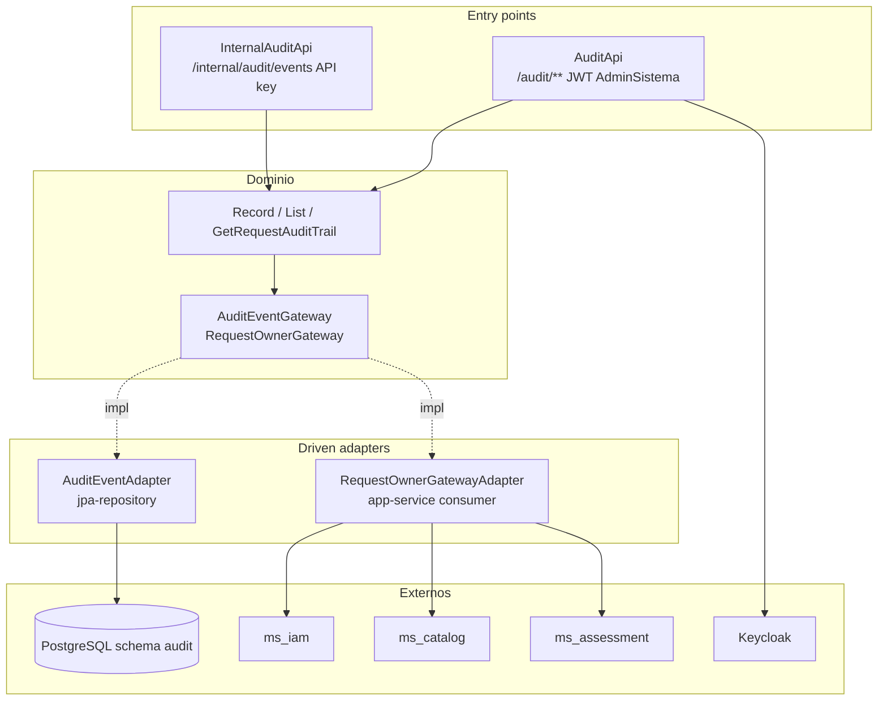

# ms_audit — Diseño

| Campo | Valor |
|---|---|
| Repositorio | `MSPI_NVA_CO_MR_BACK/ms_audit` |
| Fecha del documento / Última revisión cruzada con código | **2026-10-19** |
| Estado | Activo |
| Alcance | Arquitectura hexagonal, modelo de datos, APIs y decisiones de diseño de `ms_audit` |

---

## 1. Arquitectura general

`ms_audit` sigue **Clean Architecture** multi-módulo Gradle (`MsAudit`), sin generación automática de código:

El dominio (`:model`, `:usecase`) no depende de Spring/JPA. Los casos de uso se cablean como beans en `app-service`.

## 2. Modelo de datos

Fuente: `docker-config/docker/postgres/init/patch-audit-schema.sql`.

### 2.1 Tabla `audit.audit_log`

| Columna | Tipo | Notas |
|---|---|---|
| `id` | `bigserial` PK | |
| `event_type` | `varchar(80)` NOT NULL | |
| `entity_type` | `varchar(80)` NOT NULL | |
| `entity_id` | `varchar(120)` NOT NULL | |
| `assessment_id` | `uuid` | Opcional; **sin FK** |
| `actor_user_id` | `uuid` | Opcional; **sin FK** |
| `occurred_at` | `timestamptz` NOT NULL DEFAULT `now()` | |
| `ip` | `varchar(64)` | |
| `user_agent` | `varchar(400)` | |
| `before_json` | `jsonb` | |
| `after_json` | `jsonb` | |
| `metadata_json` | `jsonb` | Incluye correlación `requestNumber` |

Índices: `(assessment_id, occurred_at)`, `(actor_user_id, occurred_at)`, `(event_type, occurred_at)`, `(entity_type, entity_id)`.

Migración idempotente: si existe `iam.audit_log`, copia filas faltantes, ajusta sequence y hace `DROP TABLE iam.audit_log`.

### 2.2 Correlación `requestNumber`

No hay columna dedicada: se lee/escribe en `metadata_json.requestNumber` (`AuditEventAdapter`, `AuditLogRepository`).

## 3. Diseño de API

### 3.1 Pública — `AuditApi` (`ms_audit/.../api/audit/AuditApi.java`)

| Método | Ruta | Auth | Parámetros / cuerpo |
|---|---|---|---|
| GET | `/audit/events` | JWT `AdminSistema` | `page`, `size`, `q`, `eventType`, `entityType`, `dateFrom`, `dateTo`, `actor`, `requestNumber` |
| GET | `/audit/requests/{requestNumber}` | JWT `AdminSistema` | Path: número de solicitud; respuesta: header + `timeline` |

Envelope de éxito: `CorrectResponse` vía `ApiResponseMapper.success`.

### 3.2 Interna — `InternalAuditApi` (`.../api/internal/InternalAuditApi.java`)

| Método | Ruta | Auth | Respuesta |
|---|---|---|---|
| POST | `/internal/audit/events` | `X-Internal-Api-Key` | **202** + `"recorded"` |

Cuerpo: `AuditEventRequest` (`@Valid`) con campos de evento + JSON before/after/metadata.

### 3.3 Seguridad

- `SecurityConfig`: `/audit/**` → `hasRole("AdminSistema")`; `/internal/**` autenticado por filtro de API key (no JWT).
- `InternalApiKeyFilter`: comparación constant-time (`MessageDigest.isEqual`); clave desde `app.internal-api-key` / `INTERNAL_API_KEY`.

## 4. Enrutado de dueño de solicitud

`RequestOwnerGatewayAdapter` (`applications/app-service/.../consumer/RequestOwnerGatewayAdapter.java`):

| Prefijo | Cliente RestClient | Destino típico |
|---|---|---|
| `SOL-CAT-` | `msCatalogRestClient` | catalog `/internal/requests/{requestNumber}` |
| `SOL-PWD-` | `msIamRestClient` | iam |
| `SOL-ELIM-`, `SOL-AMPL-` | `msAssessmentRestClient` | assessment |
| Otros | cascade assessment → catalog → iam | |

URLs configurables: `adapter.ms-assessment.url` (`MS_ASSESSMENT_URL`), `adapter.ms-catalog.url` (`MS_CATALOG_URL`), `adapter.ms-iam.url` (`MS_IAM_URL`).

## 5. Decisiones de diseño

| Decisión | Justificación observada |
|---|---|
| Esquema propio `audit` | Desacoplar bitácora de `iam`; migración vía patch SQL |
| Sin FK a usuarios/evaluaciones | Independencia de esquemas; UUIDs opacos |
| Append-only | Tabla sin `deleted_at`; ingestión solo INSERT |
| 202 en ingestión | Aceptación asíncrona-friendly; productores no esperan procesamiento pesado |
| Metadata JSON para `requestNumber` | Flexibilidad sin alterar DDL por cada atributo de correlación |
| Consulta admin solo `AdminSistema` | Bitácora sensible; panel de administración |
