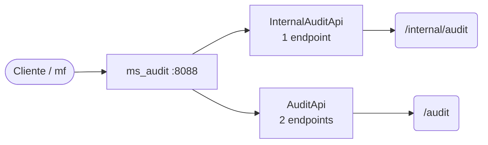

# 08 · Referencia de API — `ms_audit`

**Bitácora central de auditoría** · puerto local `:8088` · 3 endpoints (2 de negocio, 1 internos).

> Generada a partir del código fuente (controladores `@RestController` y `SecurityConfig`). Si un endpoint cambia en el código, esta referencia debe regenerarse.

## Convenciones

| Aspecto | Regla |
|---|---|
| URL base (local) | `http://localhost:8088` |
| Autenticación de usuario | `Authorization: Bearer <JWT>` emitido por Keycloak; roles en `realm_access.roles` → `ROLE_*` |
| Autenticación servicio-a-servicio | Rutas `/internal/**` con cabecera `X-Internal-Api-Key` (comparación en tiempo constante) |
| Respuesta exitosa | `{ "meta": { "traceId", "timestamp" }, "data": … }` |
| Respuesta de error | `{ "meta": …, "error": [ { "code", "message" } ] }` (manejador global de excepciones) |
| Formato | JSON (`application/json`) salvo cargas de archivos (`multipart/form-data`) y descargas binarias |

## Reglas de acceso (SecurityConfig)

Se evalúan en orden; la primera regla que coincide decide. La autorización fina de negocio (miembro de la evaluación, estado, rol en la evaluación) se valida además dentro de cada caso de uso.

| # | Método | Patrón | Regla |
|---|---|---|---|
| 1 | * | `/actuator/health`, `/actuator/info` | Público |
| 2 | * | `/error` | Público |
| 3 | * | `/internal/**` | Público (filtro de API-key interna) |
| 4 | * | `/audit/**` | Rol: Administrador del sistema |
| 5 | * | `/**` | Autenticado |

## Mapa de recursos

**Contexto.** Cada caja intermedia es un controlador (adaptador de entrada de la arquitectura hexagonal); las hojas son las raíces de recurso que expone. Los controladores no contienen lógica de negocio: delegan en casos de uso del módulo `domain/usecase`.

## Resumen

| Controlador | Endpoints | Raíz común |
|---|---|---|
| `InternalAuditApi` | 1 | `/internal/audit/events` |
| `AuditApi` | 2 | `/audit` |

## Endpoints de negocio

### `AuditApi`

| Método | Ruta | Acceso | Parámetros | Cuerpo | HTTP | Caso de uso / guarda |
|---|---|---|---|---|---|---|
| `GET` | `/audit/events` | JWT · Administrador del sistema | `?page=0`, `?size=20`, `?q?`, `?eventType?`, `?entityType?`, `?dateFrom?`, `?dateTo?`, `?actor?`, `?requestNumber?` | — | 200 | `ListAuditEventsUseCase` |
| `GET` | `/audit/requests/{requestNumber}` | JWT · Administrador del sistema | `requestNumber` | — | 200 | `GetRequestAuditTrailUseCase` |

## Endpoints internos (servicio a servicio)

### `InternalAuditApi`

| Método | Ruta | Acceso | Parámetros | Cuerpo | HTTP | Caso de uso / guarda |
|---|---|---|---|---|---|---|
| `POST` | `/internal/audit/events` | API-key interna (`X-Internal-Api-Key`) | — | `AuditEventRequest` | 200 | `RecordAuditEventUseCase` |

---

Ver también: [`03-Diseno.md`](03-Diseno.md) (arquitectura y modelo) · [Referencia consolidada](../../Documentacion-General/08-Referencia-API.md) · [Modelo de datos](../../Documentacion-General/Modelo-Datos-MER.md)
