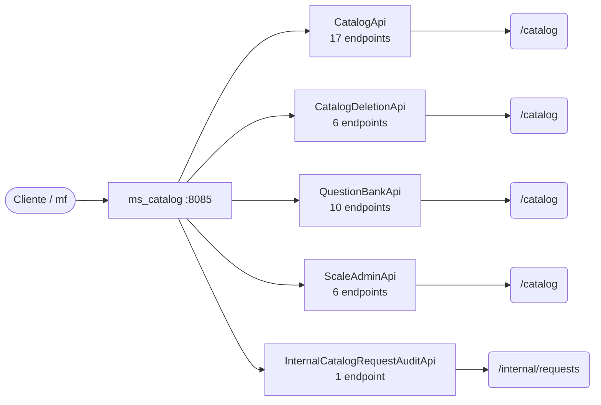

# 08 · Referencia de API — `ms_catalog`

**Catálogo versionado del instrumento** · puerto local `:8085` · 40 endpoints (39 de negocio, 1 internos).

> Generada a partir del código fuente (controladores `@RestController` y `SecurityConfig`). Si un endpoint cambia en el código, esta referencia debe regenerarse.

## Convenciones

| Aspecto | Regla |
|---|---|
| URL base (local) | `http://localhost:8085` |
| Autenticación de usuario | `Authorization: Bearer <JWT>` emitido por Keycloak; roles en `realm_access.roles` → `ROLE_*` |
| Autenticación servicio-a-servicio | Rutas `/internal/**` con cabecera `X-Internal-Api-Key` (comparación en tiempo constante) |
| Respuesta exitosa | `{ "meta": { "traceId", "timestamp" }, "data": … }` |
| Respuesta de error | `{ "meta": …, "error": [ { "code", "message" } ] }` (manejador global de excepciones) |
| Formato | JSON (`application/json`) salvo cargas de archivos (`multipart/form-data`) y descargas binarias |

## Reglas de acceso (SecurityConfig)

Se evalúan en orden; la primera regla que coincide decide. La autorización fina de negocio (miembro de la evaluación, estado, rol en la evaluación) se valida además dentro de cada caso de uso.

| # | Método | Patrón | Regla |
|---|---|---|---|
| 1 | * | `/actuator/health`, `/actuator/info` | Público |
| 2 | * | `/error` | Público |
| 3 | POST | `/catalog/scales/**`, `/catalog/question-banks/**` | Rol: Administrador del sistema, Administrador del instrumento |
| 4 | PUT | `/catalog/scales/**`, `/catalog/question-banks/**` | Rol: Administrador del sistema, Administrador del instrumento |
| 5 | DELETE | `/catalog/question-banks/**` | Rol: Administrador del sistema, Administrador del instrumento |
| 6 | POST | `/catalog/deletion-requests/**` | Rol: Administrador del sistema, Administrador del instrumento |
| 7 | GET | `/catalog/deletion-requests/**` | Rol: Administrador del sistema, Administrador del instrumento |
| 8 | * | `/catalog/**` | Autenticado |
| 9 | * | `/**` | Autenticado |

## Mapa de recursos

**Contexto.** Cada caja intermedia es un controlador (adaptador de entrada de la arquitectura hexagonal); las hojas son las raíces de recurso que expone. Los controladores no contienen lógica de negocio: delegan en casos de uso del módulo `domain/usecase`.

## Resumen

| Controlador | Endpoints | Raíz común |
|---|---|---|
| `CatalogApi` | 17 | `/catalog` |
| `CatalogDeletionApi` | 6 | `/catalog/deletion-requests` |
| `QuestionBankApi` | 10 | `/catalog/question-banks` |
| `ScaleAdminApi` | 6 | `/catalog/scales` |
| `InternalCatalogRequestAuditApi` | 1 | `/internal/requests/{requestNumber}` |

## Endpoints de negocio

### `CatalogApi`

| Método | Ruta | Acceso | Parámetros | Cuerpo | HTTP | Caso de uso / guarda |
|---|---|---|---|---|---|---|
| `GET` | `/catalog/entity-order-types` | JWT (cualquier rol) | — | — | 200 | `GetEntityOrderTypesUseCase` |
| `GET` | `/catalog/template-versions/active` | JWT (cualquier rol) | — | — | 200 | `GetActiveTemplateVersionUseCase` |
| `GET` | `/catalog/lifting-document-items` | JWT (cualquier rol) | `?templateVersionId?` | — | 200 | `GetLiftingDocumentItemsUseCase` |
| `GET` | `/catalog/steward-roles` | JWT (cualquier rol) | — | — | 200 | `GetStewardRolesUseCase` |
| `GET` | `/catalog/iso-domains` | JWT (cualquier rol) | — | — | 200 | `GetIsoDomainsUseCase` |
| `GET` | `/catalog/assessment-area-presets` | JWT (cualquier rol) | — | — | 200 | `GetAssessmentAreaPresetsUseCase` |
| `GET` | `/catalog/control-catalog-leaves` | JWT (cualquier rol) | `?templateVersionId?`, `?controlType?` | — | 200 | `GetLeafControlCatalogUseCase` |
| `GET` | `/catalog/control-catalog-tree` | JWT (cualquier rol) | `?templateVersionId?`, `?controlType?` | — | 200 | `GetControlCatalogTreeUseCase` |
| `GET` | `/catalog/control-rules` | JWT (cualquier rol) | `?templateVersionId?`, `?controlType?` | — | 200 | `GetControlRulesUseCase` |
| `GET` | `/catalog/scales/published` | JWT (cualquier rol) | `?scaleVersionId?` | — | 200 | `GetScalePublishedUseCase` |
| `GET` | `/catalog/nist-mappings` | JWT (cualquier rol) | `?templateVersionId?`, `?controlNodeId?` | — | 200 | `GetNistMappingsUseCase` |
| `GET` | `/catalog/phva-items` | JWT (cualquier rol) | `?templateVersionId?` | — | 200 | `GetPhvaItemCatalogUseCase` |
| `GET` | `/catalog/phva-config` | JWT (cualquier rol) | `?templateVersionId?` | — | 200 | `GetPhvaTemplateConfigUseCase` |
| `GET` | `/catalog/maturity-requirements` | JWT (cualquier rol) | `?templateVersionId?` | — | 200 | `GetMaturityRequirementCatalogUseCase` |
| `GET` | `/catalog/maturity-config` | JWT (cualquier rol) | `?templateVersionId?` | — | 200 | `GetMaturityTemplateConfigUseCase` |
| `GET` | `/catalog/nist-ciber-items` | JWT (cualquier rol) | `?templateVersionId?` | — | 200 | `GetNistCiberItemCatalogUseCase` |
| `GET` | `/catalog/nist-config` | JWT (cualquier rol) | `?templateVersionId?` | — | 200 | `GetNistTemplateConfigUseCase` |

### `CatalogDeletionApi`

| Método | Ruta | Acceso | Parámetros | Cuerpo | HTTP | Caso de uso / guarda |
|---|---|---|---|---|---|---|
| `POST` | `/catalog/deletion-requests` | JWT · Administrador del sistema / Administrador del instrumento | — | `CreateCatalogDeletionRequest` | 201 | `RequestCatalogDeletionUseCase` |
| `POST` | `/catalog/deletion-requests/{requestId}/approve` | JWT · Administrador del sistema / Administrador del instrumento | `requestId` | `CatalogDeletionDecisionRequest` | 200 | `ApproveCatalogDeletionUseCase` |
| `POST` | `/catalog/deletion-requests/{requestId}/reject` | JWT · Administrador del sistema / Administrador del instrumento | `requestId` | `CatalogDeletionDecisionRequest` | 200 | `RejectCatalogDeletionUseCase` |
| `POST` | `/catalog/deletion-requests/{requestId}/cancel` | JWT · Administrador del sistema / Administrador del instrumento | `requestId` | `CatalogDeletionDecisionRequest` | 200 | `CancelCatalogDeletionUseCase` |
| `GET` | `/catalog/deletion-requests` | JWT · Administrador del sistema / Administrador del instrumento | `?status?`, `?targetType?`, `?targetId?` | — | 200 | `ListCatalogDeletionRequestsUseCase` |
| `GET` | `/catalog/deletion-requests/pending` | JWT · Administrador del sistema / Administrador del instrumento | — | — | 200 | `ListCatalogDeletionRequestsUseCase` |

### `QuestionBankApi`

| Método | Ruta | Acceso | Parámetros | Cuerpo | HTTP | Caso de uso / guarda |
|---|---|---|---|---|---|---|
| `GET` | `/catalog/question-banks` | JWT (cualquier rol) | — | — | 200 | `ListQuestionBanksUseCase` |
| `GET` | `/catalog/question-banks/{id}` | JWT (cualquier rol) | `id` | — | 200 | `GetQuestionBankUseCase` |
| `POST` | `/catalog/question-banks` | JWT · Administrador del sistema / Administrador del instrumento | — | `CreateQuestionBankRequest` | 201 | `CreateQuestionBankUseCase` |
| `GET` | `/catalog/question-banks/{bankId}/questions` | JWT (cualquier rol) | `bankId`, `?q?`, `?domain?`, `?evaluationType?` | — | 200 | `ListCatalogQuestionsUseCase` |
| `POST` | `/catalog/question-banks/{bankId}/questions` | JWT · Administrador del sistema / Administrador del instrumento | `bankId` | `CatalogQuestionRequest` | 201 | `CreateCatalogQuestionUseCase` |
| `PUT` | `/catalog/question-banks/{bankId}/questions/{questionId}` | JWT · Administrador del sistema / Administrador del instrumento | `bankId`, `questionId` | `CatalogQuestionRequest` | 200 | `UpdateCatalogQuestionUseCase` |
| `POST` | `/catalog/question-banks/{bankId}/questions/{questionId}/duplicate` | JWT · Administrador del sistema / Administrador del instrumento | `bankId`, `questionId` | — | 201 | `DuplicateCatalogQuestionUseCase` |
| `DELETE` | `/catalog/question-banks/{bankId}/questions/{questionId}` | JWT · Administrador del sistema / Administrador del instrumento | `bankId`, `questionId` | — | 200 | `DeleteCatalogQuestionUseCase` |
| `GET` | `/catalog/question-banks/{bankId}/config` | JWT (cualquier rol) | `bankId` | — | 200 | `GetQuestionBankConfigUseCase` |
| `PUT` | `/catalog/question-banks/{bankId}/config` | JWT · Administrador del sistema / Administrador del instrumento | `bankId` | `List<DomainQuestionConfigRequest>` | 200 | `SaveQuestionBankConfigUseCase`, `SaveQuestionBankConfigUseCase` |

### `ScaleAdminApi`

| Método | Ruta | Acceso | Parámetros | Cuerpo | HTTP | Caso de uso / guarda |
|---|---|---|---|---|---|---|
| `GET` | `/catalog/scales` | JWT (cualquier rol) | `?page=0`, `?size=20`, `?q?` | — | 200 | `ListScalesUseCase` |
| `GET` | `/catalog/scales/{id}` | JWT (cualquier rol) | `id` | — | 200 | `GetScaleDetailUseCase` |
| `POST` | `/catalog/scales` | JWT · Administrador del sistema / Administrador del instrumento | — | `CreateScaleRequest` | 201 | `CreateScaleUseCase` |
| `POST` | `/catalog/scales/{id}/versions` | JWT · Administrador del sistema / Administrador del instrumento | `id` | — | 201 | `CreateScaleVersionUseCase` |
| `PUT` | `/catalog/scales/versions/{versionId}` | JWT · Administrador del sistema / Administrador del instrumento | `versionId` | `UpdateScaleVersionRequest` | 200 | `UpdateScaleVersionUseCase` |
| `POST` | `/catalog/scales/versions/{versionId}/publish` | JWT · Administrador del sistema / Administrador del instrumento | `versionId` | — | 200 | `PublishScaleVersionUseCase` |

## Endpoints internos (servicio a servicio)

### `InternalCatalogRequestAuditApi`

| Método | Ruta | Acceso | Parámetros | Cuerpo | HTTP | Caso de uso / guarda |
|---|---|---|---|---|---|---|
| `GET` | `/internal/requests/{requestNumber}` | API-key interna (`X-Internal-Api-Key`) | `requestNumber` | — | 200 | `GetCatalogRequestAuditSnapshotUseCase` |

---

Ver también: [`03-Diseno.md`](03-Diseno.md) (arquitectura y modelo) · [Referencia consolidada](../../Documentacion-General/08-Referencia-API.md) · [Modelo de datos](../../Documentacion-General/Modelo-Datos-MER.md)
