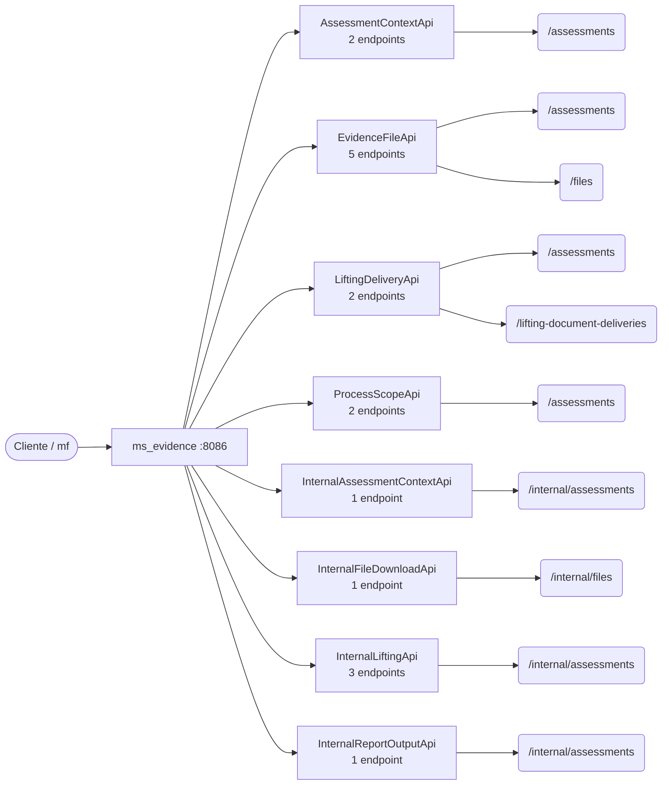

# 08 · Referencia de API — `ms_evidence`

**Evidencias y levantamiento documental** · puerto local `:8086` · 17 endpoints (11 de negocio, 6 internos).

> Generada a partir del código fuente (controladores `@RestController` y `SecurityConfig`). Si un endpoint cambia en el código, esta referencia debe regenerarse.

## Convenciones

| Aspecto | Regla |
|---|---|
| URL base (local) | `http://localhost:8086` |
| Autenticación de usuario | `Authorization: Bearer <JWT>` emitido por Keycloak; roles en `realm_access.roles` → `ROLE_*` |
| Autenticación servicio-a-servicio | Rutas `/internal/**` con cabecera `X-Internal-Api-Key` (comparación en tiempo constante) |
| Respuesta exitosa | `{ "meta": { "traceId", "timestamp" }, "data": … }` |
| Respuesta de error | `{ "meta": …, "error": [ { "code", "message" } ] }` (manejador global de excepciones) |
| Formato | JSON (`application/json`) salvo cargas de archivos (`multipart/form-data`) y descargas binarias |

## Reglas de acceso (SecurityConfig)

Se evalúan en orden; la primera regla que coincide decide. La autorización fina de negocio (miembro de la evaluación, estado, rol en la evaluación) se valida además dentro de cada caso de uso.

| # | Método | Patrón | Regla |
|---|---|---|---|
| 1 | * | `/actuator/health`, `/actuator/info` | Público |
| 2 | * | `/error` | Público |
| 3 | * | `/internal/**` | Público (filtro de API-key interna) |
| 4 | * | `/assessments/**`, `/lifting-document-deliveries/**`, `/files/**` | Autenticado |
| 5 | * | `/**` | Autenticado |

## Mapa de recursos

**Contexto.** Cada caja intermedia es un controlador (adaptador de entrada de la arquitectura hexagonal); las hojas son las raíces de recurso que expone. Los controladores no contienen lógica de negocio: delegan en casos de uso del módulo `domain/usecase`.

## Resumen

| Controlador | Endpoints | Raíz común |
|---|---|---|
| `AssessmentContextApi` | 2 | `/assessments/{assessmentId}/context` |
| `EvidenceFileApi` | 5 | `/assessments, /files` |
| `LiftingDeliveryApi` | 2 | `/assessments, /lifting-document-deliveries` |
| `ProcessScopeApi` | 2 | `/assessments/{assessmentId}/process-scope-metric` |
| `InternalAssessmentContextApi` | 1 | `/internal/assessments/{assessmentId}/context` |
| `InternalFileDownloadApi` | 1 | `/internal/files/{fileId}/download` |
| `InternalLiftingApi` | 3 | `/internal/assessments` |
| `InternalReportOutputApi` | 1 | `/internal/assessments/{assessmentId}/report-outputs` |

## Endpoints de negocio

### `AssessmentContextApi`

| Método | Ruta | Acceso | Parámetros | Cuerpo | HTTP | Caso de uso / guarda |
|---|---|---|---|---|---|---|
| `GET` | `/assessments/{assessmentId}/context` | JWT (cualquier rol) | `assessmentId` | — | 200 | `GetAssessmentContextUseCase` |
| `PATCH` | `/assessments/{assessmentId}/context` | JWT (cualquier rol) | `assessmentId` | `AssessmentContextRequest` | 200 | `UpdateAssessmentContextUseCase` |

### `EvidenceFileApi`

| Método | Ruta | Acceso | Parámetros | Cuerpo | HTTP | Caso de uso / guarda |
|---|---|---|---|---|---|---|
| `POST` | `/files` | JWT (cualquier rol) | `?file (archivo)`, `?relationType`, `?relationId` | `multipart/form-data` | 200 | `UploadEvidenceFileUseCase` |
| `POST` | `/assessments/{assessmentId}/files` | JWT (cualquier rol) | `assessmentId`, `?file (archivo)`, `?relationType`, `?relationId?`, `?contextField?` | `multipart/form-data` | 200 | `UploadEvidenceFileUseCase` |
| `GET` | `/assessments/{assessmentId}/files` | JWT (cualquier rol) | `assessmentId`, `?relationType?`, `?relationId?` | — | 200 | `ListEvidenceFilesUseCase` |
| `GET` | `/files/{fileId}/download` | JWT (cualquier rol) | `fileId` | — | archivo | `DownloadEvidenceFileUseCase` |
| `DELETE` | `/files/{fileId}` | JWT (cualquier rol) | `fileId` | — | 204 | `DeleteEvidenceFileUseCase` |

### `LiftingDeliveryApi`

| Método | Ruta | Acceso | Parámetros | Cuerpo | HTTP | Caso de uso / guarda |
|---|---|---|---|---|---|---|
| `GET` | `/assessments/{assessmentId}/lifting-document-deliveries` | JWT (cualquier rol) | `assessmentId` | — | 200 | `GetLiftingDeliveriesUseCase` |
| `PATCH` | `/lifting-document-deliveries/{deliveryId}` | JWT (cualquier rol) | `deliveryId` | `LiftingDeliveryRequest` | 200 | `UpdateLiftingDeliveryUseCase` |

### `ProcessScopeApi`

| Método | Ruta | Acceso | Parámetros | Cuerpo | HTTP | Caso de uso / guarda |
|---|---|---|---|---|---|---|
| `GET` | `/assessments/{assessmentId}/process-scope-metric` | JWT (cualquier rol) | `assessmentId` | — | 200 | `GetProcessScopeMetricUseCase` |
| `PATCH` | `/assessments/{assessmentId}/process-scope-metric` | JWT (cualquier rol) | `assessmentId` | `ProcessScopeRequest` | 200 | `UpdateProcessScopeMetricUseCase` |

## Endpoints internos (servicio a servicio)

### `InternalAssessmentContextApi`

| Método | Ruta | Acceso | Parámetros | Cuerpo | HTTP | Caso de uso / guarda |
|---|---|---|---|---|---|---|
| `GET` | `/internal/assessments/{assessmentId}/context` | API-key interna (`X-Internal-Api-Key`) | `assessmentId` | — | 200 | `GetAssessmentContextUseCase` |

### `InternalFileDownloadApi`

| Método | Ruta | Acceso | Parámetros | Cuerpo | HTTP | Caso de uso / guarda |
|---|---|---|---|---|---|---|
| `GET` | `/internal/files/{fileId}/download` | API-key interna (`X-Internal-Api-Key`) | `fileId` | — | archivo | `DownloadEvidenceFileUseCase` |

### `InternalLiftingApi`

| Método | Ruta | Acceso | Parámetros | Cuerpo | HTTP | Caso de uso / guarda |
|---|---|---|---|---|---|---|
| `POST` | `/internal/assessments/{assessmentId}/lifting/init` | API-key interna (`X-Internal-Api-Key`) | `assessmentId` | `InitLiftingRequest` | 201 | `InitLiftingUseCase` |
| `POST` | `/internal/assessments/{sourceAssessmentId}/lifting/clone/{targetAssessmentId}` | API-key interna (`X-Internal-Api-Key`) | `sourceAssessmentId`, `targetAssessmentId` | — | 201 | `CloneLiftingUseCase` |
| `GET` | `/internal/assessments/{assessmentId}/evidence-files` | API-key interna (`X-Internal-Api-Key`) | `assessmentId`, `?relationType?`, `?relationId?` | — | 200 | `ListEvidenceFilesUseCase` |

### `InternalReportOutputApi`

| Método | Ruta | Acceso | Parámetros | Cuerpo | HTTP | Caso de uso / guarda |
|---|---|---|---|---|---|---|
| `POST` | `/internal/assessments/{assessmentId}/report-outputs` | API-key interna (`X-Internal-Api-Key`) | `assessmentId`, `?file (archivo)`, `?jobId`, `?uploadedBy?` | `multipart/form-data` | 201 | `UploadEvidenceFileUseCase` |

---

Ver también: [`03-Diseno.md`](03-Diseno.md) (arquitectura y modelo) · [Referencia consolidada](../../Documentacion-General/08-Referencia-API.md) · [Modelo de datos](../../Documentacion-General/Modelo-Datos-MER.md)
