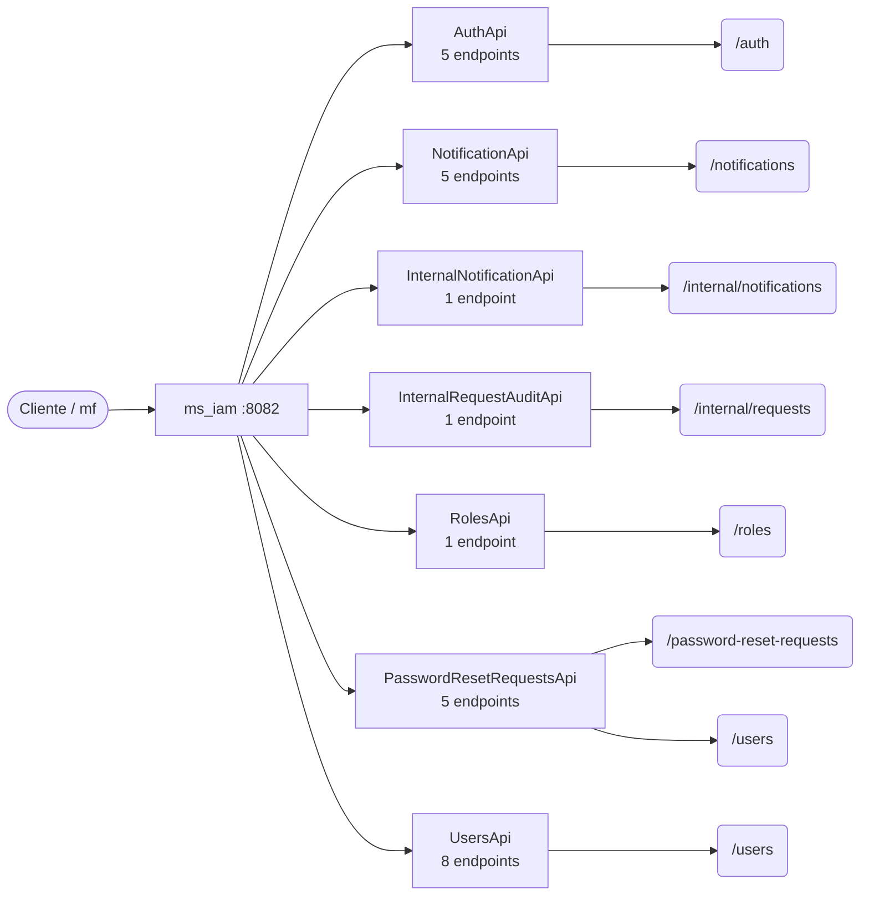

# 08 · Referencia de API — `ms_iam`

**Identidad, acceso y notificaciones** · puerto local `:8082` · 26 endpoints (24 de negocio, 2 internos).

> Generada a partir del código fuente (controladores `@RestController` y `SecurityConfig`). Si un endpoint cambia en el código, esta referencia debe regenerarse.

## Convenciones

| Aspecto | Regla |
|---|---|
| URL base (local) | `http://localhost:8082` |
| Autenticación de usuario | `Authorization: Bearer <JWT>` emitido por Keycloak; roles en `realm_access.roles` → `ROLE_*` |
| Autenticación servicio-a-servicio | Rutas `/internal/**` con cabecera `X-Internal-Api-Key` (comparación en tiempo constante) |
| Respuesta exitosa | `{ "meta": { "traceId", "timestamp" }, "data": … }` |
| Respuesta de error | `{ "meta": …, "error": [ { "code", "message" } ] }` (manejador global de excepciones) |
| Formato | JSON (`application/json`) salvo cargas de archivos (`multipart/form-data`) y descargas binarias |

## Reglas de acceso (SecurityConfig)

Se evalúan en orden; la primera regla que coincide decide. La autorización fina de negocio (miembro de la evaluación, estado, rol en la evaluación) se valida además dentro de cada caso de uso.

| # | Método | Patrón | Regla |
|---|---|---|---|
| 1 | * | `/auth/login`, `/auth/change-password` | Público |
| 2 | * | `/actuator/health`, `/actuator/info` | Público |
| 3 | * | `/error` | Público |
| 4 | * | `/internal/**` | Público (filtro de API-key interna) |
| 5 | * | `/users/**` | Rol: Administrador del sistema |
| 6 | * | `/password-reset-requests/**` | Rol: Administrador del sistema |
| 7 | * | `/notifications/**` | Autenticado |
| 8 | * | `/**` | Autenticado |

## Mapa de recursos

**Contexto.** Cada caja intermedia es un controlador (adaptador de entrada de la arquitectura hexagonal); las hojas son las raíces de recurso que expone. Los controladores no contienen lógica de negocio: delegan en casos de uso del módulo `domain/usecase`.

## Resumen

| Controlador | Endpoints | Raíz común |
|---|---|---|
| `AuthApi` | 5 | `/auth` |
| `NotificationApi` | 5 | `/notifications` |
| `InternalNotificationApi` | 1 | `/internal/notifications` |
| `InternalRequestAuditApi` | 1 | `/internal/requests/{requestNumber}` |
| `RolesApi` | 1 | `/roles` |
| `PasswordResetRequestsApi` | 5 | `/password-reset-requests, /users` |
| `UsersApi` | 8 | `/users` |

## Endpoints de negocio

### `AuthApi`

| Método | Ruta | Acceso | Parámetros | Cuerpo | HTTP | Caso de uso / guarda |
|---|---|---|---|---|---|---|
| `POST` | `/auth/login` | Público | — | `LoginRequestBody` | 200 | `LoginUseCase` |
| `POST` | `/auth/change-password` | Público | — | `ChangePasswordRequest` | 200 | `ChangePasswordUseCase` |
| `GET` | `/auth/totp/status` | JWT (cualquier rol) | — | — | 200 | `TotpStatusUseCase` |
| `POST` | `/auth/totp/setup` | JWT (cualquier rol) | — | — | 200 | `TotpSetupUseCase` |
| `POST` | `/auth/totp/verify` | JWT (cualquier rol) | — | `Map<String, String>` | 200 | `TotpVerifyUseCase` |

### `NotificationApi`

Sujeto **siempre** desde JWT (`CurrentUserResolver`). `userId` en query/body es opcional (compatibilidad): si no coincide con el token → **403**. Operaciones por `{id}` sin propiedad → **404**.

| Método | Ruta | Acceso | Parámetros | Cuerpo | HTTP | Caso de uso / guarda |
|---|---|---|---|---|---|---|
| `GET` | `/notifications` | JWT (cualquier rol) | `?userId` opcional (debe = token) | — | 200 / 403 | `ListNotificationsUseCase` |
| `POST` | `/notifications/{id}/read` | JWT (cualquier rol) | `id` (dueño = token) | — | 200 / 404 | `MarkNotificationReadUseCase` |
| `POST` | `/notifications/read-all` | JWT (cualquier rol) | — | `ReadAllRequest.userId` opcional | 200 / 403 | `MarkAllNotificationsReadUseCase` |
| `POST` | `/notifications/{id}/clear` | JWT (cualquier rol) | `id` (dueño = token) | — | 200 / 404 | `ClearNotificationUseCase` |
| `POST` | `/notifications/clear-read` | JWT (cualquier rol) | — | `ReadAllRequest.userId` opcional | 200 / 403 | `ClearAllReadNotificationsUseCase` |

### `RolesApi`

| Método | Ruta | Acceso | Parámetros | Cuerpo | HTTP | Caso de uso / guarda |
|---|---|---|---|---|---|---|
| `GET` | `/roles` | JWT (cualquier rol) | — | — | 200 | `RolesApi.list` |

### `PasswordResetRequestsApi`

| Método | Ruta | Acceso | Parámetros | Cuerpo | HTTP | Caso de uso / guarda |
|---|---|---|---|---|---|---|
| `POST` | `/users/{userId}/password-reset-requests` | JWT · Administrador del sistema | `userId` | `CreatePasswordResetRequest` | 201 | `RequestPasswordResetUseCase` |
| `GET` | `/password-reset-requests` | JWT · Administrador del sistema | `?status=PENDING` | — | 200 | `ListPasswordResetRequestsUseCase` |
| `POST` | `/password-reset-requests/{id}/approve` | JWT · Administrador del sistema | `id` | `PasswordResetDecisionRequest` | 200 | `ApprovePasswordResetUseCase` |
| `POST` | `/password-reset-requests/{id}/reject` | JWT · Administrador del sistema | `id` | `PasswordResetDecisionRequest` | 200 | `RejectPasswordResetUseCase` |
| `POST` | `/password-reset-requests/{id}/cancel` | JWT · Administrador del sistema | `id` | `PasswordResetDecisionRequest` | 200 | `CancelPasswordResetUseCase` |

### `UsersApi`

| Método | Ruta | Acceso | Parámetros | Cuerpo | HTTP | Caso de uso / guarda |
|---|---|---|---|---|---|---|
| `POST` | `/users` | JWT · Administrador del sistema | — | `CreateUserRequest` | 200 | `CreateUserUseCase`, `GetUserByIdUseCase` |
| `GET` | `/users` | JWT · Administrador del sistema | `?page=0`, `?size=10`, `?q?`, `?role?`, `?status?` | — | 200 | `GetUsersUseCase` |
| `GET` | `/users/statuses` | JWT · Administrador del sistema | — | — | 200 | `UsersApi.listStatuses` |
| `GET` | `/users/{userId}` | JWT · Administrador del sistema | `userId` | — | 200 | `GetUserByIdUseCase` |
| `PUT` | `/users/{userId}` | JWT · Administrador del sistema | `userId` | `UpdateUserRequest` | 200 | `GetUserByIdUseCase`, `UpdateUserUseCase` |
| `PATCH` | `/users/{userId}/status` | JWT · Administrador del sistema | `userId` | `StatusRequest` | 200 | `GetUserByIdUseCase`, `UpdateUserStatusUseCase` |
| `POST` | `/users/{userId}/reset-password` | JWT · Administrador del sistema | `userId` | `ResetPasswordRequest` | 200 | `ResetPasswordUseCase` |
| `POST` | `/users/disable-by-email` | JWT · Administrador del sistema | — | `DisableUserByEmailRequest` | 200 | `DisableUserByEmailUseCase` |

## Endpoints internos (servicio a servicio)

### `InternalNotificationApi`

| Método | Ruta | Acceso | Parámetros | Cuerpo | HTTP | Caso de uso / guarda |
|---|---|---|---|---|---|---|
| `POST` | `/internal/notifications` | API-key interna (`X-Internal-Api-Key`) | — | `CreateNotificationRequest` | 201 | `CreateNotificationUseCase` |

### `InternalRequestAuditApi`

| Método | Ruta | Acceso | Parámetros | Cuerpo | HTTP | Caso de uso / guarda |
|---|---|---|---|---|---|---|
| `GET` | `/internal/requests/{requestNumber}` | API-key interna (`X-Internal-Api-Key`) | `requestNumber` | — | 200 | `GetPasswordResetRequestAuditSnapshotUseCase` |

---

Ver también: [`03-Diseno.md`](03-Diseno.md) (arquitectura y modelo) · [Referencia consolidada](../../Documentacion-General/08-Referencia-API.md) · [Modelo de datos](../../Documentacion-General/Modelo-Datos-MER.md)
