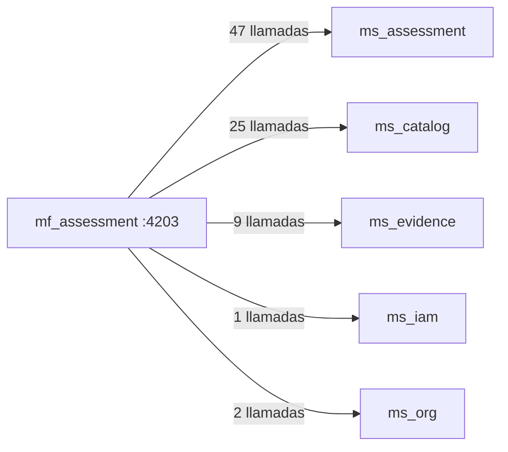

# 08 · Mapa de rutas, permisos y endpoints — `mf_assessment`

Puerto local `:4203` · **24 rutas** · **84 llamadas HTTP distintas** a 5 microservicio(s).

> Generado desde `src/app/app.routes.ts` y las llamadas `HttpClient` del código. La UI oculta lo que el rol no puede hacer, pero la autorización real siempre la valida el backend.

## Rutas y pantallas

| Ruta | Pantalla (componente) | Título visible | Requiere sesión | Permiso |
|---|---|---|---|---|
| `/catalog/deletion-requests` | `CatalogDeletionRequestsPageComponent` | Eliminación de catálogo | Sí | Gestión de plantillas |
| `/scales` | `ScaleListPageComponent` | Escalas de evaluación | Sí | Gestión de plantillas |
| `/scales/:id` | `ScaleDetailPageComponent` | Nueva escala de evaluación | Sí | Gestión de plantillas |
| `/security-baseline` | `QuestionBankListPageComponent` | Banco de preguntas | Sí | Gestión de plantillas |
| `/security-baseline/:id/questions` | `QuestionBankQuestionsPageComponent` | Banco de preguntas | Sí | Gestión de plantillas |
| `/security-baseline/:id/config` | `QuestionBankConfigPageComponent` | Seleccionar preguntas del banco | Sí | Gestión de plantillas |
| `/evaluations` | `EvaluationListPageComponent` | Evaluaciones | Sí | Ver evaluaciones |
| `/evaluations/my-assigned` | `MyAssignedEvaluationsPageComponent` | Mis evaluaciones asignadas | Sí | Ver evaluaciones |
| `/evaluations/extension-requests` | `ExtensionRequestsPageComponent` | Solicitudes de ampliación | Sí | Ver evaluaciones |
| `/evaluations/deletion-requests` | `DeletionRequestsPageComponent` | Solicitudes de eliminación | Sí | Ver evaluaciones |
| `/evaluations/deleted` | `DeletedAssessmentsPageComponent` | Evaluaciones eliminadas | Sí | Ver evaluaciones |
| `/evaluations/new` | `EvaluationCreatePageComponent` | — | Sí | Edición de evaluaciones |
| `/evaluations/:id` | `EvaluationDashboardPageComponent` | — | Sí | Ver evaluaciones |
| `/evaluations/:id/entity-form` | `EvaluationCreatePageComponent` | — | Sí | Ver evaluaciones |
| `/evaluations/:id/scale` | `EvaluationScalePageComponent` | Escala de la evaluación | Sí | Ver evaluaciones |
| `/evaluations/:id/information-gathering` | `InformationGatheringPageComponent` | Levantamiento de información | Sí | Ver evaluaciones |
| `/evaluations/:id/entity-order-type` | `EntityOrderTypePageComponent` | Tipo de entidad territorial | Sí | Ver evaluaciones |
| `/evaluations/:id/areas` | `AreasPageComponent` | Áreas y temas | Sí | Ver evaluaciones |
| `/evaluations/:id/stewardship` | `StewardshipPageComponent` | Stewardship | Sí | Ver evaluaciones |
| `/evaluations/:id/controls/admin` | `ControlsPageComponent` | — | Sí | Ver evaluaciones |
| `/evaluations/:id/controls/tech` | `ControlsPageComponent` | — | Sí | Ver evaluaciones |
| `/evaluations/:id/phva` | `PhvaPageComponent` | Ciclo PHVA | Sí | Ver evaluaciones |
| `/evaluations/:id/maturity` | `MaturityPageComponent` | Madurez | Sí | Ver evaluaciones |
| `/evaluations/:id/nist` | `NistPageComponent` | NIST CSF | Sí | Ver evaluaciones |

## Matriz rol × permiso usado en este microfrontend

| Rol | Edición de evaluaciones | Ver evaluaciones | Gestión de plantillas |
|---|---|---|---|
| AdminSistema | ✅ | ✅ | ✅ |
| AdminInstrumento | — | ✅ | ✅ |
| Evaluador | ✅ | ✅ | — |
| Revisor | — | ✅ | — |
| EvaluadorRevisor | ✅ | ✅ | — |
| Lector | — | ✅ | — |

Fuente: `ROLE_AUTHORITIES` (`mf_shell/src/app/domain/dashboard/authority.ts`), replicado en cada microfrontend.

## Endpoints de backend consumidos

| Microservicio | Método | Ruta | Archivo(s) |
|---|---|---|---|
| `ms_assessment` | `DELETE` | `/assessments/{id}/members/{id}` | `infrastructure/members/api-assessment-member.repository.ts` |
| `ms_assessment` | `GET` | `/assessments` | `infrastructure/assessment/api-assessment.repository.ts` |
| `ms_assessment` | `GET` | `/assessments/deleted` | `infrastructure/deletion/api-deletion-request.repository.ts` |
| `ms_assessment` | `GET` | `/assessments/workflow-rules` | `infrastructure/assessment/api-assessment.repository.ts` |
| `ms_assessment` | `GET` | `/assessments/{id}` | `infrastructure/assessment/api-assessment.repository.ts` |
| `ms_assessment` | `GET` | `/assessments/{id}/areas` | `infrastructure/assessment/api-assessment.repository.ts` |
| `ms_assessment` | `GET` | `/assessments/{id}/controls` | `infrastructure/assessment/api-assessment.repository.ts` |
| `ms_assessment` | `GET` | `/assessments/{id}/controls/stewardship` | `infrastructure/assessment/api-assessment.repository.ts` |
| `ms_assessment` | `GET` | `/assessments/{id}/controls/{id}` | `infrastructure/assessment/api-assessment.repository.ts` |
| `ms_assessment` | `GET` | `/assessments/{id}/deletion-requests` | `infrastructure/deletion/api-deletion-request.repository.ts` |
| `ms_assessment` | `GET` | `/assessments/{id}/diagnostic/dashboard` | `infrastructure/assessment/api-assessment.repository.ts` |
| `ms_assessment` | `GET` | `/assessments/{id}/diagnostic/domain-effectiveness` | `infrastructure/assessment/api-assessment.repository.ts` |
| `ms_assessment` | `GET` | `/assessments/{id}/extension-requests` | `infrastructure/extension/api-extension-request.repository.ts` |
| `ms_assessment` | `GET` | `/assessments/{id}/gaps` | `infrastructure/assessment/api-assessment.repository.ts` |
| `ms_assessment` | `GET` | `/assessments/{id}/maturity/requirements` | `infrastructure/assessment/api-assessment.repository.ts` |
| `ms_assessment` | `GET` | `/assessments/{id}/maturity/summary` | `infrastructure/assessment/api-assessment.repository.ts` |
| `ms_assessment` | `GET` | `/assessments/{id}/members` | `infrastructure/members/api-assessment-member.repository.ts` |
| `ms_assessment` | `GET` | `/assessments/{id}/nist/items` | `infrastructure/assessment/api-assessment.repository.ts` |
| `ms_assessment` | `GET` | `/assessments/{id}/nist/summary` | `infrastructure/assessment/api-assessment.repository.ts` |
| `ms_assessment` | `GET` | `/assessments/{id}/phva/items` | `infrastructure/assessment/api-assessment.repository.ts` |
| `ms_assessment` | `GET` | `/assessments/{id}/phva/summary` | `infrastructure/assessment/api-assessment.repository.ts` |
| `ms_assessment` | `GET` | `/assessments/{id}/scores/rollup` | `infrastructure/assessment/api-assessment.repository.ts` |
| `ms_assessment` | `GET` | `/assessments/{id}/status-history` | `infrastructure/assessment/api-assessment.repository.ts` |
| `ms_assessment` | `GET` | `/deletion-requests` | `infrastructure/deletion/api-deletion-request.repository.ts` |
| `ms_assessment` | `GET` | `/extension-requests` | `infrastructure/extension/api-extension-request.repository.ts` |
| `ms_assessment` | `PATCH` | `/assessments/{id}` | `infrastructure/assessment/api-assessment.repository.ts` |
| `ms_assessment` | `PATCH` | `/assessments/{id}/controls/{id}` | `infrastructure/assessment/api-assessment.repository.ts` |
| `ms_assessment` | `PATCH` | `/assessments/{id}/controls/{id}/review` | `infrastructure/assessment/api-assessment.repository.ts` |
| `ms_assessment` | `PATCH` | `/assessments/{id}/controls/{id}/steward` | `infrastructure/assessment/api-assessment.repository.ts` |
| `ms_assessment` | `PATCH` | `/assessments/{id}/maturity/requirements/{id}` | `infrastructure/assessment/api-assessment.repository.ts` |
| `ms_assessment` | `PATCH` | `/assessments/{id}/nist/items/{id}` | `infrastructure/assessment/api-assessment.repository.ts` |
| `ms_assessment` | `PATCH` | `/assessments/{id}/phva/items/{id}` | `infrastructure/assessment/api-assessment.repository.ts` |
| `ms_assessment` | `POST` | `/assessments` | `infrastructure/assessment/api-assessment.repository.ts` |
| `ms_assessment` | `POST` | `/assessments/{id}/clone` | `infrastructure/assessment/api-assessment.repository.ts` |
| `ms_assessment` | `POST` | `/assessments/{id}/deletion-requests` | `infrastructure/deletion/api-deletion-request.repository.ts` |
| `ms_assessment` | `POST` | `/assessments/{id}/deletion-requests/{id}/approve` | `infrastructure/deletion/api-deletion-request.repository.ts` |
| `ms_assessment` | `POST` | `/assessments/{id}/deletion-requests/{id}/cancel` | `infrastructure/deletion/api-deletion-request.repository.ts` |
| `ms_assessment` | `POST` | `/assessments/{id}/deletion-requests/{id}/reject` | `infrastructure/deletion/api-deletion-request.repository.ts` |
| `ms_assessment` | `POST` | `/assessments/{id}/extension-requests` | `infrastructure/extension/api-extension-request.repository.ts` |
| `ms_assessment` | `POST` | `/assessments/{id}/extension-requests/{id}/approve` | `infrastructure/extension/api-extension-request.repository.ts` |
| `ms_assessment` | `POST` | `/assessments/{id}/extension-requests/{id}/reject` | `infrastructure/extension/api-extension-request.repository.ts` |
| `ms_assessment` | `POST` | `/assessments/{id}/members` | `infrastructure/members/api-assessment-member.repository.ts` |
| `ms_assessment` | `POST` | `/assessments/{id}/publish` | `infrastructure/assessment/api-assessment.repository.ts` |
| `ms_assessment` | `POST` | `/assessments/{id}/reopen` | `infrastructure/assessment/api-assessment.repository.ts` |
| `ms_assessment` | `POST` | `/assessments/{id}/status` | `infrastructure/assessment/api-assessment.repository.ts` |
| `ms_assessment` | `PUT` | `/assessments/{id}/areas/{id}/topics` | `infrastructure/assessment/api-assessment.repository.ts` |
| `ms_assessment` | `PUT` | `/assessments/{id}/entity-order-type` | `infrastructure/assessment/api-assessment.repository.ts` |
| `ms_catalog` | `DELETE` | `/catalog/question-banks/{id}/questions/{id}` | `infrastructure/question-bank/api-question-bank.repository.ts` |
| `ms_catalog` | `GET` | `/catalog/deletion-requests` | `infrastructure/catalog-deletion/api-catalog-deletion.repository.ts` |
| `ms_catalog` | `GET` | `/catalog/deletion-requests/pending` | `infrastructure/catalog-deletion/api-catalog-deletion.repository.ts` |
| `ms_catalog` | `GET` | `/catalog/question-banks` | `infrastructure/question-bank/api-question-bank.repository.ts` |
| `ms_catalog` | `GET` | `/catalog/question-banks/{id}` | `infrastructure/question-bank/api-question-bank.repository.ts` |
| `ms_catalog` | `GET` | `/catalog/question-banks/{id}/config` | `infrastructure/question-bank/api-question-bank.repository.ts` |
| `ms_catalog` | `GET` | `/catalog/question-banks/{id}/questions` | `infrastructure/question-bank/api-question-bank.repository.ts` |
| `ms_catalog` | `GET` | `/catalog/scales` | `infrastructure/scale/api-scale.repository.ts` |
| `ms_catalog` | `GET` | `/catalog/scales/published` | `infrastructure/catalog/api-catalog.repository.ts` |
| `ms_catalog` | `GET` | `/catalog/scales/{id}` | `infrastructure/scale/api-scale.repository.ts` |
| `ms_catalog` | `GET` | `/catalog/template-versions/active` | `infrastructure/catalog/api-catalog.repository.ts` |
| `ms_catalog` | `GET` | `/catalog/{recurso}` | `infrastructure/catalog/api-catalog.repository.ts` |
| `ms_catalog` | `POST` | `/catalog/deletion-requests` | `infrastructure/catalog-deletion/api-catalog-deletion.repository.ts` |
| `ms_catalog` | `POST` | `/catalog/deletion-requests/{id}/approve` | `infrastructure/catalog-deletion/api-catalog-deletion.repository.ts` |
| `ms_catalog` | `POST` | `/catalog/deletion-requests/{id}/cancel` | `infrastructure/catalog-deletion/api-catalog-deletion.repository.ts` |
| `ms_catalog` | `POST` | `/catalog/deletion-requests/{id}/reject` | `infrastructure/catalog-deletion/api-catalog-deletion.repository.ts` |
| `ms_catalog` | `POST` | `/catalog/question-banks` | `infrastructure/question-bank/api-question-bank.repository.ts` |
| `ms_catalog` | `POST` | `/catalog/question-banks/{id}/questions` | `infrastructure/question-bank/api-question-bank.repository.ts` |
| `ms_catalog` | `POST` | `/catalog/question-banks/{id}/questions/{id}/duplicate` | `infrastructure/question-bank/api-question-bank.repository.ts` |
| `ms_catalog` | `POST` | `/catalog/scales` | `infrastructure/scale/api-scale.repository.ts` |
| `ms_catalog` | `POST` | `/catalog/scales/versions/{id}/publish` | `infrastructure/scale/api-scale.repository.ts` |
| `ms_catalog` | `POST` | `/catalog/scales/{id}/versions` | `infrastructure/scale/api-scale.repository.ts` |
| `ms_catalog` | `PUT` | `/catalog/question-banks/{id}/config` | `infrastructure/question-bank/api-question-bank.repository.ts` |
| `ms_catalog` | `PUT` | `/catalog/question-banks/{id}/questions/{id}` | `infrastructure/question-bank/api-question-bank.repository.ts` |
| `ms_catalog` | `PUT` | `/catalog/scales/versions/{id}` | `infrastructure/scale/api-scale.repository.ts` |
| `ms_evidence` | `DELETE` | `/files/{id}` | `infrastructure/evidence/api-evidence.repository.ts` |
| `ms_evidence` | `GET` | `/assessments/{id}/files` | `infrastructure/evidence/api-evidence.repository.ts` |
| `ms_evidence` | `GET` | `/assessments/{id}/lifting-document-deliveries` | `infrastructure/evidence/api-evidence.repository.ts` |
| `ms_evidence` | `GET` | `/assessments/{id}/process-scope-metric` | `infrastructure/evidence/api-evidence.repository.ts` |
| `ms_evidence` | `GET` | `/files/{id}/download` | `infrastructure/evidence/api-evidence.repository.ts` |
| `ms_evidence` | `PATCH` | `/assessments/{id}/process-scope-metric` | `infrastructure/evidence/api-evidence.repository.ts` |
| `ms_evidence` | `PATCH` | `/lifting-document-deliveries/{id}` | `infrastructure/evidence/api-evidence.repository.ts` |
| `ms_evidence` | `POST` | `/assessments/{id}/files` | `infrastructure/evidence/api-evidence.repository.ts` |
| `ms_evidence` | `POST` | `/files` | `infrastructure/evidence/api-evidence.repository.ts` |
| `ms_iam` | `GET` | `/users` | `infrastructure/users/api-user-directory.repository.ts` |
| `ms_org` | `GET` | `/organizations` | `infrastructure/organizations/api-organization-list.repository.ts` |
| `ms_org` | `GET` | `/organizations/my-organization` | `infrastructure/organizations/api-organization-list.repository.ts` |

**Contexto.** Cada flecha resume cuántas operaciones distintas de ese microservicio usa esta interfaz. Todas viajan con el token JWT de la sesión, que el shell comparte con el iframe por `postMessage`.

---

Ver también: [`03-Diseno.md`](03-Diseno.md) · [Referencia de API](../../Documentacion-General/08-Referencia-API.md)
