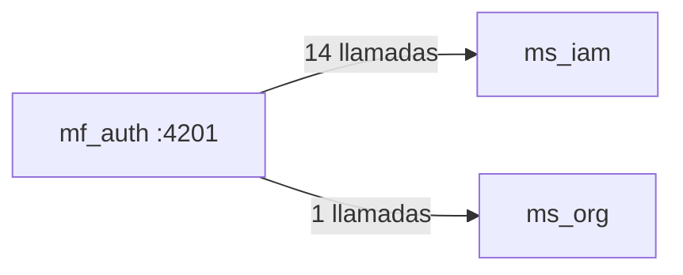

# 08 · Mapa de rutas, permisos y endpoints — `mf_auth`

Puerto local `:4201` · **9 rutas** · **15 llamadas HTTP distintas** a 2 microservicio(s).

> Generado desde `src/app/app.routes.ts` y las llamadas `HttpClient` del código. La UI oculta lo que el rol no puede hacer, pero la autorización real siempre la valida el backend.

## Rutas y pantallas

| Ruta | Pantalla (componente) | Título visible | Requiere sesión | Permiso |
|---|---|---|---|---|
| `/login` | `LoginPageComponent` | Iniciar sesión | No | — |
| `/welcome` | `WelcomePageComponent` | Bienvenido | No | — |
| `/setup-2fa` | `Setup2FAPageComponent` | Configurar 2FA | No | — |
| `/verify-2fa` | `Verify2FAPageComponent` | Verificar código | No | — |
| `/change-password` | `ChangePasswordPageComponent` | Cambiar contraseña | No | — |
| `/consent` | `ConsentPageComponent` | Antes de continuar | No | — |
| `/users` | `UserListPageComponent` | Usuarios | Sí | Gestión de usuarios |
| `/users/new` | `UserFormPageComponent` | — | Sí | Gestión de usuarios |
| `/users/:id` | `UserFormPageComponent` | — | Sí | Gestión de usuarios |

## Matriz rol × permiso usado en este microfrontend

| Rol | Gestión de usuarios |
|---|---|
| AdminSistema | ✅ |
| AdminInstrumento | — |
| Evaluador | — |
| Revisor | — |
| EvaluadorRevisor | — |
| Lector | — |

Fuente: `ROLE_AUTHORITIES` (`mf_shell/src/app/domain/dashboard/authority.ts`), replicado en cada microfrontend.

## Endpoints de backend consumidos

| Microservicio | Método | Ruta | Archivo(s) |
|---|---|---|---|
| `ms_iam` | `GET` | `/auth/consent/status` | `infrastructure/auth/api-auth.repository.ts` |
| `ms_iam` | `GET` | `/auth/totp/status` | `infrastructure/auth/api-auth.repository.ts` |
| `ms_iam` | `GET` | `/roles` | `infrastructure/roles/api-roles.repository.ts` |
| `ms_iam` | `GET` | `/users` | `infrastructure/users/api-user.repository.ts` |
| `ms_iam` | `GET` | `/users/{id}` | `infrastructure/users/api-user.repository.ts` |
| `ms_iam` | `PATCH` | `/users/{id}/status` | `infrastructure/users/api-user.repository.ts` |
| `ms_iam` | `POST` | `/auth/change-password` | `infrastructure/auth/api-auth.repository.ts` |
| `ms_iam` | `POST` | `/auth/consent` | `infrastructure/auth/api-auth.repository.ts` |
| `ms_iam` | `POST` | `/auth/login` | `infrastructure/auth/api-auth.repository.ts` |
| `ms_iam` | `POST` | `/auth/totp/setup` | `infrastructure/auth/api-auth.repository.ts` |
| `ms_iam` | `POST` | `/auth/totp/verify` | `infrastructure/auth/api-auth.repository.ts` |
| `ms_iam` | `POST` | `/users` | `infrastructure/users/api-user.repository.ts` |
| `ms_iam` | `POST` | `/users/{id}/password-reset-requests` | `infrastructure/users/api-user.repository.ts` |
| `ms_iam` | `PUT` | `/users/{id}` | `infrastructure/users/api-user.repository.ts` |
| `ms_org` | `GET` | `/organizations` | `infrastructure/organizations/api-organization-list.repository.ts` |

**Contexto.** Cada flecha resume cuántas operaciones distintas de ese microservicio usa esta interfaz. Todas viajan con el token JWT de la sesión, que el shell comparte con el iframe por `postMessage`.

---

Ver también: [`03-Diseno.md`](03-Diseno.md) · [Referencia de API](../../Documentacion-General/08-Referencia-API.md)
