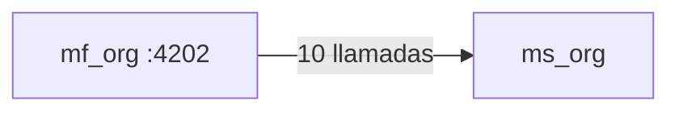

# 08 · Mapa de rutas, permisos y endpoints — `mf_org`

Puerto local `:4202` · **4 rutas** · **10 llamadas HTTP distintas** a 1 microservicio(s).

> Generado desde `src/app/app.routes.ts` y las llamadas `HttpClient` del código. La UI oculta lo que el rol no puede hacer, pero la autorización real siempre la valida el backend.

## Rutas y pantallas

| Ruta | Pantalla (componente) | Título visible | Requiere sesión | Permiso |
|---|---|---|---|---|
| `/my-organization` | `MyOrganizationPageComponent` | Mi organización | Sí | Sesión |
| `/organizations` | `OrganizationListPageComponent` | Organizaciones | Sí | Gestión de organizaciones |
| `/organizations/new` | `OrganizationFormPageComponent` | — | Sí | Gestión de organizaciones |
| `/organizations/:id` | `OrganizationFormPageComponent` | — | Sí | Gestión de organizaciones |

## Matriz rol × permiso usado en este microfrontend

| Rol | Gestión de organizaciones |
|---|---|
| AdminSistema | ✅ |
| AdminInstrumento | — |
| Evaluador | — |
| Revisor | — |
| EvaluadorRevisor | — |
| Lector | — |

Fuente: `ROLE_AUTHORITIES` (`mf_shell/src/app/domain/dashboard/authority.ts`), replicado en cada microfrontend.

## Endpoints de backend consumidos

| Microservicio | Método | Ruta | Archivo(s) |
|---|---|---|---|
| `ms_org` | `GET` | `/location/countries` | `infrastructure/api-location.repository.ts` |
| `ms_org` | `GET` | `/location/countries/{id}/states` | `infrastructure/api-location.repository.ts` |
| `ms_org` | `GET` | `/location/countries/{id}/states/{id}/cities` | `infrastructure/api-location.repository.ts` |
| `ms_org` | `GET` | `/organizations` | `infrastructure/api-organization.repository.ts` |
| `ms_org` | `GET` | `/organizations/my-organization` | `infrastructure/api-organization.repository.ts` |
| `ms_org` | `GET` | `/organizations/{id}` | `infrastructure/api-organization.repository.ts` |
| `ms_org` | `GET` | `/organizations/{id}/areas-base` | `infrastructure/areas-base/api-areas-base.repository.ts` |
| `ms_org` | `POST` | `/organizations` | `infrastructure/api-organization.repository.ts` |
| `ms_org` | `PUT` | `/organizations/{id}` | `infrastructure/api-organization.repository.ts` |
| `ms_org` | `PUT` | `/organizations/{id}/areas-base` | `infrastructure/areas-base/api-areas-base.repository.ts` |

**Contexto.** Cada flecha resume cuántas operaciones distintas de ese microservicio usa esta interfaz. Todas viajan con el token JWT de la sesión, que el shell comparte con el iframe por `postMessage`.

---

Ver también: [`03-Diseno.md`](03-Diseno.md) · [Referencia de API](../../Documentacion-General/08-Referencia-API.md)
