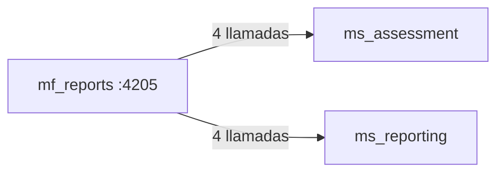

# 08 · Mapa de rutas, permisos y endpoints — `mf_reports`

Puerto local `:4205` · **3 rutas** · **8 llamadas HTTP distintas** a 2 microservicio(s).

> Generado desde `src/app/app.routes.ts` y las llamadas `HttpClient` del código. La UI oculta lo que el rol no puede hacer, pero la autorización real siempre la valida el backend.

## Rutas y pantallas

| Ruta | Pantalla (componente) | Título visible | Requiere sesión | Permiso |
|---|---|---|---|---|
| `/reports` | `ReportsHomePageComponent` | Reportes MSPI | Sí | Exportar reportes |
| `/assessments/:id/dashboard` | `DiagnosticDashboardPageComponent` | — | Sí | Exportar reportes |
| `/assessments/:id/export` | `ReportsExportPageComponent` | Exportar reportes | Sí | Exportar reportes |

## Matriz rol × permiso usado en este microfrontend

| Rol | Exportar reportes |
|---|---|
| AdminSistema | ✅ |
| AdminInstrumento | ✅ |
| Evaluador | ✅ |
| Revisor | ✅ |
| EvaluadorRevisor | ✅ |
| Lector | ✅ |

Fuente: `ROLE_AUTHORITIES` (`mf_shell/src/app/domain/dashboard/authority.ts`), replicado en cada microfrontend.

## Endpoints de backend consumidos

| Microservicio | Método | Ruta | Archivo(s) |
|---|---|---|---|
| `ms_assessment` | `GET` | `/assessments` | `presentation/pages/reports-home-page.component.ts` |
| `ms_assessment` | `GET` | `/assessments/{id}` | `infrastructure/reporting/api-reporting.repository.ts`, `presentation/pages/reports-export-page.component.ts` |
| `ms_assessment` | `GET` | `/assessments/{id}/diagnostic/dashboard` | `infrastructure/reporting/api-reporting.repository.ts` |
| `ms_assessment` | `GET` | `/assessments/{id}/gaps` | `infrastructure/reporting/api-reporting.repository.ts` |
| `ms_reporting` | `GET` | `/reports/jobs/{id}` | `infrastructure/reporting/api-reporting.repository.ts` |
| `ms_reporting` | `GET` | `/reports/jobs/{id}/download` | `infrastructure/reporting/api-reporting.repository.ts` |
| `ms_reporting` | `POST` | `/reports/comparative/jobs` | `infrastructure/reporting/api-reporting.repository.ts` |
| `ms_reporting` | `POST` | `/reports/jobs` | `infrastructure/reporting/api-reporting.repository.ts` |

**Contexto.** Cada flecha resume cuántas operaciones distintas de ese microservicio usa esta interfaz. Todas viajan con el token JWT de la sesión, que el shell comparte con el iframe por `postMessage`.

---

Ver también: [`03-Diseno.md`](03-Diseno.md) · [Referencia de API](../../Documentacion-General/08-Referencia-API.md)
