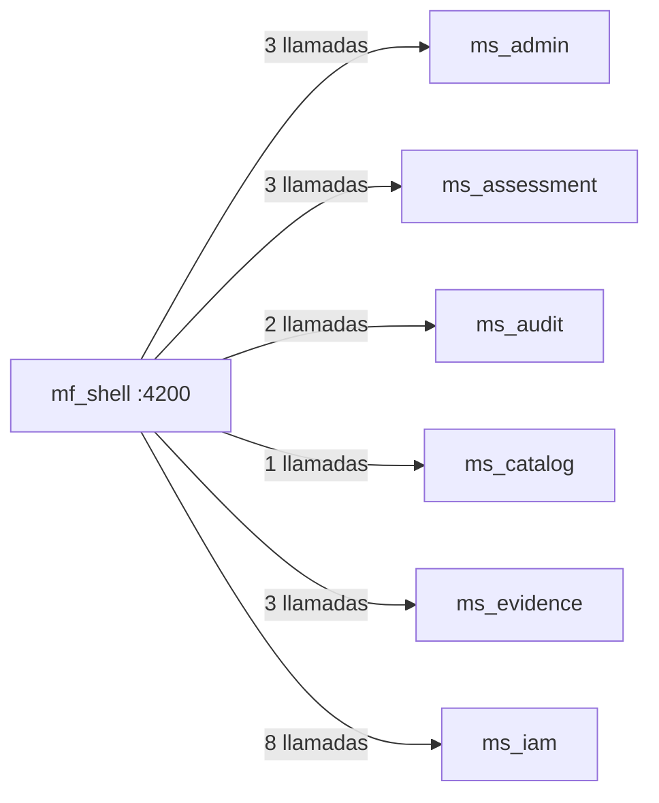

# 08 · Mapa de rutas, permisos y endpoints — `mf_shell`

Puerto local `:4200` · **17 rutas** · **20 llamadas HTTP distintas** a 6 microservicio(s).

> Generado desde `src/app/app.routes.ts` y las llamadas `HttpClient` del código. La UI oculta lo que el rol no puede hacer, pero la autorización real siempre la valida el backend.

## Rutas y pantallas

| Ruta | Pantalla (componente) | Título visible | Requiere sesión | Permiso |
|---|---|---|---|---|
| `/` | `ShellLayoutComponent` | — | Sí | Sesión |
| `/dashboard` | `DashboardPageComponent` | — | Sí | Sesión |
| `/users` | `UsersRedirectComponent` | — | Sí | Gestión de usuarios |
| `/organizations` | `OrganizationsRedirectComponent` | — | Sí | Gestión de organizaciones |
| `/my-organization` | `MyOrganizationRedirectComponent` | — | Sí | Sesión |
| `/evaluations` | `EvaluationsRedirectComponent` | — | Sí | Ver evaluaciones |
| `/evaluations/my-assigned` | `MyAssignedRedirectComponent` | — | Sí | Ver evaluaciones |
| `/evidence` | `EvidenceRedirectComponent` | — | Sí | Ver evaluaciones |
| `/reports` | `ReportsRedirectComponent` | — | Sí | Exportar reportes |
| `/scales` | `ScalesRedirectComponent` | — | Sí | Gestión de plantillas |
| `/security-baseline` | `SecurityBaselineRedirectComponent` | — | Sí | Gestión de plantillas |
| `/audit` | `AuditPageComponent` | Auditoría del sistema | Sí | Ver auditoría |
| `/audit/requests` | `AuditRequestsPageComponent` | Solicitudes | Sí | Ver auditoría |
| `/audit/requests/:requestNumber` | `AuditRequestDetailPageComponent` | Detalle de solicitud | Sí | Ver auditoría |
| `/system-settings` | `SystemSettingsPageComponent` | Parámetros del sistema | Sí | Solo AdminSistema |
| `/login` | `LoginPlaceholderComponent` (redirige a mf_auth) | — | No | — |
| `/privacidad` | `PrivacyPageComponent` | — | No | — |

## Matriz rol × permiso usado en este microfrontend

| Rol | Ver evaluaciones | Ver auditoría | Gestión de organizaciones | Exportar reportes | Solo AdminSistema | Gestión de plantillas | Gestión de usuarios |
|---|---|---|---|---|---|---|---|
| AdminSistema | ✅ | ✅ | ✅ | ✅ | ✅ | ✅ | ✅ |
| AdminInstrumento | ✅ | — | — | ✅ | — | ✅ | — |
| Evaluador | ✅ | — | — | ✅ | — | — | — |
| Revisor | ✅ | — | — | ✅ | — | — | — |
| EvaluadorRevisor | ✅ | — | — | ✅ | — | — | — |
| Lector | ✅ | — | — | ✅ | — | — | — |

Fuente: `ROLE_AUTHORITIES` (`mf_shell/src/app/domain/dashboard/authority.ts`), replicado en cada microfrontend.

## Endpoints de backend consumidos

| Microservicio | Método | Ruta | Archivo(s) |
|---|---|---|---|
| `ms_admin` | `GET` | `/system/config` | `infrastructure/admin/api-system-config.repository.ts`, `infrastructure/dashboard/dashboard-stats.service.ts` |
| `ms_admin` | `GET` | `/system/config/history` | `infrastructure/admin/api-system-config.repository.ts` |
| `ms_admin` | `PUT` | `/system/config` | `infrastructure/admin/api-system-config.repository.ts` |
| `ms_assessment` | `GET` | `/assessments/my-assigned` | `infrastructure/dashboard/dashboard-stats.service.ts` |
| `ms_assessment` | `GET` | `/deletion-requests` | `infrastructure/admin/api-request-tray.repository.ts` |
| `ms_assessment` | `GET` | `/extension-requests` | `infrastructure/admin/api-request-tray.repository.ts` |
| `ms_audit` | `GET` | `/audit/events` | `infrastructure/admin/api-audit.repository.ts` |
| `ms_audit` | `GET` | `/audit/requests/{id}` | `infrastructure/admin/api-audit.repository.ts` |
| `ms_catalog` | `GET` | `/catalog/deletion-requests` | `infrastructure/admin/api-request-tray.repository.ts` |
| `ms_evidence` | `GET` | `/assessments/{id}/files` | `infrastructure/dashboard/dashboard-stats.service.ts` |
| `ms_evidence` | `GET` | `/assessments/{id}/lifting-document-deliveries` | `infrastructure/dashboard/dashboard-stats.service.ts` |
| `ms_evidence` | `GET` | `/files/{id}/download` | `application/admin/download-request-attachment.use-case.ts` |
| `ms_iam` | `GET` | `/notifications` | `infrastructure/notifications/api-notification.repository.ts` |
| `ms_iam` | `GET` | `/password-reset-requests` | `infrastructure/admin/api-request-tray.repository.ts` |
| `ms_iam` | `POST` | `/notifications/clear-read` | `infrastructure/notifications/api-notification.repository.ts` |
| `ms_iam` | `POST` | `/notifications/read-all` | `infrastructure/notifications/api-notification.repository.ts` |
| `ms_iam` | `POST` | `/notifications/{id}/clear` | `infrastructure/notifications/api-notification.repository.ts` |
| `ms_iam` | `POST` | `/notifications/{id}/read` | `infrastructure/notifications/api-notification.repository.ts` |
| `ms_iam` | `POST` | `/password-reset-requests/{id}/approve` | `infrastructure/admin/api-request-tray.repository.ts` |
| `ms_iam` | `POST` | `/password-reset-requests/{id}/reject` | `infrastructure/admin/api-request-tray.repository.ts` |

**Contexto.** Cada flecha resume cuántas operaciones distintas de ese microservicio usa esta interfaz. Todas viajan con el token JWT de la sesión, que el shell comparte con el iframe por `postMessage`.

---

Ver también: [`03-Diseno.md`](03-Diseno.md) · [Referencia de API](../../Documentacion-General/08-Referencia-API.md)
