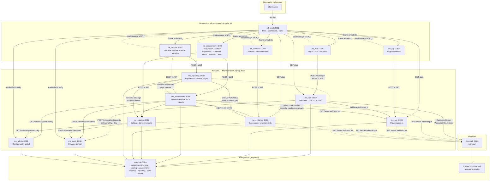
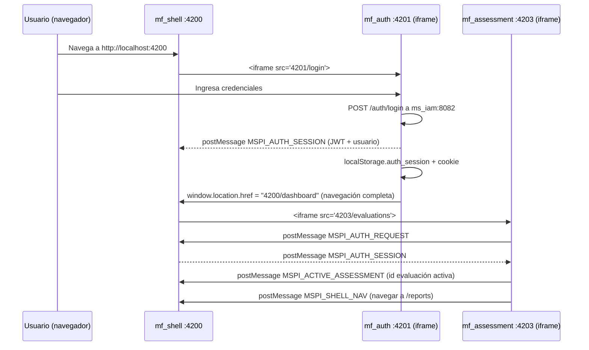
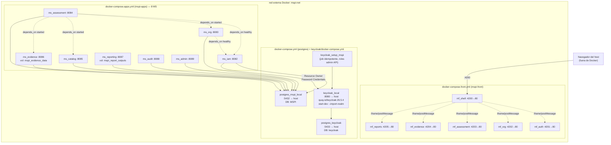
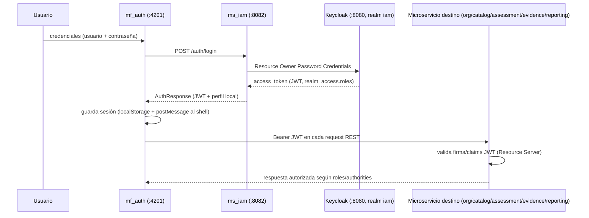
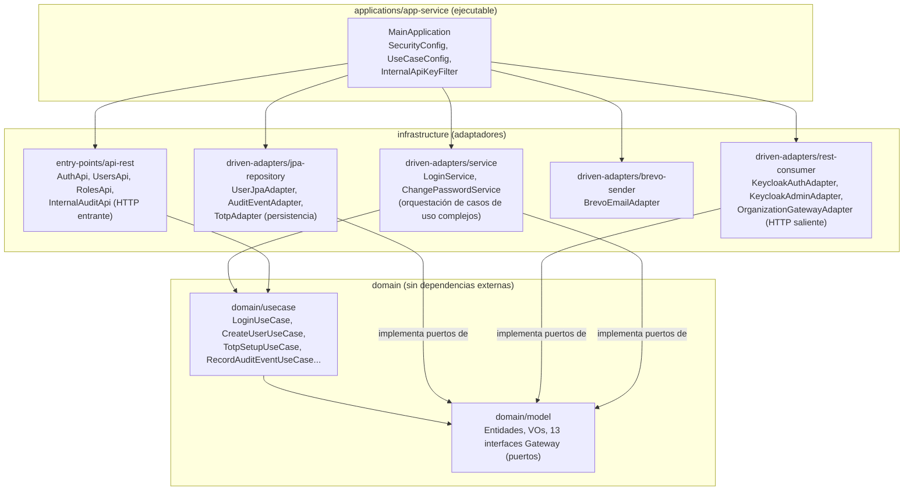

# Arquitectura General del Sistema — Proyecto MSPI

**Documento de nivel de proyecto completo** (no por microservicio individual)

| Campo | Valor |
|---|---|
| Proyecto de grado | MSPI — Modelo de Seguridad y Privacidad de la Información |
| Estudiantes | Bairon Alexander Suarez Camacho, Juan Diego Tovar Rodriguez |
| Programa académico | Ingeniería de Sistemas |
| Dirigido a | Profesor/asesor de trabajo de grado |
| Fuentes primarias | `Documentacion-investigacion/Documento-Investigacion.md`; los 8 `03-Diseno.md` de `Documentacion-Backend/`; los 6 `03-Diseno.md` de `Documentacion-Frontend/`; [MER-MSPI (dbdocs)](https://dbdocs.io/jdtovar-2021a/MER-MSPI); `Documentacion-General/MER-MSPI.sql`; `MSPI_NVA_CO_MR_BACK/docs/proyecto/DB-MER.txt` y `DBvsExcel.md`; `docker-compose.apps.yml` / `docker-compose.front.yml` / `docker-compose.yml` (postgres, keycloak) |

> **Nota de trazabilidad.** Cada afirmación técnica de este documento cita, entre paréntesis, el archivo del repositorio en el que se verificó. Cuando un dato no pudo confirmarse en ningún documento fuente, se declara explícitamente como no verificado en lugar de asumirse.

---

## 1. Resumen ejecutivo

MSPI es una plataforma web que automatiza el **Instrumento de Identificación de la Línea Base de Seguridad MSPI** de MinTIC Colombia (hoja de cálculo Excel de nueve pestañas), reemplazando el diligenciamiento manual por una aplicación con motor de cálculo centralizado, trazabilidad de evidencias y control de acceso basado en roles (`Documento-Investigacion.md`, secc. 2 y 4).

El sistema se construyó bajo dos estilos arquitectónicos combinados:

- **Backend de microservicios** (Java 21 / Spring Boot, arquitectura hexagonal): **8 microservicios activos** con puerto y esquema propios — `ms_iam` 8082, `ms_org` 8083, `ms_assessment` 8084, `ms_catalog` 8085, `ms_evidence` 8086, `ms_reporting` 8087, `ms_audit` 8088, `ms_admin` 8089 — verificados en `MSPI_NVA_CO_MR_BACK/ms_*/applications/app-service/.../application.yaml` y `docker-compose.apps.yml`.
- **Frontend de microfrontends** (Angular 19): **6** aplicaciones independientes compuestas por un *shell* host. Composición **canónica**: **iframes + `window.postMessage`** vía `shell-iframe-bridge.ts` (y bridges hijos), con respaldo de sesión en `localStorage`/cookie. **Module Federation** se contempla solo como **evolución futura** (`docs/INTEGRACION-SHELL.md`). Verificado en los 6 MF (`Documentacion-Frontend/*/03-Diseno.md`; secc. 4 y [`15-Diagramas-C4-y-Secuencias.md`](15-Diagramas-C4-y-Secuencias.md)).

La base de datos es una única instancia PostgreSQL particionada en **ocho esquemas** (`iam`, `org`, `catalog`, `assessment`, `evidence`, `reporting`, `audit`, `admin`), cada uno propiedad de un microservicio. Las tablas `audit.audit_log` y `admin.system_config(_history)` se migraron desde `iam.*` vía `patch-audit-schema.sql` / `patch-admin-schema.sql` (UUID sin FK cross-dominio). El MER consolidado (`MER-MSPI.sql` / `.dbml` / `.svg`) incluye `iam.password_reset_request` y columnas `request_number` (`SOL-ELIM` / `SOL-AMPL` / `SOL-CAT` / `SOL-PWD`) derivadas de los `patch-*.sql` del init Docker. El MER interactivo está en [dbdocs.io/jdtovar-2021a/MER-MSPI](https://dbdocs.io/jdtovar-2021a/MER-MSPI); la fuente SQL local es [`MER-MSPI.sql`](MER-MSPI.sql). La identidad se delega a **Keycloak** como IdP externo (realm `iam`), y el sistema aplica sobre sí mismo controles de seguridad equivalentes a los que audita (2FA/TOTP, auditoría centralizada) — coherencia señalada en `Documento-Investigacion.md`, secc. 4. Flujos de radicado/auditoría: [`14-Flujos-Solicitudes-Auditoria-y-Seguridad.md`](14-Flujos-Solicitudes-Auditoria-y-Seguridad.md).

---

## 2. Arquitectura de alto nivel (diagrama de contenedores, estilo C4)



**Fuentes del diagrama:** puertos y dependencias `depends_on` de `docker-compose.apps.yml` y `docker-compose.front.yml`; flujo de auditoría interna verificado en `Documentacion-Backend/ms_audit/03-Diseno.md` (`POST /internal/audit/events`, cabecera `X-Internal-Api-Key`); mecanismo iframe/postMessage verificado en `Documentacion-Frontend/mf_shell/03-Diseno.md`; relación IdP/Resource Server en `Documento-Investigacion.md` secc. 7 y `docker-config/docs/docker/keycloak/README.md`.

---

## 3. Microservicios backend

| Microservicio | Puerto | Estado | Responsabilidad | Esquema BD propio |
|---|---|---|---|---|
| `ms_iam` | 8082 | **Activo** | Autenticación (Keycloak), perfil local, 2FA/TOTP, usuarios/roles, solicitudes `SOL-PWD`, correo Brevo | `iam` |
| `ms_org` | 8083 | **Activo** | CRUD de organizaciones/entidades evaluadas, contactos, geografía, áreas base reutilizables | `org` |
| `ms_catalog` | 8085 | **Activo** | Catálogo versionado del instrumento; solicitudes `SOL-CAT` de eliminación lógica | `catalog` |
| `ms_assessment` | 8084 | **Activo** | Ciclo de vida de evaluación, cálculo, solicitudes `SOL-ELIM` / `SOL-AMPL` | `assessment` |
| `ms_evidence` | 8086 | **Activo** | Contexto/misión, levantamiento documental, archivos multipart (soft-delete) | `evidence` |
| `ms_reporting` | 8087 | **Activo** | Generación asíncrona de reportes PDF/Excel, jobs con *polling*, comparativos | `reporting` |
| `ms_audit` | 8088 | **Activo** | Bitácora central `audit.audit_log`; consulta admin + ingesta S2S; timeline por `requestNumber` | `audit` |
| `ms_admin` | 8089 | **Activo** | Configuración global `admin.system_config` (+ historial); plazos/gracia consumidos por assessment/catalog | `admin` |

Fuente: `Documentacion-Backend/ms_admin/` y `Documentacion-Backend/ms_audit/`; `ms_audit/.../application.yaml` (`SERVER_PORT:8088`); `ms_admin/.../application.yaml` (`SERVER_PORT:8089`); migraciones `patch-audit-schema.sql` / `patch-admin-schema.sql`.

### 3.1 Dependencias de arranque entre microservicios (Docker Compose)

`docker-compose.apps.yml` declara explícitamente `depends_on`:

- `ms_org` → espera `ms_iam` (`service_healthy`).
- `ms_assessment` → espera `ms_iam` (`service_healthy`), `ms_org`, `ms_catalog`, `ms_evidence` (`service_started`).
- `ms_catalog`, `ms_evidence`, `ms_reporting` no declaran dependencias de arranque explícitas en el compose, aunque a nivel funcional `ms_reporting` consume `ms_assessment`/`ms_catalog`/`ms_evidence` en tiempo de ejecución (`DBvsExcel.md`, secc. "Por qué existe reporting.* si ya está todo en assessment"; `DB-MER.txt` comentario Módulo 9: *"Sin duplicar scores: ms_reporting consume ms_assessment / ms_catalog / ms_evidence vía REST interno"*).

---

## 4. Microfrontends

| Microfrontend | Puerto (dev) | Responsabilidad | Integración con el shell |
|---|---|---|---|
| `mf_shell` | 4200 | Host/orquestador: layout, menú, guards de ruta y autoridad, tarjetas de dashboard por rol, componentes `*-redirect` que embeben cada MF hijo en un `<iframe>` | Es el host — implementa `shell-iframe-bridge.ts`, el protocolo de mensajería `postMessage` y la lista blanca de orígenes |
| `mf_auth` | 4201 | Login, 2FA (setup/verify TOTP), cambio de contraseña, gestión de usuarios | Iframe hijo; tras login navega a `:4200/dashboard` (`window.location.href`) |
| `mf_org` | 4202 | CRUD de organizaciones; vista de solo lectura `/my-organization` | Iframe hijo; consume sesión (no la origina) |
| `mf_assessment` | 4203 | Wizard de evaluación y tablero de diagnóstico consolidado | Iframe hijo; `MSPI_ACTIVE_ASSESSMENT`, `MSPI_SHELL_NAV` |
| `mf_evidence` | 4204 | Contexto/misión y levantamiento documental | Iframe hijo; `MSPI_AUTH_REQUEST` → `MSPI_AUTH_SESSION` |
| `mf_reports` | 4205 | Generación/descarga de reportes (jobs PDF/Excel) | Iframe hijo |

**Composición frontend (canónica, los 6 MF):**

1. **`<iframe>`** — el shell embebe cada hijo (`*-redirect.component.ts` → `http://localhost:420X/…`).
2. **`postMessage`** — protocolo `MSPI_AUTH_SESSION` / `MSPI_AUTH_REQUEST` / `MSPI_ACTIVE_ASSESSMENT` / `MSPI_SHELL_NAV` en `shell-iframe-bridge.ts` (+ bridges hijos). Orígenes allowlist `http://(localhost|127.0.0.1):420[1-5]`.
3. **Sesión** — `localStorage`/`cookie` de respaldo (puertos distintos no comparten storage nativo).

`docs/INTEGRACION-SHELL.md`: *"Modelo actual: iframe (no Module Federation activo)"*; Module Federation = **evolución futura**. Árboles `src/federated/*` (plantilla React/Vite) son **código muerto**, no la arquitectura en producción. Diagramas: [`15-Diagramas-C4-y-Secuencias.md`](15-Diagramas-C4-y-Secuencias.md).



Fuente: `Documentacion-Frontend/mf_shell/03-Diseno.md`, `Documentacion-Frontend/mf_auth/03-Diseno.md`, `Documentacion-Frontend/mf_assessment/03-Diseno.md`, `Documentacion-Frontend/mf_evidence/03-Diseno.md`, `Documentacion-Frontend/mf_reports/03-Diseno.md`, `Documentacion-Frontend/mf_org/03-Diseno.md`.

---

## 5. Diagrama de despliegue (Docker Compose real)



**Notas de despliegue verificadas:**
- Backend: imagen build multi-stage `eclipse-temurin:21-jdk-alpine` → `-jre-alpine` (excepción: `ms_reporting` → `-jre-jammy` + LibreOffice; `Documento-Investigacion.md`, tabla marco tecnológico).
- Frontend: `Node 22-alpine` (build) + `Nginx 1.27-alpine` (runtime) — cada MF corre en su propio contenedor Nginx en el puerto interno 80, mapeado a 420X en el host.
- Todos los contenedores comparten la red externa `mspi-net`, creada manualmente antes de levantar los *compose stacks* (`docker network create mspi-net`).
- Persistencia por volúmenes nombrados: `mspi_evidence_data` (archivos de evidencia), `mspi_report_outputs` (PDF/Excel generados), `mspi_pgdata` y `mspi_pgdata_keycloak`.
- El frontend construye desde un repositorio hermano configurable por variable de entorno `MSPI_FRONT_ROOT` (por defecto `../../../MSPI_NVA_CO_MR_FRONT`), evidenciando que backend y frontend son repositorios físicamente separados.

Fuente: `docker-compose.apps.yml`, `docker-compose.front.yml`, `docker-config/docker/postgres/docker-compose.yml`, `docker-config/docker/keycloak/docker-compose.yml`.

---

## 6. Arquitectura de seguridad

### 6.1 Keycloak como IdP y flujo de autenticación

- Keycloak (`quay.io/keycloak/keycloak:26.5.4`) corre como contenedor independiente con su propia base de datos PostgreSQL (`postgres_keycloak`, puerto host 5433), realm principal **`iam`**, importado desde `docker-config/docker/keycloak/imports/iam-realm.json` al arrancar (`docker-config/docs/docker/keycloak/README.md`).
- `ms_iam` actúa como intermediario: el login del usuario (`mf_auth` → `POST /auth/login` en `ms_iam:8082`) usa el flujo **Resource Owner Password Credentials** contra Keycloak (`Documento-Investigacion.md`, tabla marco tecnológico, fila "Identidad / IdP"), y `ms_iam` traduce la respuesta de Keycloak a un `LoginResult`/`AuthResponse` de dominio (`KeycloakAuthAdapter`, `Documentacion-Backend/ms_iam/03-Diseno.md` §3).
- El resto de microservicios (`ms_org`, `ms_catalog`, `ms_assessment`, `ms_evidence`, `ms_reporting`) actúan como **Resource Server OAuth2**: validan el JWT emitido por Keycloak directamente (Spring Security + `spring-security-oauth2-resource-server-jose`), sin volver a autenticar contra `ms_iam`.
- Los roles de negocio viajan en el claim `realm_access.roles` del JWT (`Documento-Investigacion.md`, secc. 4), y el `organization_id` del usuario (obligatorio para el rol `Lector`) viaja como claim adicional, validado contra `ms_org` al crearse (`iam.user.organization_id`, `DB-MER.txt` línea 226).



### 6.2 RBAC — 5 roles de negocio

El sistema define **5 roles de negocio** con autoridades diferenciadas (`Documento-Investigacion.md` secc. 4; confirmado en `Documentacion-Backend/ms_iam/03-Diseno.md`, tabla `iam.role` de `DB-MER.txt` línea 245-250 con nota *"AdminSistema|AdminInstrumento|Evaluador|Revisor|Lector"*):

| Rol | Autoridades principales | Alcance |
|---|---|---|
| `AdminSistema` | Todas (`USER_MANAGE`, `ORG_MANAGE`, `TEMPLATE_MANAGE`, `ASSESSMENT_EDIT`, `ASSESSMENT_REVIEW`, `REPORT_EXPORT`, `AUDIT_VIEW`) | Acceso total, sin restricción de membresía en evaluaciones |
| `AdminInstrumento` | `TEMPLATE_MANAGE`, `REPORT_EXPORT` | Gestión de catálogo/plantillas; no gestiona usuarios ni edita evaluaciones directamente |
| `Evaluador` | `ASSESSMENT_EDIT`, `REPORT_EXPORT` | Solo evaluaciones donde es miembro (`assessment.assessment_member.member_role = EVALUATOR`) |
| `Revisor` | `ASSESSMENT_REVIEW`, `REPORT_EXPORT` | Solo evaluaciones donde es miembro `REVIEWER`; revisa y comenta, no edita |
| `Lector` | `REPORT_EXPORT` | Solo lectura de evaluaciones donde es miembro `READER`; vinculado obligatoriamente a una `organization_id` |

> **Nota de trazabilidad:** la tabla de autoridades y el detalle de restricciones por rol provienen de `MSPI_NVA_CO_MR_FRONT/Mspijdbs/RBAC-GUIDE.md`, que forma parte del **prototipo Figma Make** (documentación de exploración UI/UX, no del código Angular de producción — ver `Documento-Investigacion.md` secc. 10.4). El modelo de datos real de roles (`iam.role`, `iam.user_role`) y el mecanismo de membresía por evaluación (`assessment.assessment_member`) sí están confirmados en `DB-MER.txt` (líneas 245-260, 1069-1081) y en `Documentacion-Backend/ms_iam/03-Diseno.md`; la tabla exacta de autoridades por rol debe considerarse consistente con el diseño pero no 100% verificada en código Spring de `ms_iam` en el material revisado para este documento.

### 6.3 Segundo factor de autenticación (2FA/TOTP)

- `ms_iam` implementa TOTP con `java-otp 0.4.0` + `commons-codec` (`Documento-Investigacion.md`, tabla tecnológica), persistiendo el secreto en `iam.user_totp` (clave primaria `keycloak_sub`, columna `secret` Base32, `enabled_at` nulo hasta la primera verificación — `DB-MER.txt` líneas 262-267).
- Casos de uso dedicados: `TotpSetupUseCase`, `TotpStatusUseCase`, `TotpVerifyUseCase` (`Documentacion-Backend/ms_iam/03-Diseno.md` §2).
- Justificación documentada del propio proyecto: alineación con "los lineamientos de la línea base de seguridad ISO 27001 del proyecto" — el sistema aplica sobre sí mismo el mismo tipo de control de acceso que audita (`Documento-Investigacion.md` secc. 4).

### 6.4 Auditoría centralizada

- **`ms_audit` (:8088)** posee `audit.audit_log` (migrado desde `iam.audit_log` vía `patch-audit-schema.sql`). Ingesta S2S: `POST /internal/audit/events` + `X-Internal-Api-Key`. Consulta admin: `GET /audit/events` y `GET /audit/requests/{requestNumber}` (JWT `AdminSistema`) — `ms_audit/.../AuditApi.java`, `InternalAuditApi.java`.
- Productores verificados: `ms_iam` (`AuditAuthRestAdapter`, `AuditGatewayAdapter`), `ms_assessment` y `ms_catalog` (`AuditGatewayAdapter`) → `MS_AUDIT_URL`.
- Correlación de solicitudes por `metadata_json.requestNumber` (prefijos `SOL-ELIM` / `SOL-AMPL` / `SOL-PWD` / `SOL-CAT`). Detalle en [`14-Flujos-Solicitudes-Auditoria-y-Seguridad.md`](14-Flujos-Solicitudes-Auditoria-y-Seguridad.md).

---

## 7. Patrones arquitectónicos aplicados

### 7.1 Arquitectura hexagonal / Clean Architecture (backend)

Verificada en código real de `ms_iam` como **build multi-módulo de Gradle** (no solo convención de carpetas): cada capa es un subproyecto Gradle independiente con dependencias declaradas físicamente, lo que impone la regla de dependencia en tiempo de compilación (`Documentacion-Backend/ms_iam/03-Diseno.md` §1).



**Regla de dependencia observada (confirmada en `build.gradle` de cada módulo):**
```
applications/app-service  → depende de todos los módulos
infrastructure/*          → depende de domain/model (+ domain/usecase en api-rest)
domain/usecase             → depende de domain/model
domain/model                sin dependencias (POJOs + Lombok + java.time/util)
```

La estructura multi-módulo Gradle aplica **arquitectura hexagonal / Clean Architecture (puertos y adaptadores) por convención de carpetas** (`domain/model`, `domain/usecase`, `infrastructure/*`, `applications/app-service`) — `Documentacion-Backend/ms_iam/03-Diseno.md` §1. Los ocho microservicios activos (`ms_iam`, `ms_org`, `ms_catalog`, `ms_evidence`, `ms_assessment`, `ms_reporting`, `ms_audit`, `ms_admin`) reproducen el mismo layout.

### 7.2 Separación catálogo vs. ejecución (patrón de snapshot)

Ver sección 3 del documento `02-Modelo-de-Dominio.md` para el detalle completo. En resumen: `catalog.*` es la "plantilla vacía" versionable del instrumento; `assessment.*` + `evidence.*` son la "instancia congelada" de una evaluación concreta, copiada al crear la evaluación para que actualizaciones futuras del instrumento no alteren evaluaciones históricas ya publicadas (`DBvsExcel.md` secc. 3; `DB-MER.txt`, nota de `catalog.control_catalog_node`).

### 7.3 Bloqueo optimista (optimistic locking)

Implementado mediante el campo `row_version` en `assessment.assessment` (incrementado en cada `PATCH`, `DB-MER.txt` línea 1006) y campos `version` equivalentes en `control_response`, `phva_item_response`, `assessment_maturity_requirement_response`, `nist_ciber_item_response`, `lifting_answer`, `lifting_document_delivery`, `evidence.assessment_context`. El sistema responde `HTTP 409` ante conflicto de versión, resolviendo directamente el caso borde documentado: *"Dos evaluadores no pueden editar simultáneamente la misma evaluación"* (`Documento-Investigacion.md` secc. 2, punto 2). Complementariamente existe un mecanismo de **bloqueo pesimista opcional** (`assessment.assessment_edit_lock`, con `lock_token` y `expires_at`, `DB-MER.txt` líneas 1052-1067), documentado como estrategia complementaria, no sustitutiva, del bloqueo optimista.

---

## 8. Stack tecnológico — cómo encajan las piezas

| Capa | Tecnología | Cómo se integra en la arquitectura |
|---|---|---|
| Lenguaje / runtime backend | Java 21 sobre `eclipse-temurin:21-jdk-alpine` (build) → `-jre-alpine` (runtime); **excepción:** `ms_reporting` usa `-jre-jammy` + LibreOffice Calc | Cada uno de los 8 microservicios activos compila a un JAR ejecutable independiente, empaquetado en su propia imagen Docker |
| Framework backend | Spring Boot 4.0.2 (Spring MVC, servlet) | Expone los `entry-points/api-rest` de cada microservicio; `SecurityConfig` en `applications/app-service` configura el filtro OAuth2 Resource Server |
| Build multi-módulo | Gradle 9.3.0 | Materializa físicamente las capas hexagonales como subproyectos con dependencias unidireccionales verificables en tiempo de compilación |
| Seguridad backend | Spring Security + OAuth2 Resource Server (JWT) | Cada microservicio (excepto `ms_iam`, que además hace de cliente OAuth hacia Keycloak) valida el JWT emitido por Keycloak sin estado compartido entre servicios |
| Identidad / IdP | Keycloak 26.5.4 (realm `iam`) | Único emisor de tokens del ecosistema; contenedor independiente con su propia base de datos PostgreSQL |
| Persistencia | Spring Data JPA + Hibernate; H2 en memoria (dev), PostgreSQL 16-alpine (producción/docker) | Cada microservicio mapea entidades JPA solo sobre su propio esquema (`iam`, `org`, `catalog`, `assessment`, `evidence`, `reporting`, `audit`, `admin`), aunque la instancia física de PostgreSQL es compartida |
| Base de datos | PostgreSQL, esquema `MSPI` particionado por microservicio | Permite claves foráneas físicas entre esquemas (integridad referencial cruzada) mientras conserva la propiedad lógica de cada tabla por microservicio; documentado como decisión reversible hacia *database-per-service* si se requiere en el futuro (`DB-MER.txt` línea 198: *"can be relaxed if DB-per-service later"*) |
| 2FA/TOTP | java-otp 0.4.0 + commons-codec | Módulo `jpa-repository` de `ms_iam`; secretos Base32 en `iam.user_totp`, desacoplados de Keycloak (Keycloak no almacena este secreto) |
| Gestión de secretos | Infisical SDK 3.0.2 | `InfisicalConfig` en `applications/app-service` de `ms_iam`; evita credenciales de BD en texto plano en el repositorio |
| Resiliencia | Resilience4j Spring Boot 3 (2.3.0) | Aplicado en el módulo `rest-consumer` de `ms_iam` para llamadas salientes a Keycloak y a `ms_org` |
| Observabilidad backend | Micrometer + Prometheus registry | Expuesto en `api-rest` de cada microservicio activo |
| Contenerización backend | Docker Compose (`mspi-apps`), red externa `mspi-net` | Orquesta los 8 microservicios activos con `depends_on`/`healthcheck` declarados |
| Framework frontend | Angular ^19.0.0 (standalone components), TypeScript ~5.6.0 modo `strict` | Cada uno de los 6 microfrontends es un proyecto Angular independiente con su propio `angular.json`, sin *workspace* multi-proyecto compartido |
| Composición de microfrontends | Iframe + `postMessage` (`shell-iframe-bridge`) + `localStorage`/cookie; Module Federation = evolución futura | El *shell* es el único punto de composición visual; cada MF hijo es una SPA autónoma servida por su propio Nginx |
| UI / diseño | Angular Material + CDK, Tailwind CSS, `@ng-icons/lucide`, `ng2-charts`/Chart.js | Usados dentro de cada MF de forma independiente (sin *design system* compartido a nivel de librería publicada) |
| Gestión de estado frontend | Angular Signals (`signal`, `computed`) | `AuthSessionService` (sesión), `AssessmentStateService` (evaluación activa en `localStorage`), `CatalogCacheService` (`sessionStorage`) — patrón repetido de forma independiente en cada MF, sin librería de estado compartida entre ellos |
| Contenerización frontend | Node 22-alpine (build) → Nginx 1.27-alpine (runtime) | Cada MF se sirve como sitio estático independiente en su propio contenedor, puerto interno 80 mapeado a 420X |
| Reportería | Jobs asíncronos en `ms_reporting` (plantillas classpath PORTADA + instrumento completo; PDF vía LibreOffice; watermark PDFBox en borrador) | `reporting.report_generation_job` con estados `PENDING→RUNNING→COMPLETED/FAILED`; el archivo final se persiste como `evidence.evidence_file` (`relation_type=REPORT_OUTPUT`), desacoplando el almacenamiento físico del microservicio que lo genera |
| Notificaciones | Brevo (Sendinblue) | Módulo `brevo-sender` de `ms_iam`, para correo transaccional (p. ej. contraseña temporal) |
| Calidad / pruebas backend | JUnit 5, Mockito, MockWebServer 5.3.2, ArchUnit 1.4.1, JaCoCo 0.8.14, Pitest, SonarQube | Confirmado en `ms_iam`; ArchUnit valida en tiempo de test que la regla de dependencia hexagonal no se rompa |
| CI/CD backend | Bitbucket Pipelines → Railway | `bitbucket-pipelines.yml` en `ms_iam` |
| Pruebas frontend | **No verificadas en ninguno de los 6 microfrontends** | Ninguno de los 6 documentos `03-Diseno.md` de frontend menciona Jasmine/Karma/Jest/Cypress/Playwright — dato ausente en las fuentes revisadas, no simplemente "no implementado" |

---

## 9. Decisiones arquitectónicas clave y su justificación

| Decisión | Justificación documentada | Fuente |
|---|---|---|
| Microservicios (no monolito) | Partición por *bounded context* de negocio (identidad, organización, catálogo, evaluación, evidencia, reportes) que cambian a ritmos distintos: el catálogo cambia cuando MinTIC actualiza el instrumento; la identidad casi nunca | `Documento-Investigacion.md` secc. 9.2 |
| Cálculo centralizado en backend, no en el frontend (Plan v1 descartado) | Evita mantener dos implementaciones del mismo algoritmo (riesgo de inconsistencia), permite actualizar el catálogo sin *redeploy* del frontend, centraliza el manejo de ítems heredados (`editable:false`) y bloqueo optimista | `Documento-Investigacion.md` secc. 9.1, citando `PLAN_TRABAJO_MSPI_v2.md` |
| Arquitectura hexagonal en backend | Aísla el motor de cálculo del instrumento (dominio) de Spring/JPA/Keycloak, habilitando pruebas unitarias del algoritmo sin infraestructura | `Documento-Investigacion.md` secc. 7 (justificación técnica) |
| Keycloak como IdP externo (no gestión propia de contraseñas) | Reduce superficie de ataque, delega hashing/políticas de bloqueo/MFA de bajo nivel, alineado con el dominio A.9 (Control de acceso) de ISO/IEC 27001 que el propio sistema audita | `Documento-Investigacion.md` secc. 7 y 9.2 |
| PostgreSQL con esquema único particionado (no *database-per-service* desde el inicio) | Permite integridad referencial física entre esquemas mientras se mantiene la trazabilidad histórica exigida por auditoría (control A.18); reversible a *DB-per-service* si se requiere aislamiento más estricto | `DB-MER.txt` línea 198; `Documento-Investigacion.md` secc. 7 |
| Snapshot de catálogo por evaluación | Garantiza que evaluaciones históricas no cambien si se actualiza la plantilla del instrumento; requisito no negociable para auditabilidad de un SGSI | `DBvsExcel.md` secc. 3 |
| Reportes server-side asíncronos (no generación en cliente, Plan v1 descartado) | El cliente no puede reproducir con exactitud la plantilla oficial de Excel de MinTIC (formato, fórmulas, estilos); un job asíncrono desacopla la generación pesada de la latencia de la petición HTTP | `Documento-Investigacion.md` secc. 9.2 |
| Microfrontends (6 aplicaciones Angular independientes) | Permite que los 6 dominios funcionales (auth, org, evaluación, evidencia, reportes, shell) se desarrollen y desplieguen de forma desacoplada, cada uno con su propio ciclo de vida de contenedor Nginx | `Documento-Investigacion.md` secc. 6.2 y 7 |
| Iframe + postMessage como composición actual (Module Federation = futuro) | Evita acoplar el build del shell a los builds de los 5 MF hijos; cada uno se despliega y versiona de forma independiente | `mf_shell/03-Diseno.md`, `INTEGRACION-SHELL.md`, `15-Diagramas-…` |

---

## 10. Limitaciones y deuda arquitectónica conocida

Esta sección documenta con honestidad las brechas encontradas al consolidar los 14 documentos de diseño por componente, citando explícitamente dónde se evidenció cada hallazgo.

1. **Extracción de auditoría y configuración desde `ms_iam` (cerrada en código).** `ms_audit` (:8088, esquema `audit`) y `ms_admin` (:8089, esquema `admin`) son microservicios hexagonales activos; la bitácora y el system config ya no viven en `iam.*` (migraciones `patch-audit-schema.sql` / `patch-admin-schema.sql`). Residual documental histórico en borradores antiguos — fuente actual: de ambos MS y [`14-Flujos-…`](14-Flujos-Solicitudes-Auditoria-y-Seguridad.md).

2. **Composición por iframe (estándar actual) vs. Module Federation (evolución futura).** Los 6 MF usan iframe + `postMessage` (`shell-iframe-bridge`). El plan v2 mencionaba Module Federation; el código y `INTEGRACION-SHELL.md` fijan iframe como modelo vigente. Las URLs de desarrollo siguen en `environment.ts`; en Docker/dominio real se sobrescriben con `config.json` (`mf_shell/06-Implementacion-Despliegue.md`).

3. **Cobertura de pruebas automatizadas heterogénea entre backend y frontend.** El backend tiene 83 clases y 354 casos de prueba (JUnit 5, Mockito; inventario en cada `05-Pruebas.md`); en el frontend solo `mf_org` tiene una prueba unitaria. El pipeline de CI compila pero no ejecuta las pruebas. Detalle y brechas priorizadas en [`18-Matriz-Trazabilidad.md`](18-Matriz-Trazabilidad.md).

4. **Código residual de plantillas previas.** Los árboles de una plantilla React + Vite que convivían con Angular en `mf_shell`, `mf_auth` y `mf_org` ya se retiraron; solo queda un `pnpm-workspace.yaml` sin uso en `mf_auth`.
5. **~~Despliegue fuera de localhost~~ (resuelto).** Los 6 MF cargan `/assets/config.json` en runtime (`AppConfigService`); nginx genera CSP y `config.json` desde `MSPI_*` al arrancar el contenedor (`docker-compose.front.yml` / `.env.example`). Los literales `localhost:42xx` quedan solo como defaults de `environment.ts` para `ng serve`.

6. **Riesgos ya cerrados (verificados en el código).** Los 6 microfrontends protegen sus rutas con `authGuard` y `roleGuard` (mapa en cada `08-Mapa-Rutas-y-Endpoints.md`); `mf_assessment` ya no tiene modo de datos simulados; y la correspondencia rol → permiso está en el código (`ROLE_AUTHORITIES` en `mf_shell/src/app/domain/dashboard/authority.ts`, replicada en cada microfrontend) y la valida el backend en `SecurityConfig` y en las guardas de dominio.

7. **~~Control de propiedad en notificaciones~~ (resuelto).** `NotificationApi` usa el JWT (`CurrentUserResolver`); `userId` ajeno → 403; operaciones por id sin propiedad → 404. Ver `Documentacion-Backend/ms_iam/03-Diseno.md` / `07-Mantenimiento.md`.

---

*Fin del documento de arquitectura general. Para el modelo de dominio detallado (bounded contexts, entidades y glosario), ver `02-Modelo-de-Dominio.md` en esta misma carpeta.*
