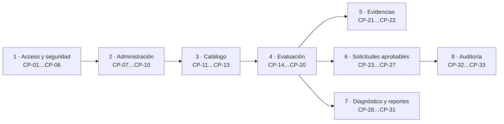

# 06 · Guía de pruebas funcionales end-to-end

Casos de prueba para demostrar el sistema completo con el stack levantado (ver
[05-Manual-Despliegue.md](05-Manual-Despliegue.md)) en **http://localhost:4200**. Cada caso indica el rol que lo
ejecuta, los pasos y el **resultado esperado**, que es el criterio de aceptación. Se recomienda ejecutarlos en el
orden en que aparecen, porque los últimos reutilizan los datos creados en los primeros.

## Datos de prueba

| Elemento | Valor sugerido |
|---|---|
| Usuarios | Uno por rol: `AdminSistema`, `AdminInstrumento`, `Evaluador`, `Revisor`, `EvaluadorRevisor`, `Lector` (creados por el administrador en el caso CP-03) |
| Organización | Entidad de prueba de tipo Territorial A |
| Archivo de evidencia | Un PDF real de menos de 10 MB (la plataforma valida el contenido del archivo, no solo la extensión) |
| Aplicación de 2FA | Cualquier app TOTP (Google Authenticator, Microsoft Authenticator, Authy) |

## Mapa de cobertura

**Contexto.** Los bloques siguen el recorrido real de un usuario: primero se asegura el acceso, luego se prepara el
catálogo, se ejecuta una evaluación de punta a punta y se cierra con reportes y auditoría. Las solicitudes
aprobables (eliminación, ampliación, reenvío de contraseña, eliminación de catálogo) dependen de que ya exista una
evaluación o un catálogo.

## 1. Acceso y seguridad

| ID | Rol | Pasos | Resultado esperado |
|---|---|---|---|
| CP-01 | Cualquiera | Iniciar sesión con usuario y contraseña válidos | Ingresa al tablero; el menú muestra solo las secciones de su rol |
| CP-02 | Usuario nuevo | Ingresar con la contraseña temporal recibida por correo | El sistema obliga a configurar el segundo factor (escanear QR y validar un código) y después a cambiar la contraseña temporal; recién entonces entra al tablero |
| CP-03 | Cualquiera | Equivocarse 3 veces seguidas en la contraseña | El cuarto intento informa que la cuenta está bloqueada temporalmente (15 minutos) |
| CP-04 | Cualquiera | Iniciar sesión (el 2FA es obligatorio para todos) | Pide el código de 6 dígitos; un código incorrecto no da acceso |
| CP-05 | Cualquiera | Abrir directamente una ruta para la que no se tiene permiso | Se redirige al tablero; el backend responde 403 si se llama la API |
| CP-06 | Cualquiera | Abrir el enlace «Política de privacidad» del pie de página | Muestra la política en `/privacidad` sin pedir sesión |

## 2. Administración (AdminSistema)

| ID | Rol | Pasos | Resultado esperado |
|---|---|---|---|
| CP-07 | AdminSistema | Crear un usuario por cada rol | Cada usuario recibe un correo con contraseña temporal; aparece en la lista con estado Activo |
| CP-08 | AdminSistema | Inactivar un usuario y pedirle que inicie sesión | El usuario no puede ingresar; al reactivarlo vuelve a poder |
| CP-09 | AdminSistema | Crear una organización (país, departamento, ciudad) y sus áreas base | La organización queda disponible para nuevas evaluaciones |
| CP-10 | AdminSistema | En «Parámetros del sistema» cambiar los días de gracia y guardar | El cambio se aplica y aparece en el historial con versión, usuario y fecha |

## 3. Catálogo del instrumento (AdminInstrumento o AdminSistema)

| ID | Rol | Pasos | Resultado esperado |
|---|---|---|---|
| CP-11 | AdminInstrumento | Crear una escala, agregar una versión y publicarla | La versión publicada queda en solo lectura y disponible para evaluaciones |
| CP-12 | AdminInstrumento | Cambiar de vista con cambios sin guardar en una escala | Aparece el modal propio de confirmación (no el diálogo del navegador) |
| CP-13 | AdminInstrumento | Crear un banco de preguntas, agregar, duplicar y filtrar preguntas | El filtro por texto, dominio y tipo devuelve solo las coincidencias |

## 4. Ciclo de vida de una evaluación

| ID | Rol | Pasos | Resultado esperado |
|---|---|---|---|
| CP-14 | AdminSistema | Crear evaluación: organización, tipo de entidad, escala, fecha límite, prioridad | Queda en estado **Borrador** con el árbol de controles y el levantamiento inicializados |
| CP-15 | AdminSistema | Asignar miembros (Evaluador, Revisor, EvaluadorRevisor) | Cada miembro la ve en «Mis evaluaciones asignadas» y recibe notificación |
| CP-16 | Evaluador | Completar áreas y temas con sus responsables | El responsable se propaga a los controles del área |
| CP-17 | Evaluador | Calificar controles administrativos y técnicos (0–100 o N/A) con hallazgo, brecha y recomendación | El promedio por dominio se recalcula excluyendo los N/A |
| CP-18 | Evaluador | Completar PHVA, Madurez y NIST (solo los ítems manuales) | Los ítems heredados se calculan solos y se muestran en solo lectura |
| CP-19 | Evaluador → Revisor | Enviar a revisión; el revisor marca un control como «requiere cambios» y devuelve | La evaluación vuelve a **En diligenciamiento** con el comentario del revisor |
| CP-20 | Revisor | Validar todos los controles y cerrar | Estado **Cerrada**; ya no se puede editar salvo reapertura |

## 5. Evidencias

| ID | Rol | Pasos | Resultado esperado |
|---|---|---|---|
| CP-21 | Evaluador | Adjuntar un PDF a un control y a un ítem del levantamiento | El archivo queda listado, descargable y con su huella SHA-256 |
| CP-22 | Evaluador | Intentar subir un ejecutable renombrado a `.pdf` | Se rechaza: el contenido no coincide con el tipo declarado |

## 6. Solicitudes aprobables (radicados `SOL-*`)

| ID | Rol | Pasos | Resultado esperado |
|---|---|---|---|
| CP-23 | Evaluador | Solicitar **ampliación de plazo** de una evaluación vencida o por vencer, con justificación | Se genera un radicado `SOL-AMPL-…`; el decisor recibe notificación |
| CP-24 | Revisor / Admin | Aprobar la ampliación | La fecha límite se extiende y la decisión queda registrada |
| CP-25 | Evaluador | Solicitar **eliminación** de una evaluación (motivo + adjunto opcional) | Radicado `SOL-ELIM-…`; al aprobarse la evaluación queda **solo lectura** y fuera de Evidencias/Reportes durante el periodo de gracia |
| CP-26 | Decisor | Pulsar **Recuperar** (botón naranja) durante la gracia | El modal informa los días restantes; al confirmar, la evaluación vuelve a la normalidad. Vencida la gracia se oculta (borrado lógico, nunca físico) |
| CP-27 | AdminSistema | En Usuarios pulsar la **llave naranja** (reenvío de contraseña) y aprobar la solicitud | Radicado `SOL-PWD-…`; el usuario recibe una contraseña temporal nueva y debe **reconfigurar el 2FA** en su siguiente ingreso |

## 7. Diagnóstico y reportes

| ID | Rol | Pasos | Resultado esperado |
|---|---|---|---|
| CP-28 | Cualquiera con acceso | Abrir el tablero de diagnóstico | Efectividad por dominio, avance PHVA, nivel de madurez y desempeño NIST calculados en tiempo real |
| CP-29 | Cualquiera con acceso | Exportar el **instrumento oficial en Excel** | El archivo abre sin aviso de reparación y contiene las 11 hojas diligenciadas |
| CP-30 | Cualquiera con acceso | Exportar el **instrumento oficial en PDF** | El PDF contiene el instrumento completo, no solo la portada |
| CP-31 | Cualquiera con acceso | Generar un comparativo entre dos evaluaciones de la misma organización | Muestra la variación por dominio, PHVA, madurez y NIST |

## 8. Auditoría (AdminSistema)

| ID | Rol | Pasos | Resultado esperado |
|---|---|---|---|
| CP-32 | AdminSistema | En Auditoría filtrar por tipo de evento, actor y rango de fechas | Aparecen los inicios de sesión y las acciones de los casos anteriores |
| CP-33 | AdminSistema | Abrir «Solicitudes» y buscar un radicado de CP-23 a CP-27 | Línea de tiempo completa: solicitado → decidido → ejecutado, con quién y cuándo |

## 9. Mensajes de error

Cualquier error de validación o de servidor debe mostrarse como un mensaje específico en español dentro de la
interfaz, sin identificadores internos (UUID, nombres de clases o códigos de enumeración).

## Registro de ejecución

| ID | Fecha de ejecución | Ejecutado por | Resultado (OK / Falla) | Observación |
|---|---|---|---|---|
| CP-01 | | | | |
| … | | | | |

> Copiar esta tabla por cada ronda de pruebas. Las pruebas automatizadas de backend se documentan en el
> `05-Pruebas.md` de cada microservicio.
