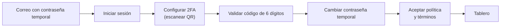
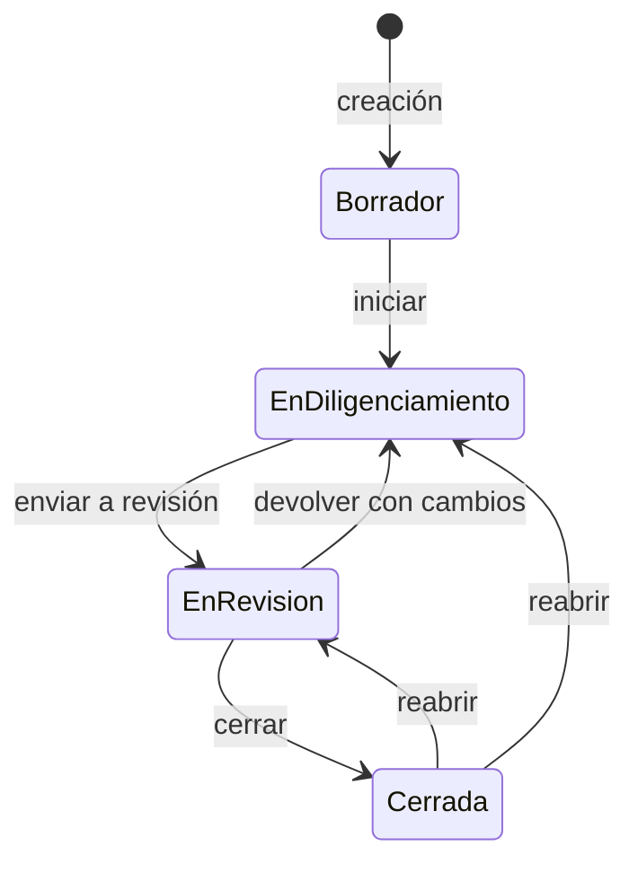

# 07 · Manual de usuario

Qué puede hacer cada rol dentro de MSPI y cómo hacerlo. En el entorno local se ingresa por
**http://localhost:4200**; en un despliegue real, por la URL que defina la entidad.

## 1. Primer ingreso

**Contexto.** Todo usuario lo crea un administrador; nadie se registra solo. El sistema envía por correo una
contraseña temporal. En el primer ingreso exige, en este orden, configurar el segundo factor con una aplicación
autenticadora, cambiar la contraseña y **aceptar la política de privacidad y los términos** (quedan registrados
versión, fecha, IP y navegador). En los ingresos siguientes basta con usuario, contraseña y el código de 6
dígitos, salvo que un administrador suba la versión de los documentos legales: entonces se vuelve a pedir la
aceptación.

- Tras **3 intentos fallidos seguidos** la cuenta se bloquea 15 minutos.
- Si pierdes el acceso a tu aplicación autenticadora o a tu contraseña, pide al administrador un
  **reenvío de contraseña**: al aprobarse recibes una contraseña temporal nueva y debes configurar el 2FA otra vez.
- La sesión vence por inactividad; el sistema avisa antes de cerrarla.
- Si se pierde la conexión a internet aparece una banda amarilla «Sin conexión a internet» en la parte superior; al recuperar la red desaparece sola. Si un servicio no responde, verás una tarjeta con el logo AuditCyber, el título «No pudimos conectar con el servidor» y el botón **Reintentar** (nunca mensajes técnicos como «Failed to fetch»).

## 2. Navegación

El menú muestra solo las secciones permitidas para tu rol. Al final hay un grupo **Legal** con **Política de
privacidad** y **Términos y condiciones** (mismas pantallas que sin sesión, pero dentro del layout de la app). La
campana muestra notificaciones priorizadas (Alta, Media, Baja): asignaciones, solicitudes pendientes de decisión y
decisiones sobre tus solicitudes. Puedes marcarlas como leídas o limpiarlas. El pie de página también enlaza la
política y los términos. Sin haber iniciado sesión puedes abrirlos en `/privacidad` y `/terminos` (fondo y logo
como la pantalla de acceso, con botón «Iniciar sesión»).

## 3. Qué puede hacer cada rol

| Capacidad | Admin. sistema | Admin. instrumento | Evaluador | Revisor | Evaluador-revisor | Lector |
|---|---|---|---|---|---|---|
| Gestionar usuarios y reenvío de contraseñas | ✅ | — | — | — | — | — |
| Gestionar organizaciones y áreas base | ✅ | — | — | — | — | — |
| Parámetros del sistema y auditoría | ✅ | — | — | — | — | — |
| Escalas y bancos de preguntas | ✅ | ✅ | — | — | — | — |
| Crear evaluaciones | ✅ | — | ✅ | — | ✅ | — |
| Asignar miembros a una evaluación | ✅ | — | — | — | — | — |
| Diligenciar evaluaciones asignadas | ✅ | — | ✅ | — | ✅ | — |
| Revisar y cerrar evaluaciones | ✅ | — | — | ✅ | ✅ | — |
| Ver evaluaciones y su diagnóstico | ✅ | ✅ | ✅ | ✅ | ✅ | ✅ |
| Exportar reportes (Excel y PDF oficial) | ✅ | ✅ | ✅ | ✅ | ✅ | ✅ |
| Ver «Mi organización» | — | — | — | — | — | ✅ |

> Diligenciar y revisar solo aplica a las evaluaciones donde la persona es **miembro asignado** (el administrador
> del sistema puede actuar sobre cualquiera). «Mi organización» es la vista del usuario de la entidad evaluada (rol
> Lector); el backend la restringe a ese rol.

## 4. Ciclo de una evaluación

**Contexto.** Estos son los estados que valida el backend (`AssessmentStatuses`). Una evaluación cerrada solo
cambia si alguien autorizado la reabre, y cada transición queda en el historial de estados y en la auditoría.

### Administrador del sistema
1. **Usuarios**: crear, editar, activar o inactivar. La **llave naranja** de cada fila solicita un reenvío de
   contraseña; la solicitud se aprueba o rechaza desde la bandeja y genera el radicado `SOL-PWD-…`.
2. **Organizaciones**: crear la entidad (país, departamento, ciudad, contactos) y sus áreas base.
3. **Evaluaciones**: crear (organización, tipo de entidad, escala, fecha límite, prioridad) y asignar miembros
   (evaluadores y revisores también pueden crear evaluaciones).
4. **Parámetros del sistema**: plazos, días de gracia, tipos de archivo; cada cambio queda versionado.
5. **Auditoría**: consultar eventos por tipo, actor y fecha, y la línea de tiempo de cada radicado.

### Administrador del instrumento
1. **Escalas**: crear una escala, agregar versiones y publicarlas (una versión publicada no se edita).
2. **Banco de preguntas**: crear bancos, agregar, duplicar, filtrar y configurar preguntas.
3. Para retirar una escala o un banco se **solicita su eliminación** (radicado `SOL-CAT-…`); las escalas y bancos
   base no se pueden eliminar.

### Evaluador
1. Abrir **Mis evaluaciones asignadas** y entrar a la evaluación.
2. Completar el **levantamiento de información** (contexto y los 43 documentos) y las **áreas y temas**.
3. Calificar los **controles administrativos y técnicos** (0, 20, 40, 60, 80, 100 o N/A) con hallazgo, brecha,
   recomendación y evidencia adjunta.
4. Completar **PHVA, Madurez y NIST**: solo los ítems manuales; los heredados se calculan solos.
5. **Enviar a revisión** cuando todo esté completo.
6. Si el plazo venció o está por vencer, **solicitar ampliación** (radicado `SOL-AMPL-…`). Si la evaluación no debe
   continuar, **solicitar su eliminación** con motivo (radicado `SOL-ELIM-…`).

### Revisor
1. Revisar cada control: **validar** o marcar **requiere cambios** con comentario.
2. Devolver a diligenciamiento o **cerrar** la evaluación.
3. Decidir las solicitudes de ampliación y eliminación de las evaluaciones donde es miembro.

### Evaluador-revisor
Combina los permisos de evaluador y revisor sobre la misma evaluación.

### Lector
Consulta evaluaciones y su diagnóstico, exporta los reportes y ve «Mi organización». No modifica datos.

## 5. Solicitudes y radicados

| Radicado | Qué pide | Quién solicita | Quién decide | Al aprobarse |
|---|---|---|---|---|
| `SOL-AMPL-…` | Ampliación de plazo | Evaluador asignado | Revisor miembro o administradores | Se extiende la fecha límite |
| `SOL-ELIM-…` | Eliminación de evaluación | Evaluador asignado | Revisor miembro o administradores | Solo lectura durante el periodo de gracia; luego borrado lógico |
| `SOL-CAT-…` | Eliminación de escala o banco | Administradores | Administrador del sistema | Periodo de gracia y luego borrado lógico |
| `SOL-PWD-…` | Reenvío de contraseña | Administrador del sistema | Administrador del sistema | Contraseña temporal nueva por correo y reinicio del 2FA |

Durante el periodo de gracia una eliminación aprobada se puede **recuperar** con el botón naranja; el sistema
indica cuántos días quedan. **Nada se borra físicamente**: los registros se marcan como eliminados y se conservan
para trazabilidad.

## 6. Diagnóstico y reportes

1. Abrir la evaluación y entrar a **Diagnóstico**: efectividad por dominio ISO, avance PHVA, nivel de madurez y
   desempeño NIST, calculados en tiempo real.
2. En **Reportes** exportar el **instrumento oficial** en Excel (11 hojas) o PDF.
3. Consultar las **brechas priorizadas** y generar un **comparativo** entre evaluaciones de la misma organización.

Las evaluaciones con eliminación aprobada no aparecen en Evidencias ni en Reportes.

## 7. Preguntas frecuentes

| Pregunta | Respuesta |
|---|---|
| No me llega el correo con la contraseña | Revisa spam; si no está, pide al administrador un reenvío de contraseña |
| Cambié de celular y perdí el 2FA | Pide un reenvío de contraseña: al aprobarse se reinicia el 2FA |
| No veo una evaluación | Solo ves las evaluaciones donde eres miembro, salvo que tu rol sea de administración o lectura |
| ¿Puedo deshacer una eliminación? | Sí, mientras dure el periodo de gracia, con el botón «Recuperar» |
| ¿Dónde se ve quién hizo un cambio? | El administrador del sistema lo consulta en Auditoría, por evento o por radicado |
