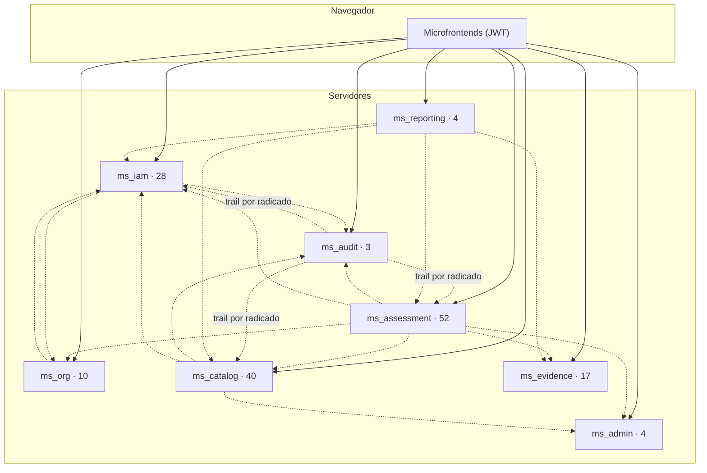

# 08 · Referencia de API (consolidada)

Índice consolidado de la API expuesta por los **8** microservicios, **alineado con los controladores `*Api.java` del backend** (`MSPI_NVA_CO_MR_BACK`). Para el detalle exacto de cada endpoint (parámetros, DTOs, ejemplos), la fuente de verdad sigue siendo el código y los documentos por microservicio en `Documentacion-Backend/`.

## Inventario por microservicio

Detalle endpoint por endpoint (método, ruta, acceso, parámetros, cuerpo, código HTTP y caso de uso), generado desde el código:

| Microservicio | Puerto | Endpoints | Internos | Referencia detallada |
|---|---|---|---|---|
| `ms_iam` | 8082 | 28 | 2 | [08-Referencia-API](../Documentacion-Backend/ms_iam/08-Referencia-API.md) |
| `ms_org` | 8083 | 10 | 0 | [08-Referencia-API](../Documentacion-Backend/ms_org/08-Referencia-API.md) |
| `ms_assessment` | 8084 | 52 | 3 | [08-Referencia-API](../Documentacion-Backend/ms_assessment/08-Referencia-API.md) |
| `ms_catalog` | 8085 | 40 | 1 | [08-Referencia-API](../Documentacion-Backend/ms_catalog/08-Referencia-API.md) |
| `ms_evidence` | 8086 | 17 | 6 | [08-Referencia-API](../Documentacion-Backend/ms_evidence/08-Referencia-API.md) |
| `ms_reporting` | 8087 | 4 | 0 | [08-Referencia-API](../Documentacion-Backend/ms_reporting/08-Referencia-API.md) |
| `ms_audit` | 8088 | 3 | 1 | [08-Referencia-API](../Documentacion-Backend/ms_audit/08-Referencia-API.md) |
| `ms_admin` | 8089 | 4 | 1 | [08-Referencia-API](../Documentacion-Backend/ms_admin/08-Referencia-API.md) |
| **Total** | | **158** | **14** | |

**Contexto.** Las flechas continuas son llamadas del navegador con el token del usuario; las punteadas son
llamadas servidor-a-servidor configuradas por variables `MS_*_URL` en cada servicio (p. ej. `ms_assessment` → `ms_audit`
para registrar eventos, → `ms_admin` para leer la configuración global). Las rutas `/internal/**` nunca se exponen
al navegador y se autentican con la clave compartida `X-Internal-Api-Key`. El número junto a cada servicio es la cantidad de endpoints que expone.

## Convenciones transversales

- **Envelope de respuesta:** `{ "meta": {...}, "data": ... }` en éxito, `{ "meta": {...}, "error": [{ "code", "message" }] }` en error.
- **Autenticación:** header `Authorization: Bearer <JWT>` emitido por Keycloak. Las rutas `/internal/**` usan `X-Internal-Api-Key` (servidor-a-servidor) y nunca se llaman desde el navegador.
- **Paginación:** estilo Spring (`page`, `size`, `content[]`, `totalElements`) en los listados.

## `ms_iam` — puerto 8082

| Grupo | Rutas | Rol requerido |
|---|---|---|
| Auth | `POST /auth/login`, `POST /auth/change-password`, `GET /auth/totp/status`, `POST /auth/totp/setup`, `POST /auth/totp/verify` | Público / autenticado |
| Usuarios | `GET/POST /users`, `GET /users/statuses`, `GET/PUT /users/{userId}`, `PATCH /users/{userId}/status`, `POST /users/{userId}/reset-password`, `POST /users/disable-by-email` | `AdminSistema` |
| Roles | `GET /roles` | `AdminSistema` |
| Reenvío contraseña (`SOL-PWD`) | `POST /users/{userId}/password-reset-requests`, `GET /password-reset-requests`, `POST …/approve\|reject\|cancel` | `AdminSistema` (decidir) |
| Notificaciones | `GET /notifications`, `POST /notifications/{id}/read`, `POST /notifications/read-all` | Autenticado |
| Interno | `POST /internal/notifications`, `GET /internal/requests/{requestNumber}` | `X-Internal-Api-Key` |

## `ms_org` — puerto 8083

| Grupo | Rutas | Rol requerido |
|---|---|---|
| Organizaciones | `GET/POST /organizations`, `GET/PUT /organizations/{organizationId}` | `AdminSistema` |
| Mi organización | `GET /organizations/my-organization` | Rol `Lector` (todo usuario de negocio) |
| Geografía | `GET /location/countries`, `GET /location/countries/{iso2}/states`, `GET .../states/{iso2}/cities` | Público (proxy a Country State City con API key de servidor) |
| Áreas base | `GET/PUT /organizations/{organizationId}/areas-base` | `AdminSistema` |

## `ms_assessment` — puerto 8084

| Grupo | Rutas | Rol requerido |
|---|---|---|
| Ciclo de vida | `POST/GET /assessments`, `GET/PATCH /assessments/{id}`, `PUT .../entity-order-type`, `POST .../publish`, `POST .../clone` | Ver RBAC por miembro |
| Workflow | `GET /assessments/my-assigned`, `GET /assessments/workflow-rules`, `POST /assessments/{id}/status`, `POST .../reopen`, `GET .../status-history` | Rol de miembro + estado |
| Ampliación de plazo | `POST/GET /assessments/{id}/extension-requests`, `POST .../extension-requests/{reqId}/approve\|reject`, `GET /extension-requests?status=PENDING` | Solicitar: Evaluador/EvaluadorRevisor asignado (vencida o ≤5 días). Decidir: AdminSistema/AdminInstrumento o Revisor/EvaluadorRevisor miembro |
| Eliminación lógica | `POST/GET /assessments/{id}/deletion-requests`, `POST .../approve\|reject\|cancel`, `GET /deletion-requests?status=PENDING`, `GET /assessments/deleted` | Solicitar: Evaluador/EvaluadorRevisor. Decidir: mismos guards que ampliación. Cancelar = recuperar en gracia. Soft delete: `deleted_at`; listados filtran `deleted_at IS NULL`. Sweeper horario |
| Miembros | `GET/POST /assessments/{id}/members`, `DELETE /assessments/{id}/members/{memberId}` | `AdminSistema` (mutación) |
| Áreas y responsables | `GET/PUT /assessments/{id}/areas`, `PUT .../areas/{areaId}/topics` | Rol de miembro editor |
| Controles | `GET /assessments/{id}/controls`, `GET/PATCH .../controls/{nodeId}`, `GET .../scores/rollup` | Rol de miembro editor (`controlStatus`: PENDIENTE\|EN_PROGRESO\|COMPLETADO). `GET` incluye `reviewStatus` (VALIDATED\|NEEDS_CHANGES\|null) |
| Revisión de control | `PATCH .../controls/{nodeId}/review` body `{ reviewStatus, comment?, severity? }` | `AssessmentAccessGuard.requireReview` (Revisor/EvaluadorRevisor + estado EN_REVISION). UPSERT en `assessment.control_review` |
| Stewardship | `GET .../controls/stewardship`, `PATCH .../controls/{nodeId}/steward` | Rol de miembro editor |
| PHVA / Madurez / NIST | `GET/PATCH .../phva/items[/{id}]`, `.../maturity/requirements[/{id}]`, `.../nist/items[/{id}]` (+ `.../summary`) | Rol de miembro editor |
| Diagnóstico | `GET /assessments/{id}/diagnostic/dashboard`, `.../diagnostic/domain-effectiveness`, `GET .../gaps` | Autenticado |
| Interno | `GET /internal/assessments/{id}/report-export-bundle`, `GET /internal/assessments/{id}/gaps` | `X-Internal-Api-Key` |

## `ms_catalog` — puerto 8085

| Grupo | Rutas | Rol requerido |
|---|---|---|
| Catálogo de referencia (lectura) | `GET /catalog/entity-order-types`, `/template-versions/active`, `/lifting-document-items`, `/steward-roles`, `/iso-domains`, `/assessment-area-presets`, `/control-catalog-leaves`, `/control-catalog-tree`, `/control-rules`, `/scales/published`, `/nist-mappings`, `/phva-items`, `/phva-config`, `/maturity-requirements`, `/maturity-config`, `/nist-ciber-items`, `/nist-config` | Autenticado |
| Escalas (admin) | `GET/POST /catalog/scales`, `GET /catalog/scales/{id}`, `POST .../{id}/versions`, `PUT .../versions/{versionId}`, `POST .../versions/{versionId}/publish` | `AdminSistema`, `AdminInstrumento` en mutación. Respuesta incluye `base`, estado de solicitud de eliminación |
| Bancos de preguntas | `GET/POST/PUT/DELETE /catalog/question-banks` (+ `.../questions`, `.../config`, duplicate) | `AdminSistema`, `AdminInstrumento` en mutación. Soft-delete vía solicitud (no DELETE físico del banco). Filtra `deleted_at IS NULL` |
| Eliminación lógica catálogo | `POST/GET /catalog/deletion-requests`, `GET .../pending`, `POST .../{id}/approve\|reject\|cancel` | Solicitar: AdminInstrumento/AdminSistema. Aprobar: AdminSistema. Bloquea `is_base=true`. Gracia `catalogDeletionGraceDays` (default 5) |

> **Nota:** no existe un endpoint único `GET /catalog/bundle`; el front consume los `GET /catalog/*` de referencia anteriores.

## `ms_evidence` — puerto 8086

| Grupo | Rutas | Rol requerido |
|---|---|---|
| Contexto | `GET/PATCH /assessments/{assessmentId}/context` | Rol de miembro editor |
| Alcance de procesos | `GET/PATCH /assessments/{assessmentId}/process-scope-metric` | Rol de miembro editor |
| Levantamiento | `GET /assessments/{assessmentId}/lifting-document-deliveries`, `PATCH /lifting-document-deliveries/{deliveryId}` | Autenticado |
| Archivos | `POST/GET /assessments/{assessmentId}/files`, `GET /files/{fileId}/download`, `DELETE /files/{fileId}` | Autenticado |
| Interno | `GET /internal/assessments/{id}/context`, `POST .../lifting/init`, `POST .../lifting/clone/{targetId}`, `GET .../evidence-files`, `POST .../report-outputs`, `GET /internal/files/{fileId}/download` | `X-Internal-Api-Key` |

## `ms_reporting` — puerto 8087

| Grupo | Rutas | Rol requerido |
|---|---|---|
| Jobs | `POST /reports/jobs`, `GET /reports/jobs/{jobId}` (polling) | Autenticado |
| Comparativo | `POST /reports/comparative/jobs` | Autenticado |
| Descarga | `GET /reports/jobs/{jobId}/download` | Autenticado |

## `ms_audit` — puerto 8088

| Grupo | Rutas | Rol requerido |
|---|---|---|
| Eventos | `GET /audit/events` (filtros `dateFrom`, `dateTo`, `actor`, `requestNumber`, …) | `AdminSistema` |
| Timeline | `GET /audit/requests/{requestNumber}` | `AdminSistema` |
| Interno | `POST /internal/audit/events` → 202 | `X-Internal-Api-Key` |

## `ms_admin` — puerto 8089

| Grupo | Rutas | Rol requerido |
|---|---|---|
| Config | `GET/PUT /system/config`, `GET /system/config/history?limit=` | `AdminSistema` |
| Interno | `GET /internal/system/config` | `X-Internal-Api-Key` |

## Contraste frontend ↔ backend

Se cruzaron las **151 llamadas HTTP** de los 6 microfrontends contra los 158 endpoints del backend:

- **0 llamadas rotas**: toda ruta que usa la interfaz existe en el backend con el mismo método.
- **5 endpoints de negocio sin consumidor directo en la interfaz** (todos con explicación):

| Endpoint | Motivo |
|---|---|
| `POST /users/{userId}/reset-password` (`ms_iam`) | Reemplazado en la UI por el flujo aprobable `SOL-PWD` (`/users/{userId}/password-reset-requests`). Se conserva para administración directa. |
| `POST /users/disable-by-email` (`ms_iam`) | Uso servidor-a-servidor desde `ms_org` al cambiar el contacto de una organización. |
| `GET /users/statuses` (`ms_iam`) | Catálogo estático; la UI tiene los estados embebidos. |
| `POST /password-reset-requests/{id}/cancel` (`ms_iam`) | La bandeja de solicitudes solo ofrece aprobar/rechazar; cancelar queda disponible por API. |
| `PUT /assessments/{assessmentId}/areas` (`ms_assessment`) | En `mf_assessment` el repositorio `replaceAreas` no llama al backend (las áreas se inicializan desde el preset al crear la evaluación y solo se editan sus temas con `PUT …/areas/{areaId}/topics`). |

Mapas por microfrontend (rutas, permisos y endpoints consumidos):
[mf_shell](../Documentacion-Frontend/mf_shell/08-Mapa-Rutas-y-Endpoints.md) ·
[mf_auth](../Documentacion-Frontend/mf_auth/08-Mapa-Rutas-y-Endpoints.md) ·
[mf_org](../Documentacion-Frontend/mf_org/08-Mapa-Rutas-y-Endpoints.md) ·
[mf_assessment](../Documentacion-Frontend/mf_assessment/08-Mapa-Rutas-y-Endpoints.md) ·
[mf_evidence](../Documentacion-Frontend/mf_evidence/08-Mapa-Rutas-y-Endpoints.md) ·
[mf_reports](../Documentacion-Frontend/mf_reports/08-Mapa-Rutas-y-Endpoints.md)
