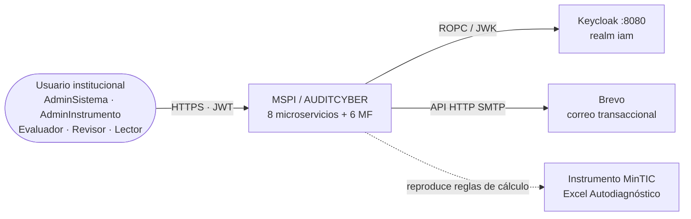
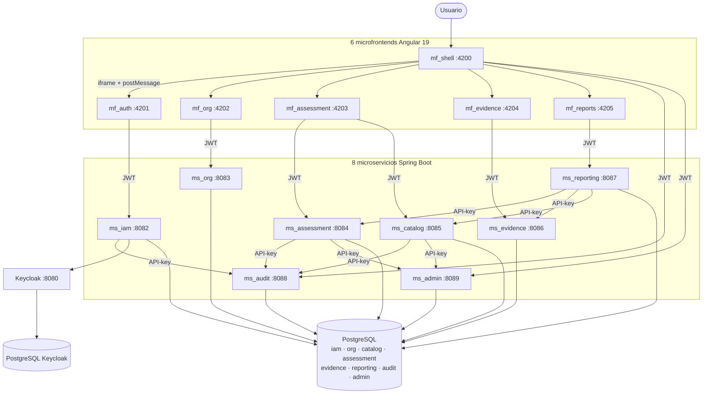
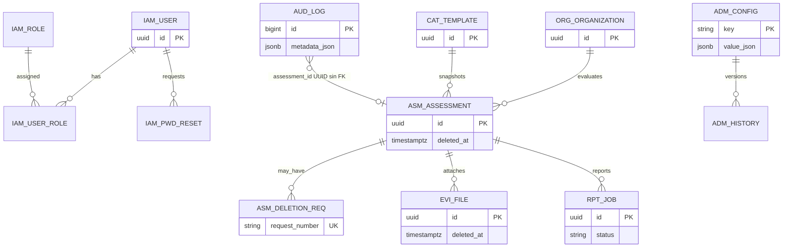
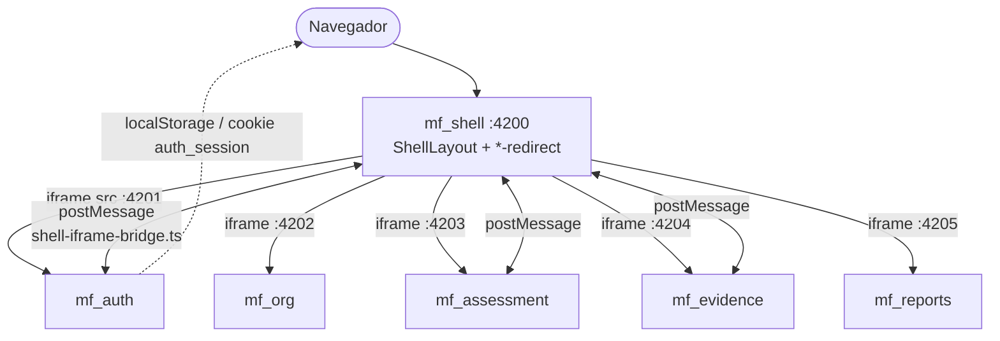
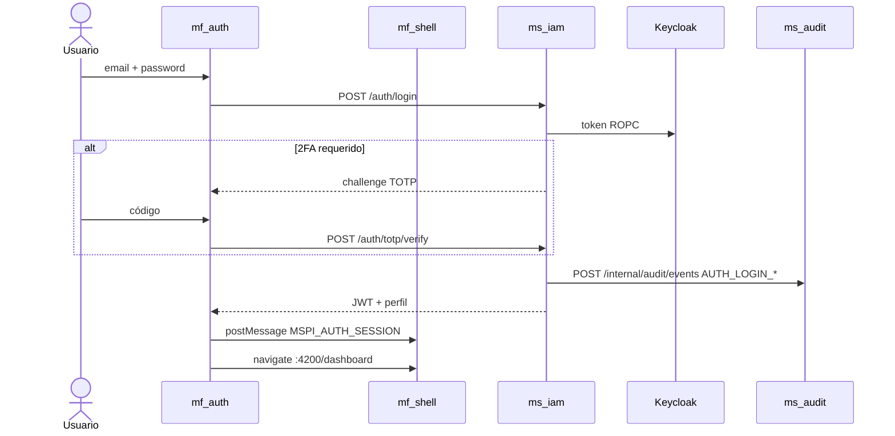
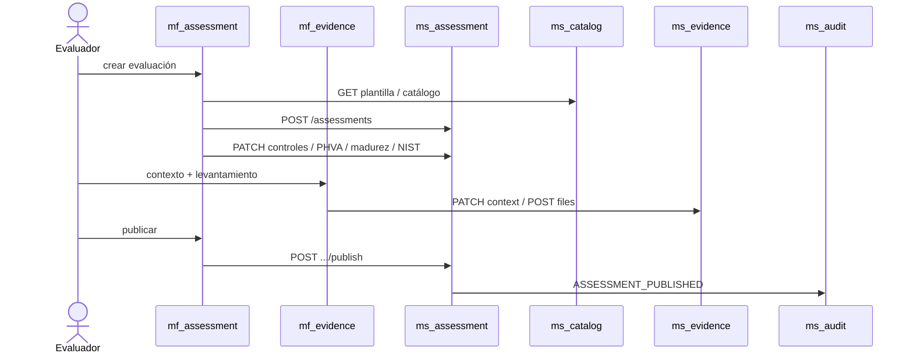
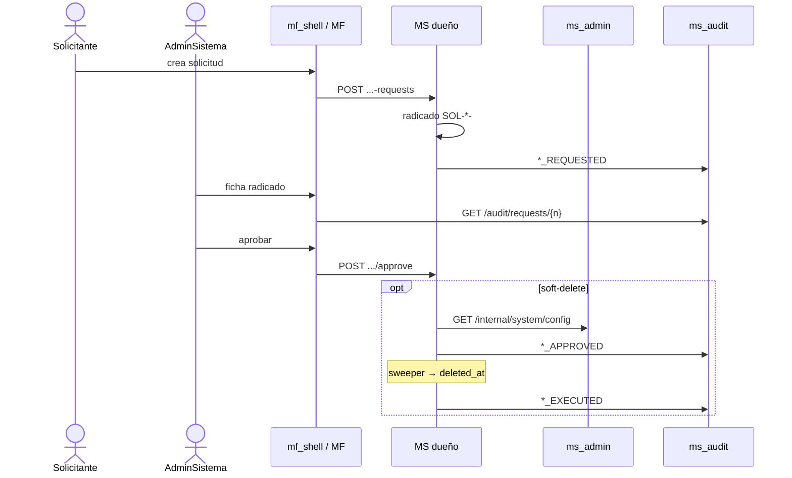
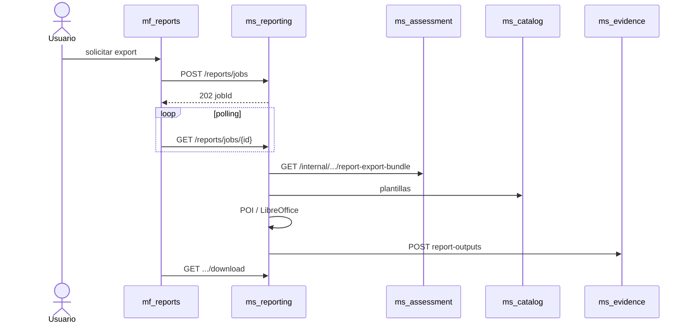
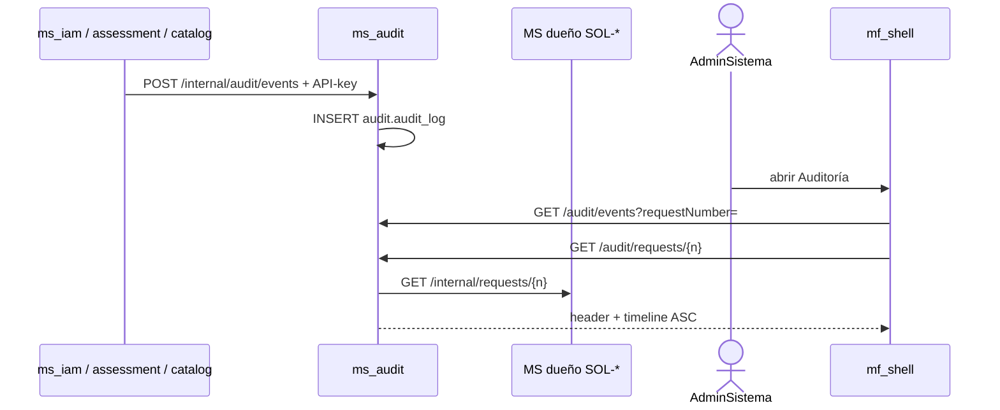

# 15 · Diagramas C4, despliegue, ER y secuencias

| Campo | Valor |
|---|---|
| Fuentes | Código `MSPI_NVA_CO_MR_BACK` / `MSPI_NVA_CO_MR_FRONT`; `MER-MSPI.sql`; `01-Arquitectura-General-del-Sistema.md`; `14-Flujos-…` |

> Todos los diagramas usan **Mermaid** (GitHub + MkDocs). Cada uno incluye **título** y **contexto**. Nombres de servicios, puertos y rutas verificados en código.

---

## 0. Cómo leer estos diagramas

| Tipo Mermaid | Qué muestra | Cómo leerlo |
|---|---|---|
| `flowchart` | Contenedores, despliegue, composición UI, hexágono | Flechas = llamadas o dependencias; cajas = procesos/servicios |
| `sequenceDiagram` | Interacción temporal entre actores | De arriba a abajo = tiempo; `->>` = mensaje síncrono |
| `erDiagram` | Tablas y cardinalidades | `\|\|--o{` = uno a muchos; UUID sin FK se anota en el texto |
| `classDiagram` | Tipos del dominio (en docs por MS) | `-->` = usa/depende; nombres = clases Java/TS reales |

**Leyenda transversal**

| Símbolo / convención | Significado |
|---|---|
| JWT | `Authorization: Bearer` validado por Resource Server (Keycloak JWK) |
| API-key | Header `X-Internal-Api-Key` en rutas `/internal/**` |
| iframe + postMessage | Composición real del frontend (`shell-iframe-bridge.ts`) |
| Module Federation | Solo evolución futura — no está en producción |

---

## 1. C4 — Contexto (nivel 1)

### Título: Fronteras del sistema MSPI / AUDITCYBER

**Contexto.** Ubica a MSPI frente a personas y sistemas externos. Interior = lo que el proyecto construye; exterior = IdP, correo e instrumento normativo MinTIC.



**Qué mirar:** el usuario nunca habla con Keycloak o Brevo directamente desde el navegador de negocio; pasa por `ms_iam` / adaptadores.

---

## 2. C4 — Contenedores (nivel 2)

### Título: Contenedores — 8 MS + 6 MF + Keycloak + PostgreSQL

**Contexto.** Descompone MSPI en procesos desplegables. Protocolos: REST+JWT al público; REST+API-key entre MS (`/internal/**`).



**Quién habla con quién (resumen):** productores de auditoría → `ms_audit`; plazos/gracia → `ms_admin`; reportes leen assessment/catalog/evidence por canal interno.

---

## 3. Despliegue Docker

### Título: Compose — redes, apps, front e identidad

**Contexto.** Vista operativa del stack local (`docker-compose*.yml` / `mspi-net`). Cada MS/MF es un contenedor con healthcheck donde aplica.

```mermaid
flowchart TB
    subgraph Net["red Docker: mspi-net"]
        subgraph Infra["postgres + keycloak"]
            PG["postgres_mspi :5432 · DB MSPI"]
            PGKC["postgres_keycloak :5433"]
            KC["keycloak :8080"]
        end
        subgraph Apps["mspi-apps — 8 MS"]
            IAM["ms_iam :8082"]
            ORG["ms_org :8083"]
            ASM["ms_assessment :8084"]
            CAT["ms_catalog :8085"]
            EVI["ms_evidence :8086"]
            RPT["ms_reporting :8087"]
            AUD["ms_audit :8088"]
            ADM["ms_admin :8089"]
        end
        subgraph Front["mspi-front — 6 MF (runtime MSPI_* → config.json + CSP)"]
            S["mf_shell :4200"]
            A["mf_auth :4201"]
            O["mf_org :4202"]
            AS["mf_assessment :4203"]
            E["mf_evidence :4204"]
            R["mf_reports :4205"]
        end
    end
    Browser([Navegador]) --> S
    Browser -.fetch /assets/config.json.-> S
    Browser -.fetch /assets/config.json.-> A
    IAM --> PG
    ORG --> PG
    ASM --> PG
    CAT --> PG
    EVI --> PG
    RPT --> PG
    AUD --> PG
    ADM --> PG
    IAM --> KC
    KC --> PGKC
    ORG -.depends_on.-> IAM
    ASM -.depends_on.-> IAM
```

**Volúmenes típicos:** evidencias (`mspi_evidence_data`), salidas de reporte (`mspi_report_outputs`). Detalle de arranque: `05-Manual-Despliegue.md`.

**Runtime front:** cada contenedor MF genera `/assets/config.json` y la CSP nginx desde `MSPI_*` al arrancar (misma imagen local/dominio real). Ver `05-Manual-Despliegue.md` §8.


---

## 4. Modelo de datos (8 esquemas)

### Título: ER conceptual por dominios

**Contexto.** Una instancia PostgreSQL, ocho esquemas propietarios. `audit`/`admin` guardan UUID **sin FK** a `iam`/`assessment` (desacople). Fuente: `MER-MSPI.sql`, `patch-audit-schema.sql`, `patch-admin-schema.sql`.



**Claves cruzadas sin FK:** `audit.audit_log.actor_user_id` / `assessment_id`; `admin.system_config.updated_by`. Correlación de radicados: `metadata_json.requestNumber`.

Vista embebida: [`Modelo-Datos-MER.md`](Modelo-Datos-MER.md).

---

## 5. Composición del frontend

### Título: Shell, iframes y `shell-iframe-bridge`

**Contexto.** Los 6 MF son SPAs independientes. El host embebe hijos en `<iframe>` y sincroniza sesión/navegación con `postMessage` (`MSPI_AUTH_*`, `MSPI_ACTIVE_ASSESSMENT`, `MSPI_SHELL_NAV`). Module Federation = evolución futura.



**Qué mirar:** el JWT viaja al API desde cada MF (interceptor); el bridge solo replica sesión entre orígenes (puertos).

---

## 6. Secuencia — (a) Login + 2FA

### Título: Autenticación con TOTP opcional

**Contexto.** Flujo de `mf_auth` → `ms_iam` → Keycloak; evento de login hacia `ms_audit`.



---

## 7. Secuencia — (b) Evaluación end-to-end

### Título: Crear, diligenciar y publicar evaluación

**Contexto.** Orquestación típica vía `mf_assessment` / `mf_evidence` y APIs de assessment, catalog y evidence.



---

## 8. Secuencia — (c) Solicitud → aprobación → ejecución

### Título: Ciclo SOL-* con auditoría

**Contexto.** Prefijos `SOL-ELIM` / `SOL-AMPL` / `SOL-PWD` / `SOL-CAT`. Gracia desde `ms_admin` cuando aplica soft-delete.



Detalle: [`14-Flujos-Solicitudes-Auditoria-y-Seguridad.md`](14-Flujos-Solicitudes-Auditoria-y-Seguridad.md).

---

## 9. Secuencia — (d) Generación de reporte

### Título: Job asíncrono PDF/Excel

**Contexto.** `mf_reports` crea job; `ms_reporting` procesa con datos internos de assessment/catalog/evidence.



---

## 10. Secuencia — (e) Trazabilidad en ms_audit

### Título: Ingesta S2S y consulta de timeline

**Contexto.** Productores empujan eventos; el admin consulta listado y trail por radicado (`RequestOwnerGateway` resuelve cabecera según prefijo SOL-*).



---

## Referencias

- Arquitectura narrativa: [`01-Arquitectura-General-del-Sistema.md`](01-Arquitectura-General-del-Sistema.md)
- Glosario: [`16-Glosario.md`](16-Glosario.md)
- Diagramas por componente: `Documentacion-Backend/*/03-Diseno.md` y `Documentacion-Frontend/*/03-Diseno.md` (sección *Ilustraciones*).
