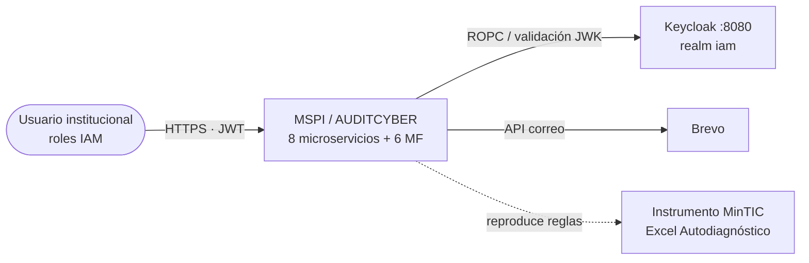
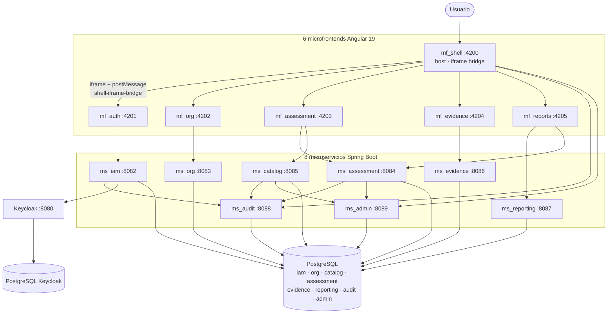
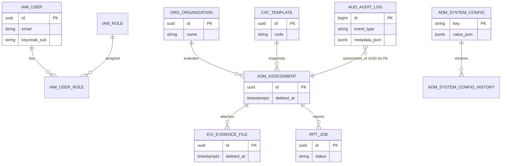
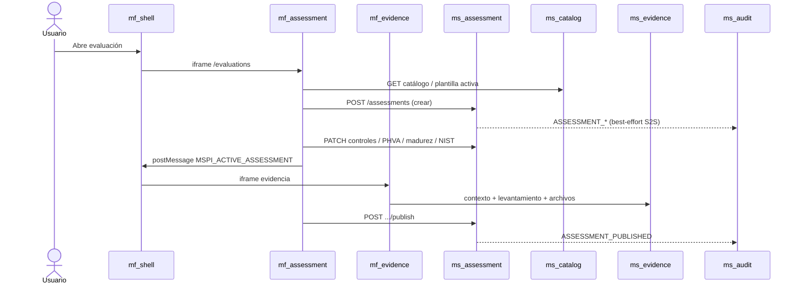
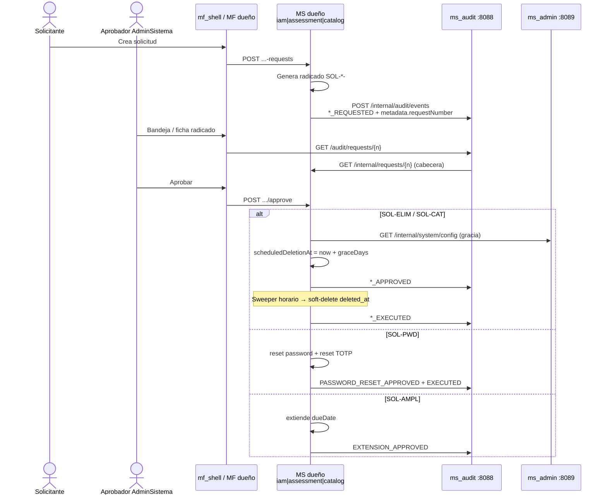
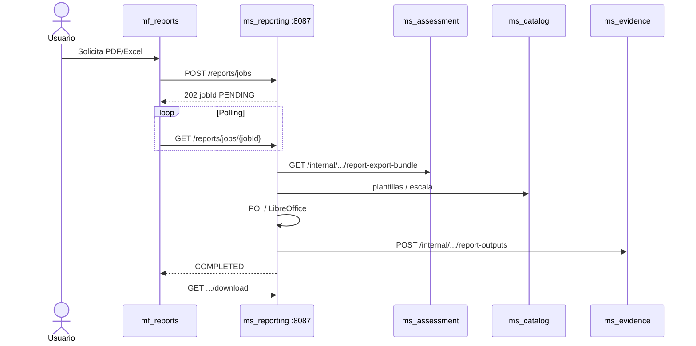
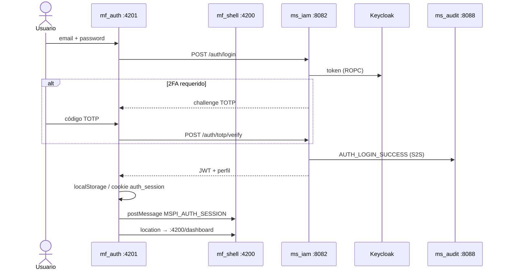

# 15 · Diagramas C4 y de secuencia

| Campo | Valor |
|---|---|
| Última revisión cruzada con código | **2026-10-19** |
| Fuentes | `01-Arquitectura-General-del-Sistema.md`, `14-Flujos-Solicitudes-Auditoria-y-Seguridad.md`, `MER-MSPI.sql`, código en `MSPI_NVA_CO_MR_BACK` / `MSPI_NVA_CO_MR_FRONT` |

> Diagramas en **Mermaid** (renderizan en GitHub y en la wiki MkDocs). No inventan componentes: solo lo verificado en código/docs.

---

## 1. C4 — Contexto del sistema

(Estilo C4 con Mermaid estándar — compatible con GitHub.)

---

## 2. C4 — Contenedores (8 MS + 6 MF + Keycloak + Postgres)

**Composición frontend (canónica):** iframes + `window.postMessage` + `shell-iframe-bridge.ts`. Module Federation = **evolución futura**, no arquitectura actual.

---

## 3. Modelo de datos (8 esquemas)

Vista conceptual; detalle tabular en [`MER-MSPI.sql`](MER-MSPI.sql) / [dbdocs](https://dbdocs.io/jdtovar-2021a/MER-MSPI) / [`Modelo-Datos-MER.md`](Modelo-Datos-MER.md).

Esquemas propietarios: `iam` · `org` · `catalog` · `assessment` · `evidence` · `reporting` · `audit` · `admin`.

---

## 4. Secuencia — (a) Evaluación end-to-end (resumen)

---

## 5. Secuencia — (b) Solicitud → aprobación → ejecución (+ auditoría)

Ejemplo genérico (`SOL-ELIM` / `SOL-AMPL` / `SOL-PWD` / `SOL-CAT`):

Detalle de prefijos y eventos: [`14-Flujos-Solicitudes-Auditoria-y-Seguridad.md`](14-Flujos-Solicitudes-Auditoria-y-Seguridad.md).

---

## 6. Secuencia — (c) Generación de reporte

---

## 7. Secuencia — (d) Login + 2FA

Fuentes: `AuthApi` / `LoginUseCase` / `TotpVerifyUseCase` (`ms_iam`); `shell-iframe-bridge.ts` (`mf_shell`).
