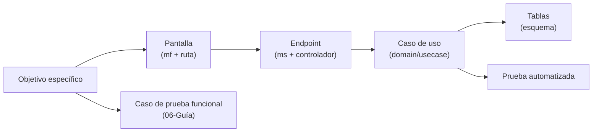

# 18 · Matriz de trazabilidad

Relaciona cada objetivo específico del proyecto con la evidencia que lo materializa en el sistema: pantallas
(microfrontend y ruta), endpoints (microservicio y controlador), tablas y pruebas automatizadas. Sirve para la
sustentación: cada fila responde «¿dónde está implementado esto?».

Fuentes: [`03-Objetivos-del-Proyecto.md`](03-Objetivos-del-Proyecto.md), los `08-Referencia-API.md` de cada
microservicio, los `08-Mapa-Rutas-y-Endpoints.md` de cada microfrontend, el [MER](Modelo-Datos-MER.md) y los
inventarios de prueba de cada `05-Pruebas.md`.

**Contexto.** La cadena se recorre de izquierda a derecha: un objetivo se cumple cuando existe una pantalla que el
usuario usa, un endpoint que la atiende, un caso de uso con la regla de negocio, las tablas donde persiste y una
prueba que la verifica. Los casos funcionales CP-xx de la [guía de pruebas](06-Guia-Pruebas-Funcionales.md)
cubren la verificación manual extremo a extremo.

## Objetivos específicos

| # | Objetivo | Pantallas | Endpoints | Tablas | Pruebas automatizadas | Pruebas funcionales |
|---|---|---|---|---|---|---|
| 1 | Configuración y levantamiento de información | `mf_assessment` `/evaluations/new`, `/evaluations/:id/entity-form`, `/information-gathering`, `/entity-order-type`; `mf_evidence` `/assessments/:id/context`, `/inventory` | `ms_assessment` `AssessmentApi` (crear, tipo de entidad); `ms_evidence` `AssessmentContextApi`, `LiftingDeliveryApi`, `ProcessScopeApi`, `EvidenceFileApi`; `ms_catalog` `GET /catalog/lifting-document-items`, `/entity-order-types` | `assessment.assessment`, `evidence.assessment_context`, `evidence.lifting_document_delivery`, `evidence.process_scope_metric`, `catalog.lifting_document_item_catalog`, `catalog.entity_order_type` | `ContentMagicValidatorTest` | CP-14, CP-21, CP-22 |
| 2 | Áreas y responsables | `mf_assessment` `/evaluations/:id/areas`, `/stewardship` | `ms_assessment` `AssessmentAreasApi`, `ControlStewardApi`; `ms_org` `OrganizationAreasBaseApi` | `assessment.assessment_area`, `assessment.assessment_area_topic`, `catalog.assessment_area_preset`, `catalog.steward_role`, `org.organization_area_base(_topic)` | — | CP-09, CP-16 |
| 3 | Calificación de controles administrativos y técnicos (Anexo A) | `mf_assessment` `/evaluations/:id/controls/admin`, `/controls/tech` | `ms_assessment` `AssessmentControlApi` (calificar, revisar, *rollup*) | `assessment.assessment_control_node`, `assessment.control_response`, `assessment.control_review`, `catalog.control_catalog_node`, `catalog.control_rule`, `catalog.iso_domain` | `PatchControlScoreUseCaseTest`, `ComputeAssessmentRollupUseCaseTest`, `ReviewControlUseCaseTest`, `V2AnnexA2022ControlCatalogSeedTest` | CP-17, CP-19 |
| 4 | Avance ponderado PHVA | `mf_assessment` `/evaluations/:id/phva` | `ms_assessment` `AssessmentPhvaApi` | `assessment.assessment_phva_item`, `assessment.phva_item_response`, `catalog.phva_item_catalog` | `ComputePhvaAdvanceUseCaseTest` | CP-18 |
| 5 | Nivel de madurez del SGSI | `mf_assessment` `/evaluations/:id/maturity` | `ms_assessment` `AssessmentMaturityApi` | `assessment.assessment_maturity_requirement(_response)`, `assessment.assessment_maturity_threshold`, `catalog.maturity_requirement_catalog`, `catalog.maturity_threshold` | `MaturityScoreResolverTest` | CP-18 |
| 6 | Evaluación NIST CSF 2.0 (6 funciones) | `mf_assessment` `/evaluations/:id/nist` | `ms_assessment` `AssessmentNistApi` | `assessment.assessment_nist_ciber_item`, `assessment.nist_ciber_item_response`, `catalog.nist_function`, `catalog.nist_subcategory`, `catalog.nist_ciber_item_catalog`, `catalog.nist_mapping` | `ComputeNistSummaryUseCaseTest`, `NistCiberScoreResolverTest` | CP-18 |
| 7 | Tablero de diagnóstico y brechas | `mf_reports` `/assessments/:id/dashboard`; `mf_assessment` `/evaluations/:id` | `ms_assessment` `AssessmentDiagnosticApi`, `AssessmentGapsApi` | `assessment.gap_register`, `assessment.gap_action` (y cálculo sobre controles) | `ComputeDomainEffectivenessUseCaseTest`, `ListGapsUseCaseTest` | CP-28, CP-31 |
| 8 | Identidad, control de acceso, 2FA y auditoría | `mf_auth` `/login`, `/setup-2fa`, `/verify-2fa`, `/change-password`, `/users`; `mf_shell` `/audit`, `/audit/requests` | `ms_iam` `AuthApi`, `UsersApi`, `PasswordResetRequestsApi`, `RolesApi`; `ms_audit` `AuditApi`, `InternalAuditApi` | `iam.user`, `iam.role`, `iam.user_role`, `iam.user_totp`, `iam.login_attempt`, `iam.password_reset_request`, `audit.audit_log` | `LoginUseCaseTest`, `LoginServiceTest`, `TotpVerifyUseCaseTest`, `TotpStatusUseCaseTest`, `AuthRateLimitFilterTest`, `GetUsersUseCaseTest`, `UsersApiTest`, `RoleNormalizerTest`, `RecordAuditEventUseCaseTest`, `ListAuditEventsUseCaseTest`, `AssessmentAccessGuardTest` | CP-01…CP-08, CP-27, CP-32, CP-33 |
| 9 | Reportes PDF y Excel con la plantilla oficial | `mf_reports` `/reports`, `/assessments/:id/export` | `ms_reporting` `ReportJobApi`, `ComparativeReportJobApi`; `ms_evidence` `InternalReportOutputApi` | `reporting.report_generation_job`, `reporting.report_job_assessment`, `reporting.excel_workbook_template`, `reporting.excel_sheet_mapping`, `evidence.evidence_file` | `CreateReportJobUseCaseTest`, `MspiInstrumentTemplateFillerTest`, `InstrumentWorkbookValidityTest`, `WorkbookFullProtectionTest`, `PdfDraftWatermarkerTest`, `ProcessReportJobOfficialGuardTest` | CP-29, CP-30, CP-31 |

## Capacidades transversales

| Capacidad | Pantallas | Endpoints | Tablas | Pruebas automatizadas | Pruebas funcionales |
|---|---|---|---|---|---|
| Flujo de estados de la evaluación | `mf_assessment` `/evaluations/:id` | `ms_assessment` `AssessmentWorkflowApi` | `assessment.assessment`, `assessment.assessment_status_history` | `AssessmentStatusesTest`, `ChangeAssessmentStatusUseCaseTest`, `AssessmentApproverNotifierTest` | CP-19, CP-20 |
| Miembros de la evaluación | `mf_assessment` `/evaluations/:id` | `ms_assessment` `AssessmentMembersApi` | `assessment.assessment_member` | `MemberRolesTest` | CP-15 |
| Ampliación de plazo (`SOL-AMPL`) | `mf_assessment` `/evaluations/extension-requests` | `ms_assessment` `AssessmentExtensionApi` | `assessment.assessment_extension_request` | — | CP-23, CP-24 |
| Eliminación lógica y recuperación (`SOL-ELIM`) | `mf_assessment` `/evaluations/deletion-requests`, `/evaluations/deleted` | `ms_assessment` `AssessmentDeletionApi` | `assessment.assessment_deletion_request` | — | CP-25, CP-26 |
| Eliminación de catálogo (`SOL-CAT`) | `mf_assessment` `/catalog/deletion-requests` | `ms_catalog` `CatalogDeletionApi` | `catalog.catalog_deletion_request` | — | CP-11 |
| Escalas y bancos de preguntas | `mf_assessment` `/scales`, `/security-baseline` | `ms_catalog` `ScaleAdminApi`, `QuestionBankApi` | `catalog.scale*`, `catalog.question_bank*` | — | CP-11…CP-13 |
| Organizaciones y geografía | `mf_org` `/organizations`, `/my-organization` | `ms_org` `OrganizationApi`, `LocationApi` | `org.organization`, `org.organization_contact` | `CreateOrganizationUseCaseTest`, `UpdateOrganizationUseCaseTest`, `GetMyOrganizationUseCaseTest`, `OrganizationApiTest`, `LocationApiTest` y 5 más | CP-09 |
| Parámetros globales | `mf_shell` `/system-settings` | `ms_admin` `SystemAdminApi`, `InternalSystemConfigApi` | `admin.system_config`, `admin.system_config_history` | `GetSystemConfigUseCaseTest`, `UpdateSystemConfigUseCaseTest`, `GetSystemConfigHistoryUseCaseTest` | CP-10 |
| Notificaciones | `mf_shell` (campana) | `ms_iam` `NotificationApi`, `InternalNotificationApi` | `iam.notification` | — | CP-15 |
| Correo transaccional | — | `ms_iam` (adaptador Brevo) | — | `BrevoEmailAdapterTest` | CP-07, CP-27 |
| Seguridad transversal | Todas | Filtros de cada ms | — | `SecurityHeadersFilterTest`, `LogSanitizerTest`, `CorsConfigTest` y `TraceIdFilterTest` (en los 8 ms) | CP-05, CP-22 |

## Brechas de cobertura automatizada

Funcionalidades verificadas solo con pruebas funcionales (sin prueba unitaria propia), priorizadas por riesgo:

1. **Solicitudes de eliminación, ampliación y recuperación** (`ms_assessment`): reglas de quién solicita y quién
   decide y el periodo de gracia.
2. **Reenvío de contraseña con reinicio de 2FA** (`ms_iam`, `ApprovePasswordResetUseCase`).
3. **Carga de evidencias** (`ms_evidence`, `UploadEvidenceFileUseCase`): solo el validador de contenido tiene prueba.
4. **Eliminación de catálogo, escalas y bancos de preguntas** (`ms_catalog`).
5. **Notificaciones** (`ms_iam`), incluido el control de propiedad pendiente de corregir.
6. **Microfrontends**: solo `mf_org` tiene una prueba unitaria; los demás no tienen suite automatizada.
