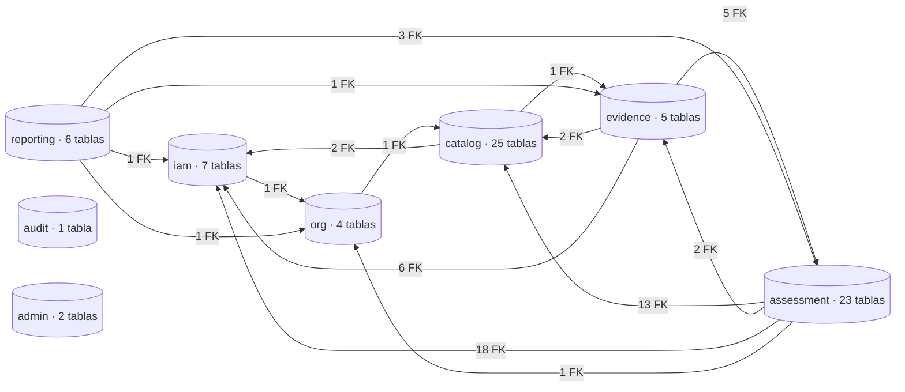
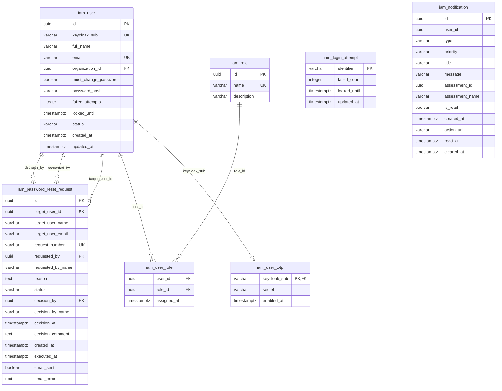
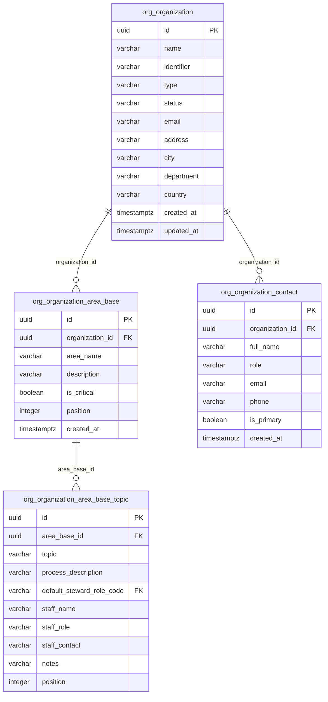
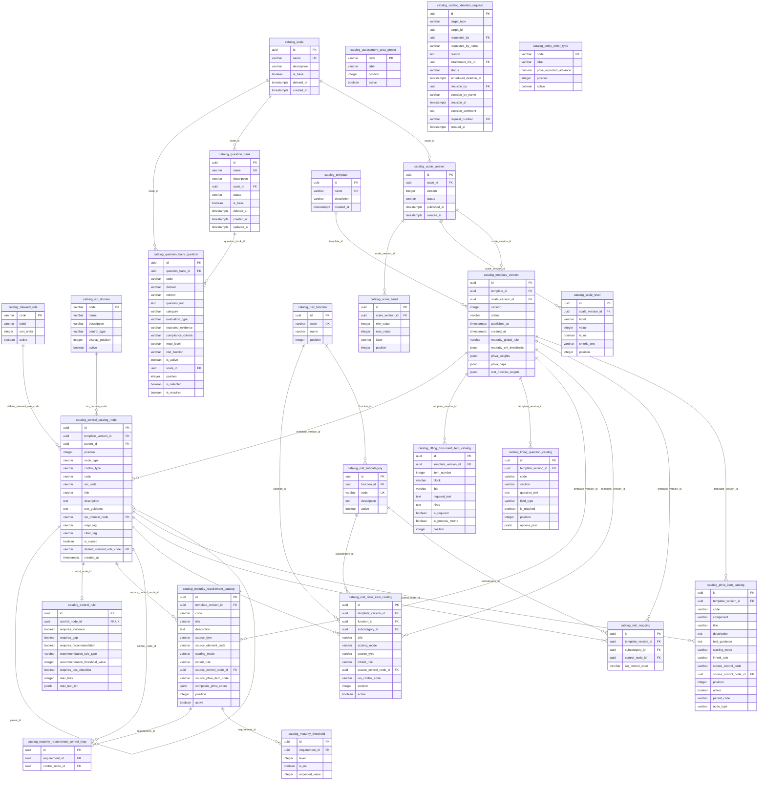
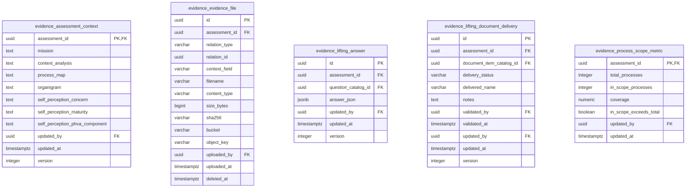
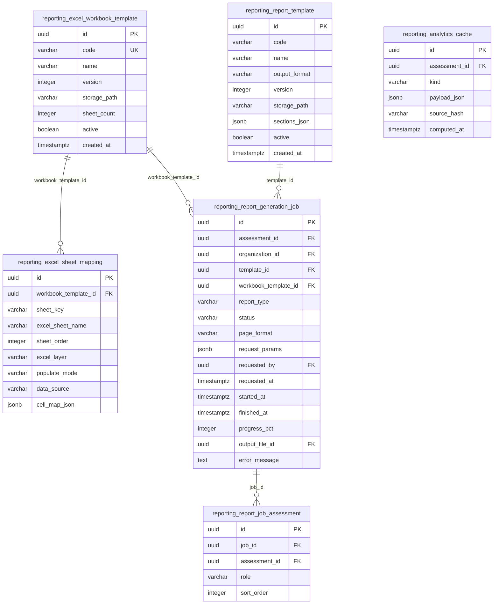
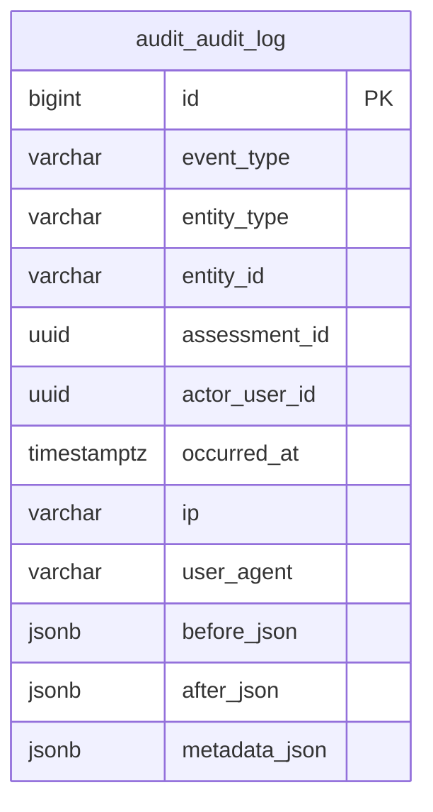
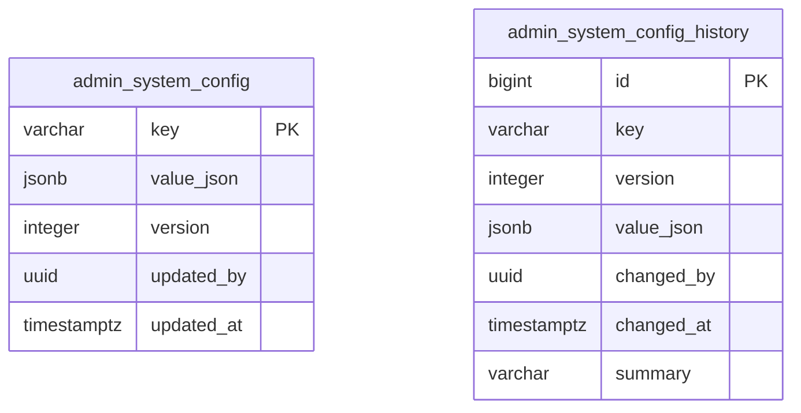

# Modelo entidad-relación (MER)

Vista del modelo de datos MSPI para la wiki. Fuentes canónicas en este directorio. El diagrama completo es **SVG vectorial** (nítido a cualquier zoom); debajo hay `erDiagram` Mermaid por esquema.

## Diagrama completo (SVG vectorial)

**Contexto.** Vista global generada con `dbml-renderer` desde [`MER-MSPI.dbml`](MER-MSPI.dbml) (esquema real: base + `patch-*.sql` del init Docker). Incluye `iam.password_reset_request`, radicados `request_number` (`SOL-*`) y esquemas `audit` / `admin`.

<object data="MER-MSPI.svg" type="image/svg+xml" width="100%" height="720" style="border:1px solid #e2e8f0;border-radius:8px;background:#fff" title="MER MSPI SVG"></object>

[Descargar MER-MSPI.svg](MER-MSPI.svg) · vectorial (Graphviz / dbml-renderer)

## Vista de alta calidad (exportada desde dbdocs.io)

**Contexto.** Diagrama exportado directamente desde dbdocs.io, con mejor calidad visual (estilo, agrupación
por esquema y tipografía). Disponible en SVG vectorial y PDF, ambos nítidos a cualquier zoom.

- 🖼️ [MER-MSPI-dbdocs.svg](MER-MSPI-dbdocs.svg) — SVG vectorial de alta calidad.
- 📄 [MER-MSPI-dbdocs.pdf](MER-MSPI-dbdocs.pdf) — PDF vectorial de alta calidad.

## Fuentes

| Artefacto | Descripción |
|---|---|
| [MER-MSPI-dbdocs.svg](MER-MSPI-dbdocs.svg) | Diagrama de alta calidad (dbdocs.io), SVG vectorial |
| [MER-MSPI-dbdocs.pdf](MER-MSPI-dbdocs.pdf) | Diagrama de alta calidad (dbdocs.io), PDF vectorial |
| [MER-MSPI.svg](MER-MSPI.svg) | Diagrama visual vectorial (dbml-renderer) |
| [MER-MSPI.sql](MER-MSPI.sql) | DDL consolidado (`pg_dump --schema-only` tras base + patches) |
| [MER-MSPI.dbml](MER-MSPI.dbml) | Fuente dbdiagram / dbdocs |
| [dbdocs.io — MER-MSPI](https://dbdocs.io/jdtovar-2021a/MER-MSPI) | Vista interactiva online |

## Esquemas PostgreSQL

Instancia única particionada (**8**): `iam` · `org` · `catalog` · `assessment` · `evidence` · `reporting` · `audit` · `admin`.

Incluye, entre otros: `iam.password_reset_request` (`SOL-PWD`), columnas `request_number` en solicitudes de eliminación/ampliación (assessment/catalog), y esquemas `audit` / `admin` (extraídos desde `iam.*` vía patches).

Migraciones de extracción (código): `patch-audit-schema.sql` (`iam.audit_log` → `audit.audit_log`), `patch-admin-schema.sql` (`iam.system_config*` → `admin.*`).

---

## Dimensión del modelo

**73 tablas · 684 columnas · 135 llaves foráneas** (77 dentro del mismo esquema, 58 entre esquemas).

| Esquema | Microservicio | Tablas | Columnas | FK internas | FK hacia otros esquemas |
|---|---|---|---|---|---|
| `iam` | ms_iam :8082 | 7 | 55 | 6 | 1 |
| `org` | ms_org :8083 | 4 | 37 | 3 | 1 |
| `catalog` | ms_catalog :8085 | 25 | 210 | 30 | 3 |
| `assessment` | ms_assessment :8084 | 23 | 255 | 34 | 34 |
| `evidence` | ms_evidence :8086 | 5 | 50 | 0 | 13 |
| `reporting` | ms_reporting :8087 | 6 | 53 | 4 | 6 |
| `audit` | ms_audit :8088 | 1 | 12 | 0 | 0 |
| `admin` | ms_admin :8089 | 2 | 12 | 0 | 0 |

### Dependencias entre esquemas

**Contexto.** Cada nodo es un esquema (uno por microservicio) y cada flecha resume las llaves foráneas físicas que apuntan de un esquema a otro. `assessment` depende fuertemente de `catalog` porque congela la plantilla del instrumento en cada evaluación; `audit` y `admin` no tienen FK hacia nadie a propósito, para que la bitácora y la configuración sigan funcionando aunque cambie el resto del modelo. Todas las bases viven en una misma instancia PostgreSQL, lo que permite estas FK cruzadas; cada servicio solo escribe en su propio esquema.

---

## Cómo leer los `erDiagram`

| Notación | Significado |
|---|---|
| `\|\|--o{` | Uno a muchos |
| `\|\|--o\|` | Uno a cero-o-uno |
| `PK` / `FK` / `UK` | Clave primaria / foránea / única |
| Etiqueta de la relación | Columna(s) FK en la tabla hija |
| FK a otro esquema | Se marca `FK` en la columna y se lista en la tabla «Referencias a otros esquemas» |

Los diagramas incluyen **todas las tablas y todas las columnas** del DDL consolidado. Fuente de verdad: [`MER-MSPI.sql`](MER-MSPI.sql). Tipos abreviados: `varchar` = character varying, `timestamptz` = timestamp with time zone.

---

## 1. Esquema `iam` (ms_iam :8082)

**Contexto.** Identidad local ligada a Keycloak, roles, segundo factor TOTP, intentos de inicio de sesión, notificaciones y solicitudes de reenvío de contraseña (`SOL-PWD`). La bitácora y la configuración global ya no viven aquí.

**7 tablas · 55 columnas · 6 FK internas · 1 FK a otros esquemas.**

| Tabla | Propósito |
|---|---|
| `iam.login_attempt` | Intentos de inicio de sesión (soporte del bloqueo por intentos fallidos). |
| `iam.notification` | Notificaciones in-app por usuario (lectura y limpieza lógica). |
| `iam.password_reset_request` | Solicitudes de reenvío de contraseña temporal + reinicio de 2FA (SOL-PWD). |
| `iam.role` | Roles de negocio (espejo de los roles de Keycloak). |
| `iam.user` | Usuario local vinculado a Keycloak (sub), organización y estado. |
| `iam.user_role` | Asignación usuario ↔ rol. |
| `iam.user_totp` | Secreto TOTP del segundo factor por usuario. |

**Referencias a otros esquemas**

| Tabla | Columna(s) | Referencia |
|---|---|---|
| `iam.user` | `organization_id` | `org.organization` |

---

## 2. Esquema `org` (ms_org :8083)

**Contexto.** Datos maestros de las entidades evaluadas, sus contactos y plantillas de áreas/temas reutilizables al crear evaluaciones.

**4 tablas · 37 columnas · 3 FK internas · 1 FK a otros esquemas.**

| Tabla | Propósito |
|---|---|
| `org.organization` | Entidad evaluada (datos maestros). |
| `org.organization_area_base` | Áreas base reutilizables de la entidad. |
| `org.organization_area_base_topic` | Temas por área base con responsable sugerido. |
| `org.organization_contact` | Contactos de la entidad. |

**Referencias a otros esquemas**

| Tabla | Columna(s) | Referencia |
|---|---|---|
| `org.organization_area_base_topic` | `default_steward_role_code` | `catalog.steward_role` |

---

## 3. Esquema `catalog` (ms_catalog :8085)

**Contexto.** Definición versionable del instrumento: plantilla y versiones, árbol de controles del Anexo A, reglas, escalas, bancos de preguntas, PHVA, madurez y NIST CSF. Escalas y bancos usan borrado lógico con radicado `SOL-CAT`. Cada evaluación congela una `template_version` publicada, por eso los cambios futuros del catálogo no alteran evaluaciones históricas.

**25 tablas · 210 columnas · 30 FK internas · 3 FK a otros esquemas.**

| Tabla | Propósito |
|---|---|
| `catalog.assessment_area_preset` | Plantilla de las áreas del instrumento para inicializar evaluaciones. |
| `catalog.catalog_deletion_request` | Solicitudes de eliminación lógica de escalas o bancos (SOL-CAT). |
| `catalog.control_catalog_node` | Árbol maestro de controles Anexo A por versión de plantilla. |
| `catalog.control_rule` | Reglas de cálculo por control hoja (administrativo o técnico). |
| `catalog.entity_order_type` | Tipos de entidad MSPI (Nacional, Territorial A/B/C, Otra) con metas PHVA. |
| `catalog.iso_domain` | Dominios ISO/IEC 27001 (A.5 … A.18 / temas 2022). |
| `catalog.lifting_document_item_catalog` | Los 43 ítems de evidencia documental del levantamiento. |
| `catalog.lifting_question_catalog` | Preguntas complementarias del levantamiento de información. |
| `catalog.maturity_requirement_catalog` | Requisitos de la hoja Madurez por versión de plantilla. |
| `catalog.maturity_requirement_control_map` | Trazabilidad requisito de madurez ↔ control. |
| `catalog.maturity_threshold` | Matriz de umbrales por requisito y nivel de madurez. |
| `catalog.nist_ciber_item_catalog` | Ítems de la hoja Ciberseguridad (NIST CSF) por versión de plantilla. |
| `catalog.nist_function` | Funciones NIST CSF 2.0 (Gobernar, Identificar, Proteger, Detectar, Responder, Recuperar). |
| `catalog.nist_mapping` | Mapeo control ISO ↔ subcategoría NIST. |
| `catalog.nist_subcategory` | Subcategorías NIST CSF referenciadas por la hoja Ciber. |
| `catalog.phva_item_catalog` | Requisitos de la hoja PHVA con su ponderación. |
| `catalog.question_bank` | Bancos de preguntas de línea base (con borrado lógico). |
| `catalog.question_bank_question` | Preguntas de cada banco. |
| `catalog.scale` | Escalas de calificación (con borrado lógico). |
| `catalog.scale_band` | Bandas de interpretación de una versión de escala. |
| `catalog.scale_level` | Niveles/valores de una versión de escala. |
| `catalog.scale_version` | Versiones de una escala (borrador / publicada). |
| `catalog.steward_role` | Cargos responsables por defecto de los controles. |
| `catalog.template` | Instrumento (plantilla) MSPI. |
| `catalog.template_version` | Versión publicada del instrumento que congela cada evaluación. |

**Referencias a otros esquemas**

| Tabla | Columna(s) | Referencia |
|---|---|---|
| `catalog.catalog_deletion_request` | `attachment_file_id` | `evidence.evidence_file` |
| `catalog.catalog_deletion_request` | `decision_by` | `iam.user` |
| `catalog.catalog_deletion_request` | `requested_by` | `iam.user` |

---

## 4. Esquema `assessment` (ms_assessment :8084)

**Contexto.** Ejecución del instrumento por evaluación: equipo, áreas, árbol de controles congelado, respuestas, revisiones, PHVA, madurez, NIST, brechas, historial de estados y las solicitudes de ampliación (`SOL-AMPL`) y eliminación lógica (`SOL-ELIM`). Es el esquema más grande y el que más referencia al catálogo.

**23 tablas · 255 columnas · 34 FK internas · 34 FK a otros esquemas.**

| Tabla | Propósito |
|---|---|
| `assessment.assessment` | Evaluación: entidad, plantilla congelada, estado del flujo, plazos, prioridad y borrado lógico. |
| `assessment.assessment_area` | Áreas institucionales involucradas en la evaluación (8 ejes del instrumento). |
| `assessment.assessment_area_topic` | Temas/procesos por área con su responsable; propaga el responsable a los controles. |
| `assessment.assessment_control_node` | Árbol de controles congelado (dominio → objetivo → control) copiado del catálogo. |
| `assessment.assessment_deletion_request` | Solicitudes de eliminación lógica con radicado SOL-ELIM, decisión y gracia. |
| `assessment.assessment_edit_lock` | Bloqueo de edición para evitar que dos evaluadores editen a la vez. |
| `assessment.assessment_extension_request` | Solicitudes de ampliación de plazo con radicado SOL-AMPL. |
| `assessment.assessment_maturity_requirement` | Requisitos de madurez (R1…Rn) instanciados por evaluación. |
| `assessment.assessment_maturity_requirement_response` | Calificación manual de requisitos de madurez no heredados. |
| `assessment.assessment_maturity_threshold` | Umbrales de nivel de madurez copiados del catálogo al crear la evaluación. |
| `assessment.assessment_member` | Equipo de la evaluación (evaluadores, revisores, líder). |
| `assessment.assessment_metadata` | Metadatos extendidos de la evaluación. |
| `assessment.assessment_nist_ciber_item` | Ítems de la hoja Ciberseguridad NIST instanciados por evaluación. |
| `assessment.assessment_phva_item` | Requisitos PHVA instanciados por evaluación. |
| `assessment.assessment_status_history` | Bitácora de transiciones de estado del flujo de la evaluación. |
| `assessment.control_comment` | Comentarios sobre un control dentro de un hilo. |
| `assessment.control_comment_thread` | Hilos de conversación por control evaluado. |
| `assessment.control_response` | Calificación de cada control hoja (puntaje, estado, responsable, observaciones). |
| `assessment.control_review` | Revisión del control por el revisor (validado / requiere cambios). |
| `assessment.gap_action` | Acciones de cierre asociadas a una brecha. |
| `assessment.gap_register` | Registro de brechas priorizadas (controles con puntaje bajo). |
| `assessment.nist_ciber_item_response` | Calificación manual de ítems NIST no heredados. |
| `assessment.phva_item_response` | Calificación manual de ítems PHVA no heredados. |

```mermaid
erDiagram
  assessment_assessment ||--o{ assessment_assessment_area : "assessment_id"
  assessment_assessment_area ||--o{ assessment_assessment_area_topic : "area_id"
  assessment_assessment ||--o{ assessment_assessment : "cloned_from_assessment_id"
  assessment_assessment ||--o{ assessment_assessment_control_node : "assessment_id"
  assessment_assessment_control_node ||--o{ assessment_assessment_control_node : "parent_id"
  assessment_assessment ||--o{ assessment_assessment_deletion_request : "assessment_id"
  assessment_assessment ||--o| assessment_assessment_edit_lock : "assessment_id"
  assessment_assessment ||--o{ assessment_assessment_extension_request : "assessment_id"
  assessment_assessment_control_node ||--o{ assessment_assessment_maturity_requirement : "source_assessment_control_node_id"
  assessment_assessment_phva_item ||--o{ assessment_assessment_maturity_requirement : "source_assessment_phva_item_id"
  assessment_assessment ||--o{ assessment_assessment_maturity_requirement : "assessment_id"
  assessment_assessment_maturity_requirement ||--o{ assessment_assessment_maturity_requirement_response : "maturity_requirement_id"
  assessment_assessment ||--o{ assessment_assessment_maturity_requirement_response : "assessment_id"
  assessment_assessment ||--o{ assessment_assessment_maturity_threshold : "assessment_id"
  assessment_assessment_maturity_requirement ||--o{ assessment_assessment_maturity_threshold : "maturity_requirement_id"
  assessment_assessment ||--o{ assessment_assessment_member : "assessment_id"
  assessment_assessment ||--o| assessment_assessment_metadata : "assessment_id"
  assessment_assessment ||--o{ assessment_assessment_nist_ciber_item : "assessment_id"
  assessment_assessment_control_node ||--o{ assessment_assessment_nist_ciber_item : "source_assessment_control_node_id"
  assessment_assessment ||--o{ assessment_assessment_phva_item : "assessment_id"
  assessment_assessment_control_node ||--o{ assessment_assessment_phva_item : "source_assessment_control_node_id"
  assessment_assessment ||--o{ assessment_assessment_status_history : "assessment_id"
  assessment_control_response ||--o{ assessment_control_comment_thread : "control_response_id"
  assessment_control_comment_thread ||--o{ assessment_control_comment : "thread_id"
  assessment_assessment ||--o{ assessment_control_response : "assessment_id"
  assessment_assessment_control_node ||--o{ assessment_control_response : "control_node_id"
  assessment_control_response ||--o| assessment_control_review : "control_response_id"
  assessment_gap_register ||--o{ assessment_gap_action : "gap_id"
  assessment_assessment ||--o{ assessment_gap_register : "assessment_id"
  assessment_control_response ||--o{ assessment_gap_register : "control_response_id"
  assessment_assessment ||--o{ assessment_nist_ciber_item_response : "assessment_id"
  assessment_assessment_nist_ciber_item ||--o{ assessment_nist_ciber_item_response : "nist_ciber_item_id"
  assessment_assessment ||--o{ assessment_phva_item_response : "assessment_id"
  assessment_assessment_phva_item ||--o{ assessment_phva_item_response : "phva_item_id"
  assessment_assessment {
    uuid id PK
    uuid organization_id FK
    uuid template_version_id FK
    varchar name
    varchar organization_name_snapshot
    date evaluation_date
    date due_date
    varchar period_label
    varchar contact
    varchar evaluator_display_name
    varchar prepared_by
    uuid auditor_id
    varchar auditor_display_name
    uuid created_by FK
    varchar entity_order_type_code FK
    varchar entity_type_other
    numeric phva_expected_advance_snapshot
    varchar status
    timestamptz status_changed_at
    uuid status_changed_by FK
    timestamptz published_at
    uuid published_by FK
    uuid cloned_from_assessment_id FK
    varchar priority
    integer row_version
    timestamptz last_saved_at
    timestamptz deleted_at
    timestamptz updated_at
    timestamptz created_at
  }
  assessment_assessment_area {
    uuid id PK
    uuid assessment_id FK
    varchar area_preset_code FK
    varchar area_name
    varchar description
    integer position
    timestamptz created_at
  }
  assessment_assessment_area_topic {
    uuid id PK
    uuid area_id FK
    varchar topic
    varchar process_description
    varchar default_steward_role_code FK
    varchar staff_name
    varchar staff_role
    varchar staff_contact
    varchar notes
    integer position
  }
  assessment_assessment_control_node {
    uuid id PK
    uuid assessment_id FK
    uuid source_catalog_node_id FK
    uuid parent_id FK
    integer position
    varchar node_type
    varchar control_type
    varchar code
    varchar iso_code
    varchar title
    text description
    text test_guidance
    varchar iso_domain_code FK
    varchar mspi_tag
    varchar ciber_tag
    boolean is_scored
    jsonb rules_json
    varchar default_steward_role_code FK
  }
  assessment_assessment_deletion_request {
    uuid id PK
    uuid assessment_id FK
    uuid requested_by FK
    varchar requested_by_name
    text reason
    uuid attachment_file_id FK
    varchar status
    timestamptz scheduled_deletion_at
    uuid decision_by FK
    varchar decision_by_name
    timestamptz decision_at
    text decision_comment
    varchar request_number UK
    timestamptz created_at
  }
  assessment_assessment_edit_lock {
    uuid assessment_id PK,FK
    uuid locked_by_user_id FK
    uuid lock_token
    timestamptz acquired_at
    timestamptz expires_at
  }
  assessment_assessment_extension_request {
    uuid id PK
    uuid assessment_id FK
    uuid requested_by FK
    varchar requested_by_name
    text reason
    uuid attachment_file_id FK
    integer days
    varchar status
    uuid decision_by FK
    varchar decision_by_name
    timestamptz decision_at
    text decision_comment
    varchar request_number UK
    timestamptz created_at
  }
  assessment_assessment_maturity_requirement {
    uuid id PK
    uuid assessment_id FK
    uuid source_catalog_requirement_id FK
    varchar code
    varchar title
    text description
    varchar source_type
    varchar source_element_code
    varchar scoring_mode
    varchar inherit_rule
    varchar source_control_code
    uuid source_catalog_control_node_id
    uuid source_assessment_control_node_id FK
    varchar source_phva_item_code
    jsonb composite_phva_codes
    uuid source_catalog_phva_item_id FK
    uuid source_assessment_phva_item_id FK
    integer position
  }
  assessment_assessment_maturity_requirement_response {
    uuid id PK
    uuid assessment_id FK
    uuid maturity_requirement_id FK
    varchar score_status
    integer score_value
    uuid updated_by FK
    timestamptz updated_at
    integer version
  }
  assessment_assessment_maturity_threshold {
    uuid id PK
    uuid assessment_id FK
    uuid maturity_requirement_id FK
    integer level
    boolean is_na
    integer expected_value
  }
  assessment_assessment_member {
    uuid assessment_id FK
    uuid user_id FK
    varchar member_role
    boolean is_leader
    timestamptz assigned_at
  }
  assessment_assessment_metadata {
    uuid assessment_id PK,FK
    varchar period
    text scope
    varchar prepared_by
    varchar approved_by
    date start_date
    date end_date
    text notes
  }
  assessment_assessment_nist_ciber_item {
    uuid id PK
    uuid assessment_id FK
    uuid source_catalog_item_id FK
    uuid function_id FK
    varchar function_code
    varchar function_name
    uuid subcategory_id FK
    varchar subcategory_code
    varchar title
    varchar scoring_mode
    varchar source_type
    varchar inherit_rule
    varchar iso_control_code
    uuid source_catalog_control_node_id
    uuid source_assessment_control_node_id FK
    integer position
  }
  assessment_assessment_phva_item {
    uuid id PK
    uuid assessment_id FK
    uuid source_catalog_item_id FK
    varchar code
    varchar component
    varchar title
    text description
    text test_guidance
    varchar scoring_mode
    varchar inherit_rule
    varchar source_control_code
    uuid source_catalog_control_node_id
    uuid source_assessment_control_node_id FK
    integer position
    varchar parent_code
    varchar node_type
  }
  assessment_assessment_status_history {
    bigint id PK
    uuid assessment_id FK
    varchar old_status
    varchar new_status
    text note
    uuid changed_by FK
    timestamptz changed_at
  }
  assessment_control_comment {
    uuid id PK
    uuid thread_id FK
    uuid author_user_id FK
    text body
    timestamptz created_at
  }
  assessment_control_comment_thread {
    uuid id PK
    uuid control_response_id FK
    uuid created_by FK
    timestamptz created_at
    boolean is_resolved
    uuid resolved_by FK
    timestamptz resolved_at
  }
  assessment_control_response {
    uuid id PK
    uuid assessment_id FK
    uuid control_node_id FK
    varchar score_status
    integer score_value
    text evidence_text
    text gap_text
    text recommendation_text
    varchar control_status
    varchar steward_source
    varchar steward_custom_name
    varchar steward_custom_staff_role
    varchar steward_custom_contact
    uuid updated_by FK
    timestamptz updated_at
    integer version
  }
  assessment_control_review {
    uuid id PK
    uuid control_response_id FK,UK
    varchar review_status
    text comment
    varchar severity
    uuid reviewed_by FK
    timestamptz reviewed_at
  }
  assessment_gap_action {
    uuid id PK
    uuid gap_id FK
    text description
    varchar owner
    date due_date
    varchar status
    timestamptz created_at
    timestamptz updated_at
  }
  assessment_gap_register {
    uuid id PK
    uuid assessment_id FK
    uuid control_response_id FK
    varchar title
    text gap_text
    varchar priority
    varchar owner
    date due_date
    varchar status
    timestamptz created_at
    timestamptz updated_at
  }
  assessment_nist_ciber_item_response {
    uuid id PK
    uuid assessment_id FK
    uuid nist_ciber_item_id FK
    varchar score_status
    integer score_value
    text evidence_text
    text gap_text
    uuid updated_by FK
    timestamptz updated_at
    integer version
  }
  assessment_phva_item_response {
    uuid id PK
    uuid assessment_id FK
    uuid phva_item_id FK
    varchar score_status
    integer score_value
    text evidence_text
    text gap_text
    uuid updated_by FK
    timestamptz updated_at
    integer version
  }
```

**Referencias a otros esquemas**

| Tabla | Columna(s) | Referencia |
|---|---|---|
| `assessment.assessment_area` | `area_preset_code` | `catalog.assessment_area_preset` |
| `assessment.assessment_area_topic` | `default_steward_role_code` | `catalog.steward_role` |
| `assessment.assessment_control_node` | `default_steward_role_code` | `catalog.steward_role` |
| `assessment.assessment_control_node` | `iso_domain_code` | `catalog.iso_domain` |
| `assessment.assessment_control_node` | `source_catalog_node_id` | `catalog.control_catalog_node` |
| `assessment.assessment` | `created_by` | `iam.user` |
| `assessment.assessment_deletion_request` | `attachment_file_id` | `evidence.evidence_file` |
| `assessment.assessment_deletion_request` | `decision_by` | `iam.user` |
| `assessment.assessment_deletion_request` | `requested_by` | `iam.user` |
| `assessment.assessment_edit_lock` | `locked_by_user_id` | `iam.user` |
| `assessment.assessment` | `entity_order_type_code` | `catalog.entity_order_type` |
| `assessment.assessment_extension_request` | `attachment_file_id` | `evidence.evidence_file` |
| `assessment.assessment_extension_request` | `decision_by` | `iam.user` |
| `assessment.assessment_extension_request` | `requested_by` | `iam.user` |
| `assessment.assessment_maturity_requirement` | `source_catalog_requirement_id` | `catalog.maturity_requirement_catalog` |
| `assessment.assessment_maturity_requirement` | `source_catalog_phva_item_id` | `catalog.phva_item_catalog` |
| `assessment.assessment_maturity_requirement_response` | `updated_by` | `iam.user` |
| `assessment.assessment_member` | `user_id` | `iam.user` |
| `assessment.assessment_nist_ciber_item` | `function_id` | `catalog.nist_function` |
| `assessment.assessment_nist_ciber_item` | `source_catalog_item_id` | `catalog.nist_ciber_item_catalog` |
| `assessment.assessment_nist_ciber_item` | `subcategory_id` | `catalog.nist_subcategory` |
| `assessment.assessment` | `organization_id` | `org.organization` |
| `assessment.assessment_phva_item` | `source_catalog_item_id` | `catalog.phva_item_catalog` |
| `assessment.assessment` | `published_by` | `iam.user` |
| `assessment.assessment` | `status_changed_by` | `iam.user` |
| `assessment.assessment_status_history` | `changed_by` | `iam.user` |
| `assessment.assessment` | `template_version_id` | `catalog.template_version` |
| `assessment.control_comment` | `author_user_id` | `iam.user` |
| `assessment.control_comment_thread` | `created_by` | `iam.user` |
| `assessment.control_comment_thread` | `resolved_by` | `iam.user` |
| `assessment.control_response` | `updated_by` | `iam.user` |
| `assessment.control_review` | `reviewed_by` | `iam.user` |
| `assessment.nist_ciber_item_response` | `updated_by` | `iam.user` |
| `assessment.phva_item_response` | `updated_by` | `iam.user` |

---

## 5. Esquema `evidence` (ms_evidence :8086)

**Contexto.** Contexto organizacional, levantamiento documental (43 ítems) y metadatos de archivos de evidencia. El binario vive en el almacenamiento de archivos; aquí solo su metadato, hash y relación.

**5 tablas · 50 columnas · 0 FK internas · 13 FK a otros esquemas.**

| Tabla | Propósito |
|---|---|
| `evidence.assessment_context` | Contexto organizacional (texto) del levantamiento de información. |
| `evidence.evidence_file` | Metadatos de archivos de evidencia y reportes (hash SHA-256, almacenamiento, relación). |
| `evidence.lifting_answer` | Respuestas a preguntas del levantamiento. |
| `evidence.lifting_document_delivery` | Estado de entrega de cada uno de los 43 documentos del levantamiento. |
| `evidence.process_scope_metric` | Métricas de alcance de procesos de la entidad (1:1 con evaluación). |

**Referencias a otros esquemas**

| Tabla | Columna(s) | Referencia |
|---|---|---|
| `evidence.assessment_context` | `assessment_id` | `assessment.assessment` |
| `evidence.assessment_context` | `updated_by` | `iam.user` |
| `evidence.evidence_file` | `assessment_id` | `assessment.assessment` |
| `evidence.evidence_file` | `uploaded_by` | `iam.user` |
| `evidence.lifting_answer` | `assessment_id` | `assessment.assessment` |
| `evidence.lifting_answer` | `question_catalog_id` | `catalog.lifting_question_catalog` |
| `evidence.lifting_answer` | `updated_by` | `iam.user` |
| `evidence.lifting_document_delivery` | `assessment_id` | `assessment.assessment` |
| `evidence.lifting_document_delivery` | `document_item_catalog_id` | `catalog.lifting_document_item_catalog` |
| `evidence.lifting_document_delivery` | `updated_by` | `iam.user` |
| `evidence.lifting_document_delivery` | `validated_by` | `iam.user` |
| `evidence.process_scope_metric` | `assessment_id` | `assessment.assessment` |
| `evidence.process_scope_metric` | `updated_by` | `iam.user` |

---

## 6. Esquema `reporting` (ms_reporting :8087)

**Contexto.** Plantillas de reporte y del libro Excel oficial, trabajos asíncronos de generación y caché analítica.

**6 tablas · 53 columnas · 4 FK internas · 6 FK a otros esquemas.**

| Tabla | Propósito |
|---|---|
| `reporting.analytics_cache` | Caché de agregados analíticos por evaluación. |
| `reporting.excel_sheet_mapping` | Mapeo de hojas/celdas del libro Excel oficial. |
| `reporting.excel_workbook_template` | Plantilla del libro Excel MinTIC (9 hojas). |
| `reporting.report_generation_job` | Trabajo asíncrono de generación (PENDING → RUNNING → COMPLETED/FAILED). |
| `reporting.report_job_assessment` | Evaluaciones incluidas en un trabajo (reportes comparativos). |
| `reporting.report_template` | Tipos de reporte disponibles y su formato de salida. |

**Referencias a otros esquemas**

| Tabla | Columna(s) | Referencia |
|---|---|---|
| `reporting.analytics_cache` | `assessment_id` | `assessment.assessment` |
| `reporting.report_generation_job` | `assessment_id` | `assessment.assessment` |
| `reporting.report_generation_job` | `organization_id` | `org.organization` |
| `reporting.report_generation_job` | `output_file_id` | `evidence.evidence_file` |
| `reporting.report_generation_job` | `requested_by` | `iam.user` |
| `reporting.report_job_assessment` | `assessment_id` | `assessment.assessment` |

---

## 7. Esquema `audit` (ms_audit :8088)

**Contexto.** Bitácora central append-only. `assessment_id` y `actor_user_id` son UUID sin FK (desacople entre servicios). Los radicados se correlacionan en `metadata_json.requestNumber`.

**1 tablas · 12 columnas · 0 FK internas · 0 FK a otros esquemas.**

| Tabla | Propósito |
|---|---|
| `audit.audit_log` | Bitácora central append-only de eventos (quién, qué, cuándo, radicado en metadata). |

---

## 8. Esquema `admin` (ms_admin :8089)

**Contexto.** Configuración global versionada (plazos, gracia, tipos MIME, etc.). `updated_by` / `changed_by` son UUID sin FK a `iam.user`.

**2 tablas · 12 columnas · 0 FK internas · 0 FK a otros esquemas.**

| Tabla | Propósito |
|---|---|
| `admin.system_config` | Parámetro global versionado (plazos, días de gracia, tipos MIME, tamaños). |
| `admin.system_config_history` | Historial inmutable de cada cambio de parámetro global. |

