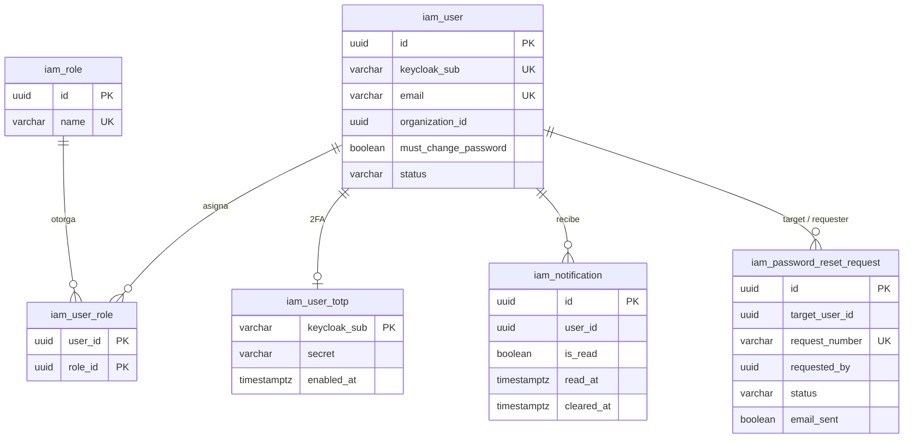
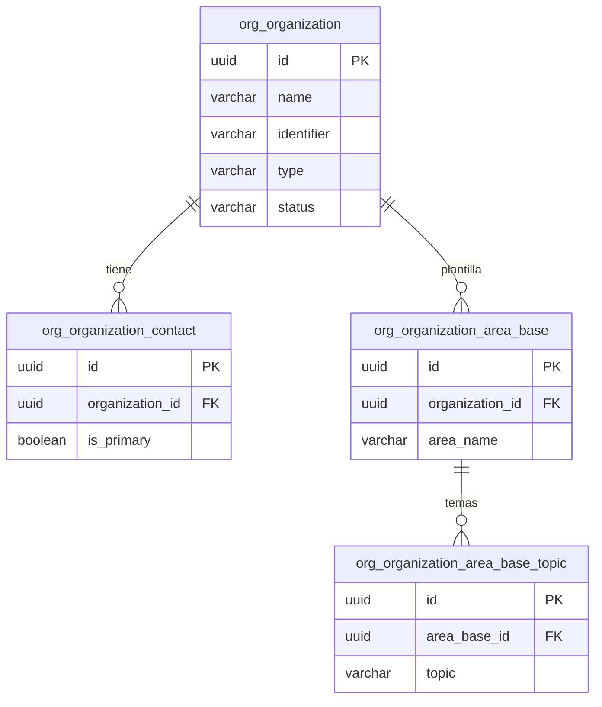
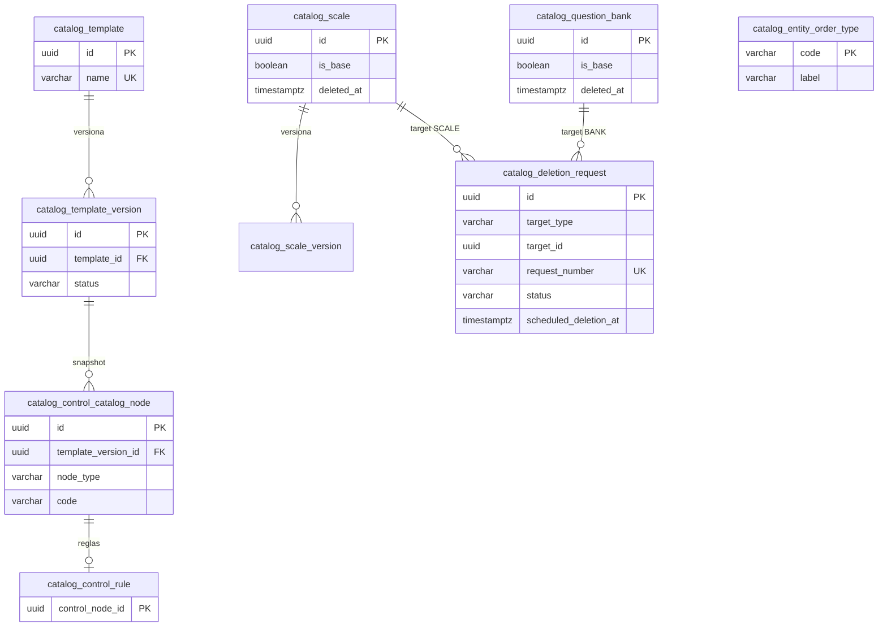
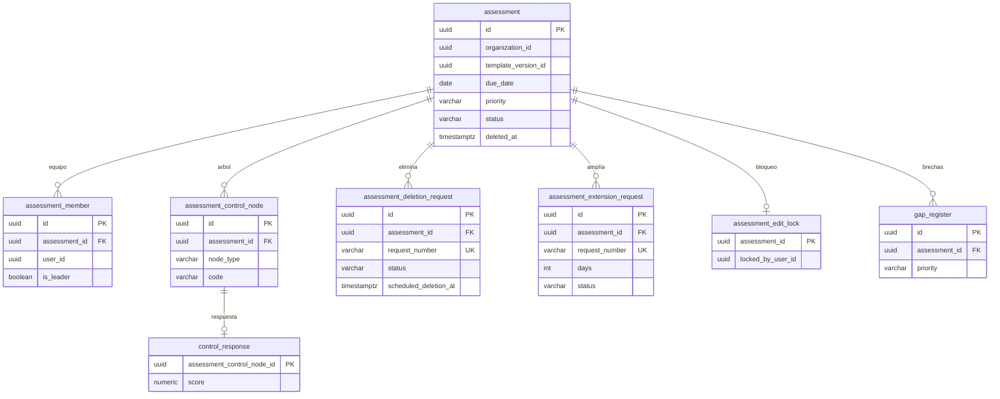
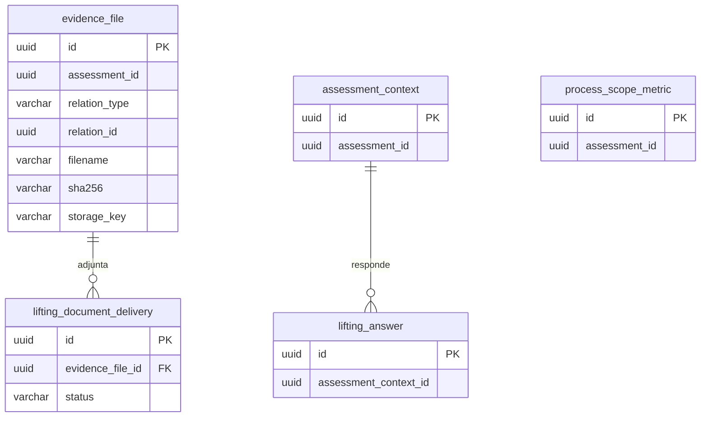
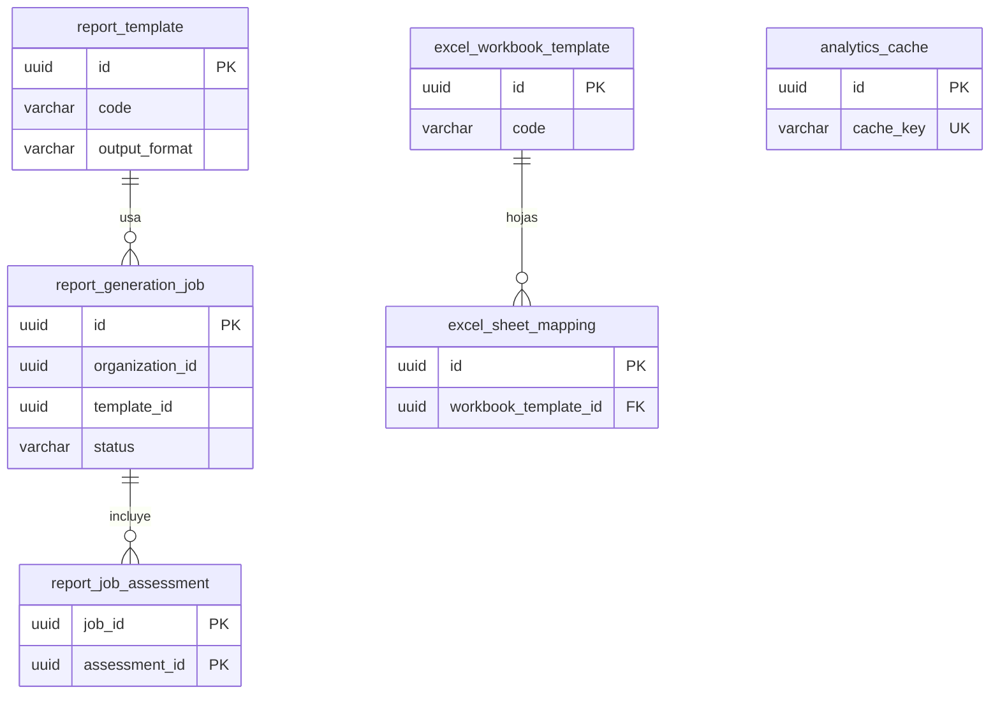
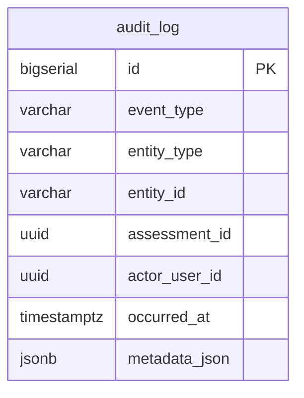
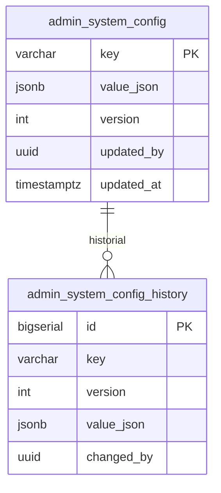

# Modelo entidad-relación (MER)

Vista del modelo de datos MSPI para la wiki. Fuentes canónicas en este directorio. El diagrama completo es **SVG vectorial** (nítido a cualquier zoom); debajo hay `erDiagram` Mermaid por esquema.

## Diagrama completo (SVG vectorial)

**Contexto.** Vista global generada con `dbml-renderer` desde [`MER-MSPI.dbml`](MER-MSPI.dbml) (esquema real: base + `patch-*.sql` del init Docker). Incluye `iam.password_reset_request`, radicados `request_number` (`SOL-*`) y esquemas `audit` / `admin`.

<object data="MER-MSPI.svg" type="image/svg+xml" width="100%" height="720" style="border:1px solid #e2e8f0;border-radius:8px;background:#fff" title="MER MSPI SVG"></object>

[Descargar MER-MSPI.svg](MER-MSPI.svg) · vectorial (Graphviz / dbml-renderer)

## Fuentes

| Artefacto | Descripción |
|---|---|
| [MER-MSPI.svg](MER-MSPI.svg) | Diagrama visual vectorial |
| [MER-MSPI.sql](MER-MSPI.sql) | DDL consolidado (`pg_dump --schema-only` tras base + patches) |
| [MER-MSPI.dbml](MER-MSPI.dbml) | Fuente dbdiagram / dbdocs |
| [dbdocs.io — MER-MSPI](https://dbdocs.io/jdtovar-2021a/MER-MSPI) | Vista interactiva online |

## Esquemas PostgreSQL

Instancia única particionada (**8**): `iam` · `org` · `catalog` · `assessment` · `evidence` · `reporting` · `audit` · `admin`.

Incluye, entre otros: `iam.password_reset_request` (`SOL-PWD`), columnas `request_number` en solicitudes de eliminación/ampliación (assessment/catalog), y esquemas `audit` / `admin` (extraídos desde `iam.*` vía patches).

Migraciones de extracción (código): `patch-audit-schema.sql` (`iam.audit_log` → `audit.audit_log`), `patch-admin-schema.sql` (`iam.system_config*` → `admin.*`).

---

## Cómo leer los `erDiagram`

| Notación | Significado |
|---|---|
| `\|\|--o{` | Uno a muchos |
| `\|\|--\|\|` | Uno a uno |
| `PK` / `UK` | Clave primaria / única |
| Sin línea entre esquemas | Referencia lógica (UUID sin FK física), p. ej. `audit` → `assessment` |

Los diagramas listan columnas clave (no todas). Fuente de verdad: [`MER-MSPI.sql`](MER-MSPI.sql).

---

## 1. Esquema `iam` (ms_iam :8082)

**Contexto.** Identidad local ligada a Keycloak (`keycloak_sub`), roles, TOTP, notificaciones y solicitudes de reenvío de contraseña (`SOL-PWD`). La bitácora y la config global ya no viven aquí (`audit` / `admin`).

---

## 2. Esquema `org` (ms_org :8083)

**Contexto.** Maestro de entidades evaluadas, contactos y plantillas de áreas/temas reutilizables al crear evaluaciones.

---

## 3. Esquema `catalog` (ms_catalog :8085)

**Contexto.** Instrumento versionado (plantilla, escalas, bancos, Anexo A, PHVA, madurez, NIST) y soft-delete de escalas/bancos con radicado `SOL-CAT`.

---

## 4. Esquema `assessment` (ms_assessment :8084)

**Contexto.** Ejecución del instrumento: evaluación, miembros, respuestas, gaps, locks, ampliación (`SOL-AMPL`) y eliminación lógica (`SOL-ELIM`) con gracia.

---

## 5. Esquema `evidence` (ms_evidence :8086)

**Contexto.** Archivos de evidencia (objeto en storage), contexto de evaluación y entregables de levantamiento documental.

---

## 6. Esquema `reporting` (ms_reporting :8087)

**Contexto.** Plantillas de informe, jobs de generación (Excel/PDF) y caché analítica.

---

## 7. Esquema `audit` (ms_audit :8088)

**Contexto.** Bitácora central append-only. `assessment_id` y `actor_user_id` son UUID **sin FK** (desacople). Los radicados se correlacionan en `metadata_json.requestNumber`.

---

## 8. Esquema `admin` (ms_admin :8089)

**Contexto.** Configuración global versionada (plazos, gracia, MIME, etc.). `updated_by` / `changed_by` son UUID **sin FK** a `iam.user`.

