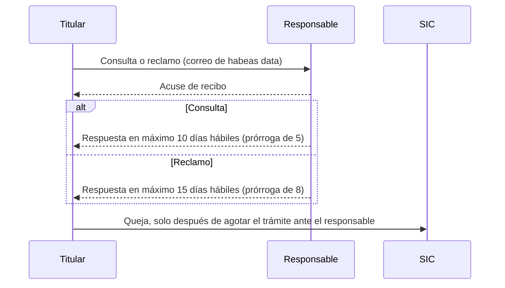

# Política de privacidad y tratamiento de datos personales — AUDITCYBER / MSPI

**Versión:** 1.1 · Alineada con la Ley 1581 de 2012, el Decreto 1377 de 2013 (compilado en el Decreto 1074 de
2015) y el artículo 15 de la Constitución Política.

> Esta política se publica en la plataforma en la ruta `/privacidad`. Los datos entre `[[ … ]]` los diligencia la
> entidad que adopte la plataforma; ver el [marco legal](README.md) para los dos escenarios de uso.

## 1. Responsable del tratamiento

| Escenario | Responsable | Contacto para *habeas data* |
|---|---|---|
| Prototipo académico (datos de prueba) | Equipo del proyecto: Bairon Alexander Suarez Camacho y Juan Diego Tovar Rodriguez, estudiantes de Ingeniería de Sistemas de la Corporación Universitaria del Huila – CORHUILA, Neiva | Correo institucional del proyecto: [[correo del proyecto]] |
| Entidad que adopte la plataforma | [[Razón social]] — NIT [[NIT]], domicilio [[dirección, ciudad]], Colombia | [[correo de protección de datos]] · [[teléfono]] |

## 2. Objeto y alcance
Esta política regula la recolección, almacenamiento, uso, circulación y supresión de los datos personales que se
tratan en la plataforma MSPI para ejecutar evaluaciones del Modelo de Seguridad y Privacidad de la Información.
Aplica a todos los usuarios de la plataforma y a los encargados que traten datos por cuenta del responsable.

## 3. Definiciones (Ley 1581 de 2012, art. 3)
- **Dato personal:** información vinculada o que pueda asociarse a una persona natural determinada o determinable.
- **Dato sensible:** el que afecta la intimidad del titular o cuyo uso indebido puede generar discriminación.
- **Titular:** persona natural cuyos datos son objeto de tratamiento.
- **Responsable:** quien decide sobre la base de datos y el tratamiento.
- **Encargado:** quien trata los datos por cuenta del responsable.
- **Tratamiento:** cualquier operación sobre datos personales.
- **Transferencia / transmisión:** envío de datos a un responsable / a un encargado, dentro o fuera de Colombia.

## 4. Principios
El tratamiento se rige por los principios de legalidad, finalidad, libertad, veracidad o calidad, transparencia,
acceso y circulación restringida, seguridad y confidencialidad (Ley 1581 de 2012, art. 4).

## 5. Datos que se tratan

| Categoría | Datos | Dónde se guardan |
|---|---|---|
| Identificación y contacto | Nombre completo, correo electrónico, organización, rol | `iam.user`, `org.organization_contact` |
| Credenciales | Contraseña (solo en Keycloak, nunca en la base de la aplicación) y secreto del segundo factor | Keycloak, `iam.user_totp` |
| Seguridad de la cuenta | Intentos fallidos de inicio de sesión y bloqueos | `iam.login_attempt` |
| Actividad | Eventos de auditoría (quién, qué, cuándo, dirección IP y navegador), solicitudes y decisiones | `audit.audit_log`, tablas de solicitudes |
| Comunicaciones | Notificaciones dentro de la plataforma | `iam.notification` |
| Documentos | Evidencias que cargan las entidades y reportes generados | `evidence.evidence_file` y almacenamiento de archivos |

La plataforma **no está diseñada para tratar datos sensibles ni datos de niños, niñas o adolescentes**. Si una
entidad carga evidencias que contengan datos de terceros, es responsable de contar con la autorización de esos
titulares.

## 6. Finalidades
1. Crear y administrar cuentas, autenticar con segundo factor y controlar el acceso por roles.
2. Ejecutar, revisar y cerrar evaluaciones del instrumento MSPI.
3. Generar reportes e instrumentos oficiales de las evaluaciones.
4. Mantener la trazabilidad y auditoría de las operaciones.
5. Enviar notificaciones operativas y correos transaccionales (contraseñas temporales, estado de solicitudes).
6. Proteger la seguridad de la plataforma (detección de accesos indebidos, bloqueo por intentos fallidos).
7. Cumplir obligaciones legales y atender requerimientos de autoridades.

Los datos no se usan con fines publicitarios ni se venden o ceden a terceros.

## 7. Autorización
La autorización se obtiene de forma previa, expresa e informada mediante el formato de
[autorización de tratamiento](AUTORIZACION-TRATAMIENTO-DATOS.md), al crear la cuenta o en el primer ingreso, y se
conserva prueba de ella. No se requiere autorización en los casos del art. 10 de la Ley 1581 de 2012.

## 8. Derechos de los titulares (Ley 1581 de 2012, art. 8)
Conocer, actualizar y rectificar sus datos; solicitar prueba de la autorización; ser informado sobre el uso dado a
sus datos; presentar quejas ante la Superintendencia de Industria y Comercio (SIC); revocar la autorización o
solicitar la supresión cuando no exista un deber legal o contractual de conservarlos; y acceder gratuitamente a sus
datos.

## 9. Procedimiento para consultas y reclamos

**Contexto.** Los plazos son los de los artículos 14 y 15 de la Ley 1581 de 2012. Si el reclamo está incompleto,
el responsable pide completarlo dentro de los 5 días siguientes; si pasan 2 meses sin respuesta del titular, se
entiende desistido.

- **Canal:** el correo de *habeas data* de la sección 1, asunto «Habeas data — consulta» o «Habeas data — reclamo».
- **Contenido del reclamo:** identificación del titular, descripción de los hechos, dirección de respuesta y
  documentos de soporte.

## 10. Transmisión y transferencia de datos

| Tercero | Rol | Datos | Ubicación | Garantía |
|---|---|---|---|---|
| Proveedor de correo transaccional (Brevo) | Encargado | Nombre y correo del destinatario, contenido del mensaje | Unión Europea | Contrato o términos de tratamiento del proveedor; país con nivel adecuado de protección según la SIC |
| Proveedor de alojamiento | Encargado | Todos los datos de la plataforma | [[país del alojamiento]] | Contrato de transmisión de datos |
| Servicio de geografía (Country State City) | No recibe datos personales | Solo códigos de país y departamento | Externo | — |

Los demás componentes (Keycloak, PostgreSQL, almacenamiento de archivos) se operan en la infraestructura del
responsable.

## 11. Cookies y almacenamiento local
La plataforma usa almacenamiento del navegador **solo para su funcionamiento** (sesión y preferencias de trabajo),
nunca para publicidad ni rastreo. Detalle en la
[política de cookies y almacenamiento local](POLITICA-COOKIES-ALMACENAMIENTO.md).

## 12. Seguridad
Se aplican medidas técnicas y administrativas descritas en la
[política de seguridad de la información](POLITICA-SEGURIDAD-INFORMACION.md): autenticación con Keycloak y segundo
factor obligatorio, contraseñas fuera de la base de la aplicación, control de acceso por roles, cifrado en
tránsito, auditoría de operaciones, validación del contenido de archivos y gestión de secretos fuera del código.

## 13. Conservación y supresión
La información **no se elimina físicamente** durante la operación: se marca como eliminada para conservar la
trazabilidad. Los plazos y el procedimiento de supresión definitiva o anonimización ante una solicitud procedente
están en la [política de retención y borrado](POLITICA-RETENCION-Y-BORRADO.md).

## 14. Vigencia y cambios
Esta política rige desde su publicación en la plataforma. Los cambios sustanciales se comunican a los titulares
por los canales de la plataforma antes de aplicarse y, cuando cambien las finalidades, se solicita una nueva
autorización. La versión vigente está siempre disponible en `/privacidad`.
