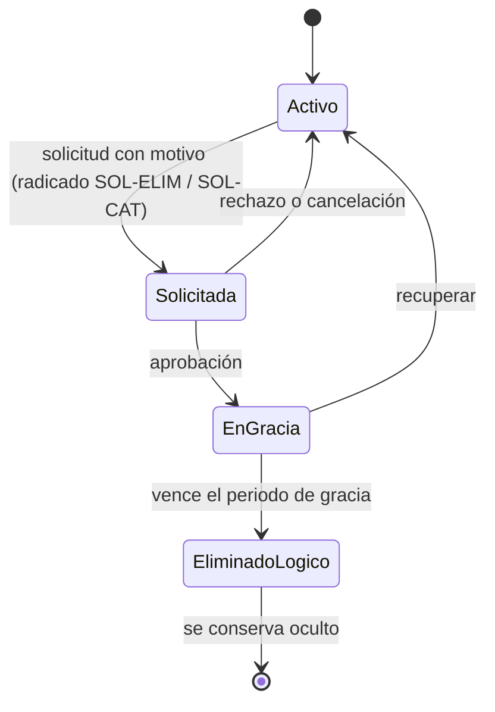

# Política de retención y borrado lógico — AUDITCYBER / MSPI

## 1. Regla de negocio
**En la plataforma nada se borra físicamente.** Las eliminaciones son lógicas: el registro se marca con una fecha
de eliminación (`deleted_at` o equivalente) y deja de mostrarse, pero se conserva para la trazabilidad y la
auditoría. Las eliminaciones de evaluaciones y de catálogo requieren solicitud aprobada.

## 2. Ciclo de una eliminación

**Contexto.** Al aprobarse, la evaluación queda en solo lectura y fuera de Evidencias y Reportes durante el periodo
de gracia, en el que puede recuperarse. Al vencer, un proceso programado la marca como eliminada. Cada paso queda
en la bitácora con su radicado.

## 3. Plazos

| Información | Plazo de conservación | Parámetro / nota |
|---|---|---|
| Periodo de gracia de evaluaciones | 5 días por defecto | `assessmentDeletionGraceDays` en Parámetros del sistema |
| Periodo de gracia de escalas y bancos | 5 días por defecto | `catalogDeletionGraceDays` |
| Cuentas de usuario | Mientras exista la relación con la entidad; luego se inactivan | No se eliminan para conservar la autoría de las acciones |
| Evaluaciones, evidencias y reportes | El que defina la entidad en sus tablas de retención documental | Para entidades públicas, según su gestión documental (Ley 594 de 2000) |
| Bitácora de auditoría | Mínimo el mismo plazo de la evaluación más larga que respalde | Solo inserción; no se modifica |
| Notificaciones | Se limpian lógicamente (`cleared_at`) | Visibles en la bandeja hasta que el usuario las limpia |

## 4. Supresión por solicitud del titular
Cuando un titular solicita la supresión y no existe un deber legal o contractual de conservar sus datos, el
responsable:
1. Inactiva la cuenta.
2. **Anonimiza** los datos de identificación (nombre y correo) en `iam` y en Keycloak, de modo que las acciones
   registradas en la auditoría ya no permitan identificar a la persona.
3. Conserva los registros de auditoría y las evaluaciones con la referencia anonimizada.
4. Responde al titular dentro de los plazos de la Ley 1581 de 2012.

La anonimización se ejecuta hoy como procedimiento administrativo (no hay una función en la interfaz).

## 5. Evidencias
El borrado de un archivo de evidencia también es lógico: `DeleteEvidenceFileUseCase` solo marca `deleted_at` y el
binario se conserva en el almacenamiento de archivos. No queda ninguna operación de purga física en el flujo normal.
