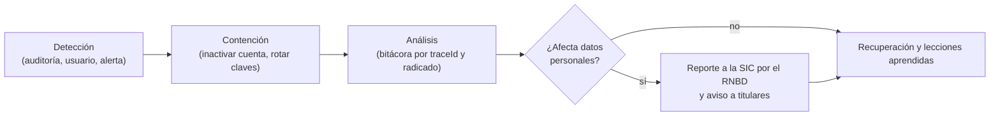

# Política de seguridad de la información — AUDITCYBER / MSPI

Establece los controles con los que se protege la plataforma y la información que trata. Como MSPI sirve para
evaluar la seguridad de otras entidades, aplica sobre sí misma los mismos principios del Modelo de Seguridad y
Privacidad de la Información: confidencialidad, integridad y disponibilidad.

## 1. Alcance
Los 8 microservicios, los 6 microfrontends, la base de datos PostgreSQL, Keycloak, el almacenamiento de archivos y
los secretos de configuración, en todos sus entornos.

## 2. Controles implementados (verificados en el código)

| Dominio | Control | Implementación |
|---|---|---|
| Identidad | Autenticación centralizada | Keycloak emite JWT; cada servicio valida firma (JWK) y emisor |
| Identidad | Segundo factor obligatorio | TOTP en `ms_iam`; reinicio solo por solicitud aprobada (`SOL-PWD`) |
| Identidad | Bloqueo por intentos fallidos | 3 intentos → 15 minutos (`iam.login_attempt`) |
| Identidad | Límite de solicitudes en endpoints públicos | `AuthRateLimitFilter` en inicio de sesión y cambio de contraseña |
| Acceso | Mínimo privilegio por rol | Reglas por ruta en `SecurityConfig` + guardas de dominio (miembro de la evaluación, estado) |
| Acceso | Doble control en acciones sensibles | Solicitudes aprobables con radicado: eliminación, ampliación, catálogo, reenvío de contraseña |
| Servicio a servicio | Clave interna | `/internal/**` con `X-Internal-Api-Key`, comparación en tiempo constante |
| Datos | Contraseñas fuera de la aplicación | Solo en Keycloak; nunca en `iam` |
| Datos | Sin borrado físico | Borrado lógico (`deleted_at`) con periodo de gracia |
| Datos | Integridad de evidencias | Huella SHA-256 por archivo; validación del contenido real (*magic bytes*) y lista de tipos permitidos |
| Datos | Consultas parametrizadas | JPA y SQL nativo con parámetros (sin concatenación) |
| Trazabilidad | Auditoría central | `ms_audit`: quién, qué, cuándo, IP y navegador; línea de tiempo por radicado |
| Trazabilidad | Registros sin datos sensibles | `LogSanitizer` y `traceId` por solicitud |
| Navegador | Cabeceras de seguridad | CSP con `script-src 'self'`, `X-Frame-Options`, `X-Content-Type-Options`, `Referrer-Policy`, HSTS |
| Navegador | CORS restringido | Orígenes permitidos por variable de entorno |
| Secretos | Fuera del código | Variables de entorno y gestor de secretos (Infisical); ver el manual de API keys |
| Dependencias | Análisis de vulnerabilidades | OWASP Dependency-Check en el build y `npm audit` |
| Contenedores | Imágenes mínimas | Ejecución con usuario sin privilegios |

## 3. Riesgos conocidos y tratamiento

| Riesgo | Nivel | Tratamiento |
|---|---|---|
| Notificaciones: el listado y la limpieza masiva usan el `userId` enviado por el cliente | Alto | Corregir para usar el usuario del token y validar propiedad (tarea registrada) |
| URLs `localhost` fijas en el frontend | Medio (operación) | Pasarlas a configuración por entorno antes de desplegar (tarea registrada) |
| Token de sesión en almacenamiento accesible por JavaScript | Medio | Mitigado con CSP estricta y tokens de 1 hora; migrar a cookie `HttpOnly` en producción |
| El pipeline de integración solo compila (no ejecuta pruebas) | Medio | Agregar `test`/`check` al pipeline |
| Repositorio de documentación público con datos personales en cartas académicas | Medio | Volver privado el repositorio o retirar esos datos |
| Sin pruebas automatizadas en 5 de 6 microfrontends | Bajo | Plan de pruebas en la matriz de trazabilidad |

## 4. Gestión de incidentes

**Contexto.** Ante un incidente se contiene primero (inactivar cuentas, rotar `INTERNAL_API_KEY`, credenciales de
Keycloak y de base de datos), se analiza con la bitácora central y, si se vieron comprometidos datos personales, el
responsable lo reporta a la Superintendencia de Industria y Comercio a través del Registro Nacional de Bases de
Datos dentro de los 15 días hábiles siguientes a su detección, e informa a los titulares afectados.

## 5. Responsabilidades
- **Responsable del tratamiento:** aprueba esta política y garantiza los recursos para cumplirla.
- **Administrador del sistema:** gestiona usuarios, aprueba solicitudes sensibles y revisa la auditoría.
- **Equipo de operación:** custodia secretos, aplica parches y respalda la base de datos.
- **Usuarios:** custodian sus credenciales y su segundo factor y reportan cualquier anomalía.

## 6. Revisión
Esta política se revisa al menos una vez al año o cuando cambie la arquitectura de la plataforma.
