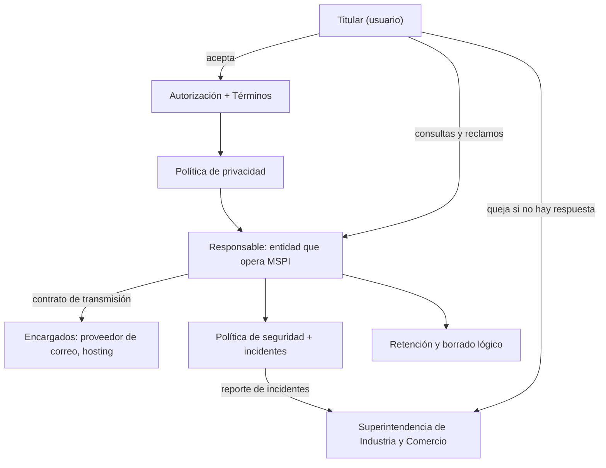

# Marco legal de MSPI · AUDITCYBER

Conjunto de documentos legales de la plataforma. Están redactados para el contexto colombiano y para dos
escenarios:

1. **Prototipo académico** (estado actual): proyecto de grado de Ingeniería de Sistemas de CORHUILA, operado por sus
   autores con **datos de prueba**.
2. **Adopción por una entidad**: cuando una entidad pública o privada despliegue la plataforma con usuarios y datos
   reales, esa entidad será la **Responsable del tratamiento** y deberá diligenciar los datos marcados con
   `[[ … ]]` y adoptar formalmente estos documentos.

> **Aviso.** Estos documentos son una base técnico-jurídica elaborada por el equipo del proyecto. Antes de usarlos
> con datos reales deben ser revisados y aprobados por el área jurídica de la entidad que adopte la plataforma (y,
> en lo académico, por la instancia correspondiente de CORHUILA).

## Documentos

| Documento | Para qué sirve | Quién lo acepta o aplica |
|---|---|---|
| [Política de privacidad y tratamiento de datos](POLITICA-PRIVACIDAD-MSPI.md) | Política exigida por la Ley 1581 de 2012 y el Decreto 1377 de 2013 | Responsable; se publica en `/privacidad` |
| [Aviso de privacidad](AVISO-PRIVACIDAD.md) | Versión corta que se muestra al recolectar los datos | Titulares |
| [Autorización de tratamiento de datos](AUTORIZACION-TRATAMIENTO-DATOS.md) | Formato de autorización previa, expresa e informada | Cada usuario |
| [Términos y condiciones de uso](TERMINOS-Y-CONDICIONES.md) | Reglas de uso de la plataforma | Cada usuario |
| [Política de cookies y almacenamiento local](POLITICA-COOKIES-ALMACENAMIENTO.md) | Qué guarda el navegador y por qué | Titulares |
| [Política de seguridad de la información](POLITICA-SEGURIDAD-INFORMACION.md) | Controles técnicos y organizativos; gestión de incidentes | Responsable y equipo de operación |
| [Política de retención y borrado lógico](POLITICA-RETENCION-Y-BORRADO.md) | Plazos de conservación y regla de no borrado físico | Responsable |
| [Acuerdo de confidencialidad](ACUERDO-CONFIDENCIALIDAD.md) | Compromiso de evaluadores, revisores y administradores | Usuarios con acceso a información de entidades |
| [Propiedad intelectual y licencia](PROPIEDAD-INTELECTUAL-Y-LICENCIA.md) | Autoría, derechos sobre el software y uso de marcos de referencia | Autores, CORHUILA, entidades |
| [Licencias de terceros](LICENCIAS-TERCEROS.md) | Componentes de software libre usados y sus licencias | Autores y quien redistribuya |

## Marco normativo aplicable

| Norma | Tema | Cómo aplica a MSPI |
|---|---|---|
| Constitución Política, art. 15 | Intimidad y *habeas data* | Fundamento de los derechos de los titulares |
| Ley 1581 de 2012 | Protección de datos personales | Política, autorización, derechos, deberes del responsable y del encargado |
| Decreto 1377 de 2013 (compilado en el Decreto 1074 de 2015) | Reglamentación de la Ley 1581 | Contenido mínimo de la política y del aviso de privacidad, autorización |
| Decreto 090 de 2018 y Circular Externa SIC 002 de 2015 | Registro Nacional de Bases de Datos (RNBD) | La entidad responsable debe evaluar si está obligada a registrar sus bases y reportar incidentes |
| Circular Externa SIC 005 de 2017 | Transferencia internacional de datos | Aplica al proveedor de correo con servidores fuera de Colombia |
| Ley 1273 de 2009 | Delitos informáticos | Acceso abusivo, interceptación y daño de datos; base de los términos de uso |
| Ley 527 de 1999 | Mensajes de datos y comercio electrónico | Validez de la aceptación electrónica de términos y autorizaciones |
| Ley 1712 de 2014 | Transparencia y acceso a la información pública | Las entidades públicas usuarias clasifican la información de sus evaluaciones (reservada o clasificada) |
| Ley 23 de 1982, Decisión Andina 351 de 1993, Decreto 1360 de 1989, Ley 1915 de 2018 | Derecho de autor y software | Protección del código como obra; derechos morales y patrimoniales |
| Decreto 1078 de 2015 y Decreto 767 de 2022 | Política de Gobierno Digital | Marco en el que las entidades públicas aplican el MSPI |
| Resolución MinTIC 500 de 2021 | Lineamientos de seguridad digital y adopción del MSPI | Origen del instrumento que la plataforma automatiza |
| CONPES 3995 de 2020 | Política nacional de confianza y seguridad digital | Contexto de política pública |

**Contexto.** El titular entrega sus datos al aceptar la autorización y los términos. El responsable los trata
según la política, se apoya en encargados con contrato y aplica las políticas de seguridad y retención. El titular
ejerce sus derechos ante el responsable y, si no obtiene respuesta, puede acudir a la SIC, autoridad de protección
de datos en Colombia.
