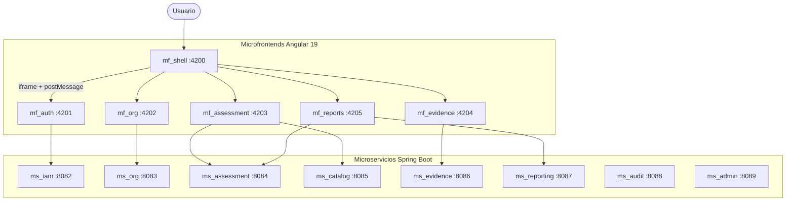

# Wiki MSPI · AUDITCYBER

Documentación técnica y funcional del **Modelo de Seguridad y Privacidad de la Información (MSPI)**: plataforma que automatiza el Instrumento de Identificación de la Línea Base de Seguridad de MinTIC Colombia.

| | |
|---|---|
| **Autores** | Bairon Alexander Suarez Camacho, Juan Diego Tovar Rodriguez |
| **Stack** | Java 21 · Spring Boot · Angular 19 · Keycloak · PostgreSQL · Docker |
| **Backend** | **8** microservicios activos (8082–8089) |
| **Última revisión** | 2026-10-19 |
| **Repos** | [README](../README.md) · [Arquitectura](../Documentacion-General/01-Arquitectura-General-del-Sistema.md) · [Flujos SOL-*](../Documentacion-General/14-Flujos-Solicitudes-Auditoria-y-Seguridad.md) |

---

## Qué es MSPI

MSPI reemplaza el diligenciamiento manual de una hoja de cálculo Excel de nueve pestañas por una aplicación web con:

- motor de cálculo centralizado (ISO/IEC 27001, PHVA, madurez SGSI, NIST CSF)
- trazabilidad de evidencias
- control de acceso basado en roles (Keycloak + JWT)

---

## Mapa de la plataforma

### Microservicios (puertos)

| Servicio | Puerto | Rol |
|---|---|---|
| **ms_iam** | 8082 | Identidad, 2FA, auditoría de eventos |
| **ms_org** | 8083 | Organizaciones y entidades |
| **ms_assessment** | 8084 | Motor de evaluación y cálculo |
| **ms_catalog** | 8085 | Catálogo del instrumento |
| **ms_evidence** | 8086 | Evidencias y levantamiento |
| **ms_reporting** | 8087 | Reportes PDF/Excel |
| **ms_audit** | 8088 | Auditoría de solicitudes (módulo) |
| **ms_admin** | 8089 | Administración de sistema |

### Microfrontends (puertos)

| MF | Puerto | Rol |
|---|---|---|
| **mf_shell** | 4200 | Host, menú, dashboard, `/privacidad` |
| **mf_auth** | 4201 | Login, 2FA, usuarios |
| **mf_org** | 4202 | Organizaciones |
| **mf_assessment** | 4203 | Evaluación, controles, PHVA, madurez |
| **mf_evidence** | 4204 | Contexto y levantamiento |
| **mf_reports** | 4205 | Exportación de reportes |

---

## Accesos rápidos

| Sección | Ir a |
|---|---|
| Arquitectura | [01 — Arquitectura general](../Documentacion-General/01-Arquitectura-General-del-Sistema.md) |
| Modelo de datos (MER) | [Vista MER](../Documentacion-General/Modelo-Datos-MER.md) |
| Grafo de código | [Grafo graphify](../Documentacion-General/Grafo-Codigo.md) |
| Seguridad | [Postura de seguridad](Seguridad.md) |
| Privacidad | [Política de privacidad](../legal/POLITICA-PRIVACIDAD-MSPI.md) |
| Despliegue | [Manual de despliegue](../Documentacion-General/05-Manual-Despliegue.md) |
| Cómo servir esta wiki | [WIKI.md](../WIKI.md) |

---

!!! note "Alcance de esta wiki"
    El contenido proviene de los Markdown ya existentes en el repositorio. No se inventan requisitos:
    donde falte material aparece un bloque **TODO**.
